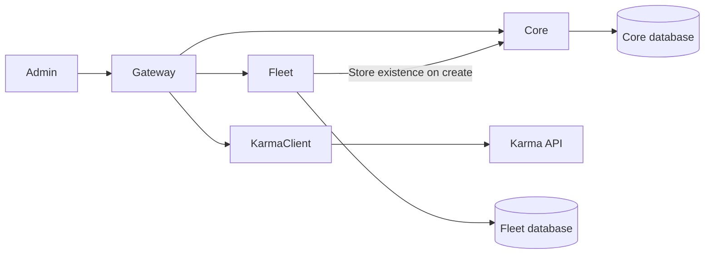

# Shared workspace architecture

The repository uses npm workspaces and Nx, with five applications and no shared runtime packages.
Applications never import another application's implementation, Prisma models or generated client.

| Application  | Responsibility                                                                                     | Local port |
| ------------ | -------------------------------------------------------------------------------------------------- | ---------- |
| admin        | Standalone Angular, Sakai/PrimeNG, Store discovery, Fleet CRUD, Karma truck data and account views | 11000      |
| gateway      | Native Apollo Router federation, `/graphql`; `/health` on 11016                                    | 11010      |
| core         | Tenant demo login, scoped Store discovery/lookup, owning database                                  | 11011      |
| fleet        | Tenant/Store-scoped Vehicles/Devices, owning database                                              | 11013      |
| karma-client | Authenticated, shared Karma truck data and account views; no database                              | 11014      |

## Execution and ownership

The native Router and Node applications run on the host. Root `dev` waits for PostgreSQL health and starts the group
using concurrently, with group shutdown. Ports and CORS origins are application-local configuration.
Only PostgreSQL runs in Compose. Setup/migration/seed are explicit commands, separate from startup.
Health endpoints prove application availability without opening database connections.

Gateway contains the official Apollo Router 2.18.0 host binary, integrated into development and tests.
It consumes the same generated static supergraph and routes directly to Core, Fleet and
Karma Client on the public GraphQL port, 11010. Its health listener uses port 11016.
Authorization, Store scope and business behavior remain in the owning subgraphs.
Only `authorization`, `x-store-id` and `x-request-id` are propagated from client requests.
`dev` starts Router, three subgraphs and Angular through concurrently. Angular's development
proxy follows `ROUTER_PORT`, defaulting to 11010. `kill` stops the native Router and Node
application processes. Gateway has no Node implementation, Nest bootstrap or npm runtime
dependencies. Development, federation/browser fixtures and CI all use the official binary.
Router's Rhai hook normalizes request IDs at the supergraph boundary, returns the ID in the
response header and public errors, filters error extensions/field errors and sanitizes
internal and transport failures. Subgraph requests have a five-second timeout.
Parse/schema-validation failures occur before that hook and intentionally retain native
Router HTTP 400 error bodies without the application request ID. Business messages,
`fieldErrors` and execution request IDs retain the application contract; early error codes
and diagnostic wording follow the pinned official Router binary without a custom Rust build.
See [Router setup and error behavior](../development.md#apollo-router).

Nx records admin → gateway, gateway → core/fleet/karma-client and fleet → core runtime dependencies.
ESLint independently prohibits application implementation imports. Shared manifests, lockfile,
configuration, ignore rules, workflows, Node version, SDL and named operations are task inputs.
Generation restores ignored outputs before dependent lint/typecheck/build/test commands.
The daemon and cloud cache are disabled. Live DB/browser tasks are noncached.
Gateway build generates the supergraph and validates Router configuration; it does not compile
Rust or create a Node bundle. It requires the explicitly installed pinned binary. Gateway DB
and admin browser fixtures build the three subgraphs, generate the supergraph and own the
Router process, subgraphs and isolated test databases. The
Router helper checks the pinned binary version and waits on its separate health listener;
startup failures and normal teardown stop the child before closing downstream resources.
[Testing](../testing.md) describes affected selection and the manual regression workflow.

## Domain documentation

[Discocan architecture](../discocan/architecture.md) describes Fleet persistence, GraphQL
contracts, the shared Karma account client and the current telemetry admin. [Ecommerce Stores](../ecommerce/stores.md)
describes the Core-owned Store foundation currently reused by Discocan.

The domains share this checkout and its infrastructure today. Their documentation boundaries
do not imply separate deployments, applications or databases beyond the described service boundaries.
