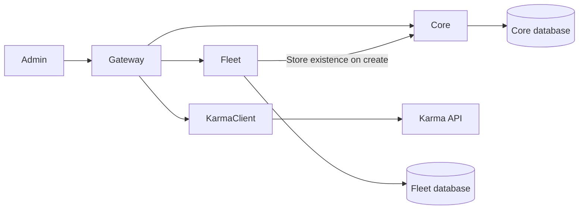

# Shared workspace architecture

The repository uses npm workspaces and Nx, with five applications and no shared runtime packages.
Applications never import another application's implementation, Prisma models or generated client.

| Application  | Responsibility                                                                                     | Local port |
| ------------ | -------------------------------------------------------------------------------------------------- | ---------- |
| admin        | Standalone Angular, Sakai/PrimeNG, Store discovery, Fleet CRUD, Karma truck data and account views | 11000      |
| gateway      | Apollo federation, public `/graphql`, `/health`                                                    | 11010      |
| core         | Tenant demo login, scoped Store discovery/lookup, owning database                                  | 11011      |
| fleet        | Tenant/Store-scoped Vehicles/Devices, owning database                                              | 11013      |
| karma-client | Authenticated, shared Karma truck data and account views; no database                              | 11014      |

## Execution and ownership

Node applications run on the host. Root `dev` waits for PostgreSQL health and starts the group
using concurrently, with group shutdown. Ports and CORS origins are application-local configuration.
Only PostgreSQL runs in Compose. Setup/migration/seed are explicit commands, separate from startup.
Health endpoints prove application availability without opening database connections.

Nx records admin → gateway, gateway → core/fleet/karma-client and fleet → core runtime dependencies.
ESLint independently prohibits application implementation imports. Shared manifests, lockfile,
configuration, ignore rules, workflows, Node version, SDL and named operations are task inputs.
Generation restores ignored outputs before dependent lint/typecheck/build/test commands.
The daemon and cloud cache are disabled. Live DB/browser tasks are noncached.
Gateway DB and admin browser fixtures build the four backends and own their test processes.
[Testing](../testing.md) describes affected selection and the manual regression workflow.

## Domain documentation

[Discocan architecture](../discocan/architecture.md) describes Fleet persistence, GraphQL
contracts, the shared Karma account client and the current telemetry admin. [Ecommerce Stores](../ecommerce/stores.md)
describes the Core-owned Store foundation currently reused by Discocan.

The domains share this checkout and its infrastructure today. Their documentation boundaries
do not imply separate deployments, applications or databases beyond the described service boundaries.
