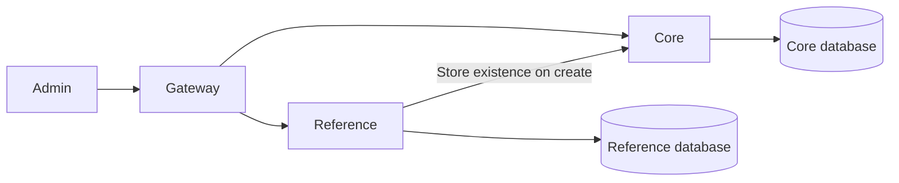

# Architecture

The repository uses npm workspaces and Nx, with four applications and no shared runtime packages.
Applications never import another application's implementation, Prisma models or generated client.

| Application | Responsibility                                                            | Local port |
| ----------- | ------------------------------------------------------------------------- | ---------- |
| admin       | Standalone Angular, Sakai/PrimeNG, Store discovery, Vehicles/Devices CRUD | 11000      |
| gateway     | Apollo federation, public `/graphql`, `/health`                           | 11010      |
| core        | Tenant demo login, scoped Store discovery/lookup, owning database         | 11011      |
| reference   | Tenant/Store-scoped Vehicles/Devices, owning database                     | 11013      |

## Execution and ownership

Node applications run on the host. Root `dev` waits for PostgreSQL health and starts the group
using concurrently, with group shutdown. Ports and CORS origins are application-local configuration.
Only PostgreSQL runs in Compose. Setup/migration/seed are explicit commands, separate from startup.
Health endpoints prove application availability without opening database connections.

Nx records admin → gateway, gateway → core/reference and reference → core runtime dependencies.
ESLint independently prohibits application implementation imports. Shared manifests, lockfile,
configuration, ignore rules, workflows, Node version, SDL and named operations are task inputs.
Generation restores ignored outputs before dependent lint/typecheck/build/test commands.
The daemon and cloud cache are disabled. Live DB/browser tasks are noncached.
Gateway DB and admin browser fixtures build the three backends and own their test processes.
[Testing](../testing.md) describes affected selection and the manual regression workflow.

## Persistence ownership

One PostgreSQL instance contains independent Core/Reference development and test databases,
with distinct owner/login roles. Admin/Gateway have no Prisma client or database credentials.
Each owning service has its own schema, reviewed SQL migrations and generated client.
Core owns Tenant (UUID, unique Name up to 200 characters, timestamps) and Store. Store has UUID, mandatory tenantId, Name (200 characters), createdAt and updatedAt. Its Tenant foreign key restricts deletion/update.
Reference owns Vehicle and Device. New tenant migrations preserve old rows under RentalSofia and reconstruct the tables transactionally so tenantId is physically second after id in Store, Vehicle and Device. Applied migrations remain unchanged.

Vehicle has UUID, tenantId, storeId, required License Plate (32 characters), nullable Notes (2000
characters) and timestamps. License Plate is not unique. Device has UUID, tenantId, storeId, required
15-digit IMEI, required vehicleId and timestamps. IMEI stays a string, preserving leading zeros.
A unique `(tenantId, storeId, imei)` index and SQL digit CHECK protect persistence. The composite
`(tenantId, storeId, vehicleId)` foreign key references Vehicle `(tenantId, storeId, id)` with restricted deletion
and update. Several Devices may share a Vehicle. There is no cross-database Store foreign key.
Seeds insert RentalSofia, two stable Stores, two sample Vehicles and one Device. Repeated seeds skip existing keys and never overwrite edits. Reference has no cross-database Tenant/Store foreign key; creation verifies the tenant-scoped Store through Core. Mandatory tenant predicates and composite indexes enforce application isolation; PostgreSQL has no row-level-security policy. Direct SQL access by the owning role can access every tenant.

Tests deploy migrations into random schemas in dedicated test databases and drop only their
own schema. Development connections, broad resets and shared truncation are not test fixtures.

## GraphQL contracts and context

[Core SDL](../../apps/core/src/stores/stores.graphql),
[Vehicle SDL](../../apps/reference/src/vehicles/vehicles.graphql) and
[Device SDL](../../apps/reference/src/devices/devices.graphql) define the API.
Vehicle SDL also declares the Reference federation link, DateTime, Store reference and root types.
Backend resolvers use generated types and delegate to concrete services/repositories.
Runtime SDL assets are copied into builds. Named Angular/Core lookup operations are explicit
inputs in [contracts.mts](../../tools/graphql/contracts.mts). Codegen/composition/validation work
offline. Gateway loads a generated static supergraph without introspection or registry polling.

Public demo discovery exposes tenants and demoLogin. Authenticated queries are stores, store, referenceVehicles, referenceVehicle, referenceDevices and referenceDevice. Mutations create/update/delete ReferenceVehicle and ReferenceDevice.
All Store/business operations require a signed demo session in Authorization. Business operations additionally require a valid `x-store-id` UUID. Inputs never accept tenantId or storeId.
Repository predicates, totals, relation lookup and federation reference resolution always include the verified Tenant and active Store.
Foreign IDs appear as NOT_FOUND. Creation checks Store existence through Core once per
Reference HTTP request; read/update/delete do not make that network call. Requesting a
federated Store field beyond its known ID (for example `store { name }`) asks Core to resolve
its persisted Store.

Vehicle search matches License Plate; Device search matches IMEI. Queries combine mandatory
Store scope with search/explicit ID filters, count before pagination and sort before slicing.
Default offset/limit are 0/20, limit is 1–100, and default sort is newest first. IDs break ties.
Search punctuation is literal. Text validation trims, counts Unicode code points and rejects NUL.
Notes can be cleared to null. Device validation requires a Vehicle from the same Store.

Gateway forwards Store context without blanket Store validation. Request IDs accept 1–100 ASCII
letters/digits or `._:-`; invalid/missing IDs are replaced with UUIDs. Responses/errors expose the
ID. Expected Nest exceptions map to BAD_USER_INPUT, NOT_FOUND, CONFLICT or SERVICE_UNAVAILABLE;
unexpected details remain hidden. Creation's Core timeout is 3 seconds, Gateway's subgraph timeout
is 5 seconds. No global current Store or cross-request Store validation cache exists.
Tenant identity comes only from the HMAC-verified, expiring session. Gateway forwards Authorization; both subgraphs independently verify it. Arbitrary tenant headers and entity representations cannot select a Tenant. Demo login deliberately allows anyone to choose any Tenant; it is not production identity or membership authorization.

`REFERENCE_ENABLED=false` rejects Reference business and entity operations while preserving
schema composition and health. Angular startup availability hides navigation and gates direct routes.

## Angular admin foundation

The standalone Angular flow is component → concrete feature API → generated TypedDocumentNode
→ Apollo Angular/HttpLink → Gateway. Login owns the standalone Sakai login view and sequential
Tenant/Store selection. A candidate token loads tenant-scoped Stores through a disposable client;
changing Tenant cancels discovery and ignores late tokens. Submitting a valid Store activates the
tab session and opens Vehicles. StoreWorkspace owns authenticated discovery and route selection;
the shell receives explicit inputs and emits Store changes without business data access.
Routes use `/bg` or `/en`, then `/stores/:storeId/reference/vehicles` or `/devices`, with `/new`
and `/:recordId/edit`. The language root shows Login while signed out and redirects to the saved
(or first available) Store's Vehicles while signed in. There is no Store list landing page.
Workspace navigation contains Vehicles/Devices; the header keeps its Store switcher. Choosing a Store at login opens Vehicles; switching Stores preserves the enabled
current business section and resets list context. Language switching preserves path/query/hash.
Unknown Stores and disabled Reference never start business requests.

ReferenceWorkspace keys child views by session/Store/language/resource/editor/ID. Each mounted page/editor
owns an immutable session/Store/language-scoped Apollo client and InMemoryCache. A → B → A creates a fresh A client.
Reads unsubscribe on retirement; submitted writes settle with their captured client and affect
only its cache. Obsolete callbacks cannot navigate, notify or mutate a new workspace.

Lists provide URL-backed search/sort/paging, selection and confirmed page-local sequential deletion.
Successful deletions remain removed after refresh failures; failed rows remain selected for retry.
Navigation retires confirmation callbacks and stops unsent deletes. Submitted writes still settle.
Typed Reactive Forms provide validation, server-field focus, null clearing, dirty navigation guards
and retained failed drafts. Device's remote Vehicle picker searches/pages through the captured
DevicesApi and hydrates the assigned Vehicle. Multiple Devices can use the same Vehicle.

Sakai defines the shell and feature presentation. The ignored [source](../development.md#sakai-source-reference)
is a visual reference only. PrimeNG Aura compatibility tokens and local Cyrillic-capable Lato use
Sakai's 14px root. Desktop header/sidebar are 56px/280px; content caps at 1504px on wide screens.
Below 992px, one Store selector moves into a second 56px row without resetting editor drafts.
The mobile Drawer traps focus and supports Escape/backdrop dismissal; collapsed desktop links
are inert. The footer carries holita. Light/dark preference uses `holita.admin.theme`; denied
storage leaves the toggle usable and reports its failure. Bulgarian/English catalogs supply UI text.
The trimmed preset contains implemented controls and their PrimeNG dependencies.
Public startup config selects GraphQL URL, availability and optional user-supplied PrimeUI license.

Demo sessions last eight hours and persist only in the browser tab sessionStorage. Logout navigates through the dirty-editor guard, clears the tab session and destroys discovery/business clients. Expiry retires the current workspace. Submitted writes retain their captured token and may settle after logout. Logout has no server-side token revocation. [Development](../development.md#demo-tenant-login) describes configuration and production limitations.
