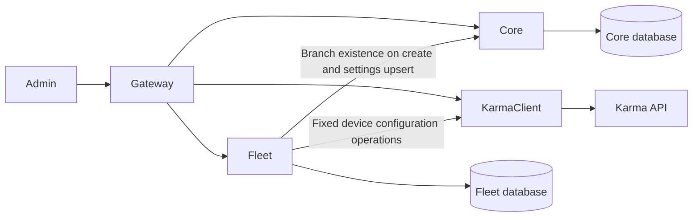

# Shared workspace architecture

The repository uses npm workspaces and Nx, with five applications and no shared runtime packages.
Applications never import another application's implementation, Prisma models or generated client.

## Source organization

Each NestJS application owns its feature modules under `src/modules/`. A feature keeps
its resolver, service, SDL, validation and unit tests together; database-backed features
also own their concrete repository. Application-local `auth/`, `graphql/`, `health/`
and, where needed, `database/` and `clock/` hold the supporting code. These directories are not shared
runtime packages. Prisma schemas, migrations and generated output retain their existing
owning-application locations.

| Application  | Feature modules                                                                                                                                   | Integration ownership                                                                                                                                                                              |
| ------------ | ------------------------------------------------------------------------------------------------------------------------------------------------- | -------------------------------------------------------------------------------------------------------------------------------------------------------------------------------------------------- |
| Core         | Tenants, Branches                                                                                                                                 | Tenant/Branch API; one local DatabaseModule provides Prisma to both features                                                                                                                       |
| Fleet        | Vehicles, Devices, Device operations, Drivers, Vehicle groups, Telemetry, Trips, Events, Service tasks, Overview, Settings, offline eData catalog | `integrations/core/` owns Branch existence checks; `integrations/karma/` owns internal device-operation HTTP; one local DatabaseModule provides Fleet Prisma; `clock/` provides the business clock |
| Karma Client | Cars, eData, Location, History, References, Accounts, internal device configuration operations                                                    | `integrations/karma/` owns external HTTP and the shared upstream account session; no database                                                                                                      |

Fleet feature modules import each other only in one direction: Telemetry and Events are used by
Vehicles, Devices (Telemetry only), Drivers and Trips; Trips by Drivers; Service tasks by
Vehicles. Settings is used by Telemetry, Devices, Drivers and Service tasks. Overview owns
the scoped KPI, group activity and daily distance queries, composing the concrete telemetry,
service urgency and settings SQL in its repository. Cross-module calls pass the already
verified Tenant/Branch scope.

The offline Fleet catalog importer remains a CLI feature, without an import/editing API.
DeviceOperations reads its eligible predefined presets through the Fleet-owned repository.
Core is the Tenant/Branch service, not a common implementation library. Fleet's durable
device-operations module calls Karma Client's fixed machine-authenticated internal HTTP endpoints
for reads and a single-definition parameter change.
Fleet owns operation persistence and the Nest scheduler; Karma Client retains the external
account connection without a database. Applications share no implementation or Prisma client.

Angular keeps business pages, concrete API services, GraphQL operations and tests under
`features/`. Fleet and Karma Client own separate route arrays composed by `app.routes.ts`
at the existing route level. `workspace/` owns the common admin session/language/login
coordination, while Branch discovery and selection remain in `features/branches/`.
Presentation is split between the theme in `theme/`, the global styles in `src/styles/`, the
patterns in `ui/` and the shell in `layout/`
([admin design system](../admin-design-system.md#where-presentation-lives)); the presentational
views and drawers in `features/fleet/*` (`*-view.ts`, `*-drawer.ts`) are shared by live feature
pages and Storybook examples. Storybook fixtures and sample pages stay in `src/storybook`
and outside application output. `core/` contains only admin-local authentication,
configuration and GraphQL transport. Feature clients and caches retain their mounted view lifetime; neither route grouping nor shared login makes business clients global.

| Application  | Responsibility                                                                                                              | Local port |
| ------------ | --------------------------------------------------------------------------------------------------------------------------- | ---------- |
| admin        | Standalone Angular, PrimeNG with the holita design system, Branch discovery, Fleet CRUD, Karma truck data and account views | 11000      |
| gateway      | Native Apollo Router federation, `/graphql`; `/health` on 11016                                                             | 11010      |
| core         | Tenant demo login, scoped Branch discovery/lookup and selected Branch rename, owning database                               | 11011      |
| fleet        | Tenant/Branch-scoped Fleet master data, telemetry, trips, alerts, service, Overview and settings, owning database           | 11013      |
| karma-client | Authenticated, shared Karma truck data and account views; no database                                                       | 11014      |

## Execution and ownership

The native Router and Node applications run on the host. Root `dev` waits for PostgreSQL health and starts the group
using concurrently, including admin Storybook on port 11001, with group shutdown. Admin GraphQL
artifacts are generated once before the Angular and Storybook processes start. Ports and CORS origins are application-local configuration.
Only PostgreSQL runs in Compose. Setup/migration/seed are explicit commands, separate from startup.
Health endpoints prove application availability without opening database connections.

Fleet also owns the [shared Simple eData vendor catalog](../discocan/erm-resources/simple-edata-catalog/README.md).
Its offline extractor and local import CLI preserve versioned reference data independently
of Tenant/Branch business records. The scoped DeviceOperations API exposes eligible presets
and owns durable reads/additions/interval updates; the catalog itself does not send commands.
See [device configuration operations](../discocan/architecture.md#background-device-configuration-reads)
for freshness, one-attempt writes, verification and vendor-queue limits.

Gateway contains the official Apollo Router 2.18.0 host binary, integrated into development and tests.
It consumes the same generated static supergraph and routes directly to Core, Fleet and
Karma Client on the public GraphQL port, 11010. Its health listener uses port 11016.
Authorization, Branch scope and business behavior remain in the owning subgraphs.
Only `authorization`, `x-branch-id` and `x-request-id` are propagated from client requests.
`dev` starts Router, three subgraphs, Angular and Storybook through concurrently. Angular's development
proxy follows `ROUTER_PORT`, defaulting to 11010. `kill` stops the native Router and Node
application processes. Gateway has no Node implementation, Nest bootstrap or npm runtime
dependencies. Development, federation/browser fixtures and CI all use the official binary.
Router's Rhai hook normalizes request IDs at the supergraph boundary, returns the ID in the
response header and public errors, filters error extensions/field errors and sanitizes
internal and transport failures. Subgraph requests have a five-second timeout.
Parse/schema-validation failures occur before that hook and intentionally retain native
Router HTTP 400 error bodies without the application request ID. Business messages,
`fieldErrors` and execution request IDs retain the application contract; early error codes
and diagnostic wording follow the pinned official Router binary without a custom Rust build.
See [Router setup and error behavior](../development.md#apollo-router).

Nx records admin → gateway, gateway → core/fleet/karma-client and fleet → core/karma-client runtime dependencies.
ESLint independently prohibits application implementation imports. Shared manifests, lockfile,
configuration, ignore rules, workflows, Node version, SDL and named operations are task inputs.
Generation restores ignored outputs before dependent lint/typecheck/build/test commands.
The daemon and cloud cache are disabled. Live DB/browser tasks are noncached.
Gateway build generates the supergraph and validates Router configuration; it does not compile
Rust or create a Node bundle. It requires the explicitly installed pinned binary. Gateway DB
and admin browser fixtures build the three subgraphs, generate the supergraph and own the
Router process, subgraphs and isolated test databases. The
Router helper checks the pinned binary version and waits on its separate health listener;
startup failures and normal teardown stop the child before closing downstream resources.
[Testing](../testing.md) describes affected selection and the manual regression workflow.

## Domain documentation

[Discocan architecture](../discocan/architecture.md) describes Fleet persistence, GraphQL
contracts, the shared Karma account client and the current telemetry admin. [Ecommerce Branches](../ecommerce/branches.md)
describes the Core-owned Branch foundation currently reused by Discocan.

The domains share this checkout and its infrastructure today. Their documentation boundaries
do not imply separate deployments, applications or databases beyond the described service boundaries.
