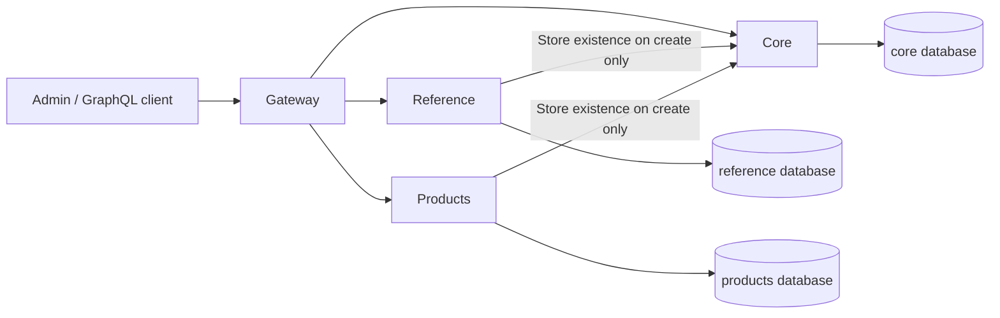

# Architecture

The repository uses npm workspaces for dependency installation and Nx for project tasks,
local caching and affected selection. Each application has a package.json and a small
project.json giving Nx its stable name and application tag. There are no shared workspace
packages or cross-application code imports.

| Application | Framework                        | Current entry points                                                                                                                                                                                                                                                                                                              |
| ----------- | -------------------------------- | --------------------------------------------------------------------------------------------------------------------------------------------------------------------------------------------------------------------------------------------------------------------------------------------------------------------------------- |
| admin       | Angular, PrimeNG, Apollo Angular | PrimeNG/Sakai shell, real Stores, Products and Reference Venues/Speakers/Tags/Vehicles CRUD and Events list/editor/overview, atomic lifecycle actions, History, Event Sessions and Gallery at http://127.0.0.1:11088; the same business workflows in backend-free Prototype with local Sakai UI catalog at http://127.0.0.1:11089 |
| gateway     | NestJS, Apollo Gateway           | /graphql and /health on 127.0.0.1:11080                                                                                                                                                                                                                                                                                           |
| core        | NestJS, Federation 2             | /graphql (stores) and /health on 127.0.0.1:11082                                                                                                                                                                                                                                                                                  |
| products    | NestJS, Federation 2             | /graphql (products) and /health on 127.0.0.1:11083                                                                                                                                                                                                                                                                                |
| reference   | NestJS, Federation 2             | /graphql (events, venues, speakers, tags, vehicles) and /health on 127.0.0.1:11086                                                                                                                                                                                                                                                |

Core owns store listing/lookup; products owns Products CRUD; reference owns Event, Venue, Speaker and Tag CRUD. Their concrete feature
repositories access their own PrismaService, whose client connects lazily and disconnects
on shutdown. Health endpoints stay independent of databases and downstream availability.
Sakai defines the Angular admin's theme and visual composition, with holita branding.
Its ignored [source checkout](../development.md#sakai-source-reference) supplies layout and
feature presentation comparisons. Angular uses PrimeNG's Aura compatibility preset and
locally served Lato. Concrete Angular features own validation and scoped lifecycles.

The gateway delegates requested Product.store fields to core through federation. That
requested field creates a core dependency; product-only list/read/update/delete do not.
Gateway configuration disables Apollo's anonymous metrics collection with its supported
APOLLO_TELEMETRY_DISABLED setting, including automatic cloud metadata detection.

## Execution and ownership

Root dev scripts use the existing concurrently package to run application scripts with
labels and group shutdown. Backend entry points validate PORT, bind to 127.0.0.1 and enable
Nest shutdown hooks. Angular development servers bind to 127.0.0.1 on separate Real/Prototype ports. Application-local .env files can override backend ports.

ESLint's Nx boundary rule prohibits application-to-application imports. Feature code stays
inside its application; shared test configuration is the root jest.preset.mjs, not a
runtime library. Runtime communication follows GraphQL contracts, not application source
imports. Shared SDL/operation/tool inputs express their impact on Nx tasks.
Nx also records admin → gateway, products → core and reference → core and gateway → core/products/reference runtime dependencies for
affected selection, without permitting implementation imports across those boundaries.
Test targets explicitly use nx:run-commands to preserve file/case arguments, including
names containing spaces, when forwarding to the native npm test scripts.

## Task inputs

Lint, typecheck, build and unit-test targets use application files plus the root package
manifest/lockfile, TypeScript configuration, ESLint configuration, Jest preset, nx.json,
.nvmrc, Git/Nx ignore rules, workflow files and the active Node version as inputs.
Build output and caches are Git-ignored.
Shared configuration changes can affect every application; selection must reflect that.
Core/products/reference also include Compose and tools/database changes in their task inputs.
Their lint/typecheck/build/test tasks depend on db-generate, which restores or regenerates
the ignored Prisma client. Test-db is explicitly noncached because a live database result
must execute again. Root tools have a separate small typecheck, not an application.
Every application also depends on graphql-generate. Generation targets explicitly use
the default named inputs, including root tooling and SDL/operations, and own only their
application's generated output. Gateway's test-db builds all four backends and runs the
whole-graph fixture from tools/graphql. It is noncached and uses dedicated test schemas.
The admin's noncached test-smoke target includes browser tooling inputs and builds the
admin plus the four backends. Angular serves its compiled production build. Real checks
start isolated backends on ephemeral ports; Prototype cases start no backend or database.
Dev tasks are continuous and not cached.
The Nx daemon is disabled; graph calculation runs within commands so local checks do not
depend on a separate background process.

[PR CI](../../.github/workflows/affected.yml) checks the event's base/head with full Git
history. Root-tool lint/type checks and offline schema checks run independently of project
selection. Affected applications select unit/DB targets; the affected admin also selects its
browser smoke target. A separate [manual workflow](../../.github/workflows/full-regression.yml)
runs full regression. Both use the root npm commands with host Node processes and the same
PostgreSQL-only Compose file. See [testing](../testing.md#github-actions) for exact behavior.

## Persistence ownership

One local PostgreSQL instance contains independent core/products/reference development databases
and corresponding test databases, each with a distinct owner/login. Gateway and admin
have no database client or credentials. Compose contains only PostgreSQL; provisioning,
migrations and seeds are host commands, separate from application startup.

Core's Store has a UUID, name (up to 200 characters) and createdAt/updatedAt timestamps.
Products' Product has a UUID, storeId UUID, name (up to 200 characters), sku (up to 100),
status DRAFT/ACTIVE (default DRAFT), and timestamps. Prisma generates UUIDs and maintains
updatedAt; createdAt has a database default. A case-sensitive unique (storeId, sku) index
allows the same SKU across stores. A (storeId, createdAt, id) index supports deterministic
store-scoped ordering. No cross-database foreign key links Product to Store.
Product service validation trims name/SKU, enforces nonempty values and limits, and
requires an explicit UUID store context. Prisma definitions alone are not authorization.

Each service owns its schema, SQL migration history and generated Prisma client. Seeds
insert stable fixtures without updating existing rows. Integration tests apply the same
SQL migrations inside a unique schema in the service's test database; cleanup removes
only that run's schema. See [database ownership](decisions/0002-database-ownership.md).

See [the workspace decision](decisions/0001-npm-workspaces-and-nx.md) and
[testing](../testing.md) for the associated workflow.

## GraphQL contracts and context

The source contracts are [core SDL](../../apps/core/src/stores/stores.graphql),
[products SDL](../../apps/products/src/products/products.graphql) and
[Reference Venue](../../apps/reference/src/venues/venues.graphql), [Event](../../apps/reference/src/events/events.graphql), [Speaker](../../apps/reference/src/speakers/speakers.graphql) and [Tag](../../apps/reference/src/tags/tags.graphql) SDL. Reference combines these explicit feature files at runtime and during offline composition. Backend signatures use
generated types; decorators register resolvers without defining a second code-first API.
Named frontend operations live near their features. Products' core lookup operation lives
in its own core client directory, with its own generated types/document.

Local Apollo composition produces a supergraph and a public schema from those files.
Operation validation and Codegen are offline. The gateway loads the static supergraph;
it does not introspect running subgraphs, poll a registry or validate every store.
See [the schema-first decision](decisions/0003-schema-first-federation.md).

| Operation                                          | Behavior                                                                                                |
| -------------------------------------------------- | ------------------------------------------------------------------------------------------------------- |
| stores                                             | List all stores by name, then ID ascending; no selected store required                                  |
| store(id)                                          | Lookup a UUID; unknown returns null, malformed returns BAD_USER_INPUT                                   |
| products(offset, limit, search, sku, status, sort) | Store-scoped, filtered items and total; defaults 0/20, limit 1..100; order createdAt then ID descending |
| product(id)                                        | Return the selected store's product or NOT_FOUND                                                        |
| createProduct(input)                               | Trim/validate name and SKU, default DRAFT; verify store via core before inserting                       |
| updateProduct(id, input)                           | Update at least one supplied field; null values are invalid; no core existence call                     |
| deleteProduct(id)                                  | Delete and return the selected store's product; no core existence call                                  |

Product list search matches name or SKU case-insensitively; the separate SKU filter combines
with search and Draft/Active status before pagination and counting. Search accepts up to 200
trimmed Unicode code points and SKU up to 100. Empty filters are omitted. `%`, `_` and `\`
are literal search characters; filters never remove the compulsory store predicate.
`ProductSort` accepts CREATED_AT, NAME, SKU or STATUS and ASC/DESC. The default remains
CREATED_AT/DESC. Sorting precedes pagination; ID descending breaks ties in either direction.
Status ascending orders Active before Draft, matching the displayed labels rather than the
PostgreSQL enum declaration order. Name and SKU use the database text ordering.

Name is 1..200 Unicode code points after trimming; SKU is 1..100 and case-sensitive.
NUL characters are rejected before store validation or persistence. These limits match
the form validation and PostgreSQL character columns. Status is
DRAFT or ACTIVE. Store IDs are absent from write inputs and cannot be reassigned. All
repository predicates and Product reference resolution include the active store. Foreign
IDs behave as NOT_FOUND on read/update/delete; representations cannot replace store
context or persisted fields. A valid unknown store lists zero items, while create fails
NOT_FOUND and writes nothing. There is no store deletion API or automatic store cache.

Each GraphQL HTTP request gets a fresh context. The gateway forwards x-store-id unchanged
for the owning feature to validate. x-request-id accepts 1..100 ASCII letters/digits or
`._:-`; otherwise a UUID is generated. Responses expose the ID, and execution errors carry
it in extensions.requestId. No process-global current store exists. Products reuses the
store-validation promise within one products HTTP request; there is no cross-request cache.

Core validation uses its generated GraphQL operation with a 3-second timeout. A failed
core request is SERVICE_UNAVAILABLE, distinct from an unknown store, and prevents writes.
Gateway subgraph requests have a 5-second timeout. With core stopped, product-only reads,
updates and deletes still work; creation and queries selecting Product.store fail clearly.

Expected Nest exceptions map to BAD_USER_INPUT, NOT_FOUND, CONFLICT or SERVICE_UNAVAILABLE.
Unexpected messages/stack traces are hidden from GraphQL clients; diagnostics keep request
IDs, error names and stack frames without logging complete request payloads. Clients must
check the GraphQL errors array even when HTTP status is 200. Schema/request errors can
return HTTP 400. No authentication, permissions layer or duplicate REST CRUD is present.

Products is the backend reference: SDL → resolver → service → concrete repository → Prisma.
It uses no generic CRUD base, duplicated handwritten API DTOs or cross-application model
imports. See [the backend skill](../../.agents/skills/holita-backend-feature/SKILL.md).

## Angular admin foundation

[Angular admin](../../apps/admin/src/app/app.config.ts) uses standalone components and lazy
routes with Angular's native CLI builder. The root npm/Nx targets own generation, checking,
building and tests. PrimeNG 22, the Aura compatibility preset and the adapted Sakai static
layout provide its shell and current Stores/Products/Reference presentation.
Concrete Angular Products/Reference features supply CRUD, dirty-form, media and request-lifecycle examples.

The flow is component → concrete feature service → Apollo Angular/HttpLink → existing gateway
in Real or the admin-owned MSW endpoint in Prototype.
[StoresApi](../../apps/admin/src/app/features/stores/stores-api.ts) discovers stores without
`x-store-id`. [ProductsApi](../../apps/admin/src/app/features/products/products-api.ts)
uses separately generated [operations](../../apps/admin/src/app/features/products/operations.graphql)
and the existing Products API; there are no backend contract changes or application imports.
Codegen validates the complete contract set and writes ignored Angular-local TypedDocumentNodes.

Routes use `/bg` or `/en`, followed by `/stores/:storeId/products` after selection.
Venues uses `/stores/:storeId/reference/venues`, `/new` and `/:venueId/edit`. Store switching
preserves the available Products/Reference section and returns to its unfiltered list. Bundled
[Bulgarian](../../apps/admin/src/app/i18n/bg.json) and [English](../../apps/admin/src/app/i18n/en.json)
catalogs supply frontend messages. Language navigation preserves the path/query/hash;
requests capture `Accept-Language` and a new `x-request-id`. The language is not persisted
as independent global state. There is no authentication. Angular also supports startup-only
Prototype for Stores/Products/Venues/Speakers/Tags/Vehicles/Events/Sessions/Media/History.

[StoreProducts](../../apps/admin/src/app/features/products/store-products.ts) validates the
selection against discovery and keys the inner Products component by store/language/Product ID.
The computed workspace collection includes both store and language, so either route change
recreates that component even when Angular reuses the route. Stores refresh failures are
applied only while their initiating discovery query remains current.
Each mounted [ProductsPage](../../apps/admin/src/app/features/products/products-page.ts) or
[ProductEditor](../../apps/admin/src/app/features/products/product-editor.ts) provides
one ProductsApi with its own Apollo client and InMemoryCache. Client initialization is
independent of `watch(variables)` so list-query changes reuse that captured client/cache.
Transport headers capture
immutable store/language values; Apollo's query deduplication and entity cache are confined
to that client. Returning to A after B creates a fresh A client and performs a real read.
Reads unsubscribe on destruction. A client with submitted mutations remains alive until
they settle, then stops; completion invalidates only that captured client's Products lists.
No retained cache registry, global store-header mutation or additional state library exists.

The [shell](../../apps/admin/src/app/layout/admin-shell.ts) receives available stores, the
selected ID, language and navigation URL through explicit inputs. StoreWorkspace owns routing
and discovery. The shell owns only desktop collapse/mobile visibility and presentation;
mobile navigation uses PrimeNG Drawer for focus trapping, Escape and backdrop dismissal.
Scoped Drawer content padding and the navigation's line height retain Sakai's menu density.
Its panel uses a responsive width of `min(20rem, 90vw)` and a single 1px right border
through the public `style` input; initial focus
targets the close button's explicit pass-through ID, and dismissal returns focus to the toggle.
Navigation exposes Stores and, for a known selection, Products and enabled Reference Venues/Speakers/Tags/Vehicles/Events.
Reference availability is passed into the shell explicitly from startup configuration. The active-store selector
uses PrimeNG Select, alongside the language and theme controls on the right of the desktop
top bar. Keyboard order follows these controls. The desktop sidebar slides out on collapse
and becomes inert immediately, removing its links from focus and accessibility navigation.
Stores remains active independently of query parameters and fragments. Below Sakai's 992px
breakpoint, the top bar uses two 56px rows: logo/language/theme, then the store selector.
One shared template mounts one selector in the appropriate DOM position, preserving its
FormControl and matching keyboard order to the visible rows. Switching the breakpoint
leaves feature/editor state intact and retires the selector's open overlay.
Mobile content keeps Sakai's 28px side gutters, card padding and gap below the header. The
[appearance service](../../apps/admin/src/app/layout/appearance.ts) owns the root dark-mode
class and `holita.admin.theme` preference; denied storage leaves the toggle usable and shows
a status message. There is no palette/configuration framework or placeholder profile data.

[Sakai SCSS](../../apps/admin/src/styles/sakai/layout.scss) retains the source layout geometry
and Aura tokens, with Sakai's 14px root and locally served Lato, including Cyrillic.
PrimeNG 22 uses the Aura compatibility preset for this 14px scale.
[The preset](../../apps/admin/src/app/layout/sakai-preset.ts) imports Aura's base and
individual component exports, retaining the original tokens for implemented controls and
their PrimeNG dependencies without including unused component presets. The main content
ends with Sakai's centered footer and subtle divider, carrying the holita name.
The desktop top bar is 56px high and the sidebar is 280px wide; content is capped at
1504px on viewports at least 1960px wide. Only the
implemented static layout is included. [Attribution](../../apps/admin/THIRD_PARTY_NOTICES.md)
records pinned upstream revisions and licenses. No demo application, Tailwind, PrimeFlex,
Quill or chart dependency is imported.

Stores, Products and Venues composition styles live beside their components. Global styles own the
shared base/card/headings and Sakai shell, including the Drawer panel appended to `body`.
Cards use 28px spacing; the editor grid owns its card gap without additional card margins.
Editor section headings follow Sakai's smaller 17.5px hierarchy, and business links use
the primary theme color with hover and keyboard focus states in both themes.
Navigation focus uses Aura's outline tokens; no inset shadow is synthesized from its optional shadow.

PrimeNG Table uses server sorting and an external PrimeNG Paginator with sizes 10/20/50/100,
defaulting to 20. Query arguments cover combined search/SKU/status filters and one sort.
[Product list query helpers](../../apps/admin/src/app/features/products/product-list-query.ts)
decode/normalize feature-owned URL state and map it to generated operation variables.
Apollo retains its default argument-based cache identity; no pagination merge policy is added.
RxJS `switchMap` disposes the obsolete watched read when query variables change. Text drafts
are writable linked signals derived from the URL and commit after a cancellable 300 ms timer.
Navigation restores drafts; immediate status/sort changes commit pending text together.
Programmatic Table sort events are coalesced and compared with the URL to avoid feedback requests.
Pagination is mounted only with a known response total, preserving bookmarked pages during
initial loading. Out-of-range pages normalize after a successful network response, rather
than from an obsolete cached total. Drafts also reset when the requested URL is unchanged.
PrimeNG's paginator ARIA
labels follow the route language through its public translation configuration.

PrimeNG Message presents errors and the shell's storage warning. Initial loading also exposes
a status announcement. Refresh errors preserve loaded rows. GraphQL errors expose the server
message/request ID; transport failures keep the translated fallback and their own operation's
request ID, preferring the Gateway's response ID for HTTP errors when available. The transport
attaches diagnostic metadata to the existing Apollo error without replacing its identity/type.
HTTP requests have a 10-second deadline.

Sibling list/create/edit routes share the store boundary; different route configurations
recreate create/list views, while the Product ID key recreates an editor on same-route ID
changes. `CanDeactivate` delegates to the current editor's PrimeNG ConfirmDialog before
discarding a dirty form. Its scoped ConfirmationService owns that dialog. The shell store
selector uses a typed FormControl and resynchronizes with the route on navigation completion,
cancellation or error;
it does not own navigation or dirty-form policy. `beforeunload` protects unsubmitted edits.

The editor owns a typed FormGroup, feature validators, initial detail loading and submission.
Reactive Form events feed template presentation; Apollo/router remain streams and local
loading/error/pending state remains in signals. Detail reads use `network-only` and hydrate
the form once. Products, lookup, Event and Session editors keep read and write errors
separate: background reads cannot clear a rejected write or its field diagnostics. Editing
clears the write error; read failures retain a retry action even after the form has loaded,
and successful retries preserve the local draft. Create/update send generated inputs through ProductsApi, keep submitted
writes alive and evict only their initiating client's list. DestroyRef checks suppress
obsolete editor callbacks, including same-store route changes. Success returns to the list
with its URL query/hash and a transient Router navigation-state acknowledgement.

ProductsPage owns single and page-local sequential deletion through its scoped
ConfirmationService and PrimeNG ConfirmDialog. Cancel has initial focus and restores the
trigger on dismissal; confirmation focuses the stable page heading. A linked signal resets
selection on list-query changes, and successful reads prune it to current rows. Targets are
captured at confirmation. Query identity and DestroyRef checks suppress obsolete callbacks
and stop unsent deletes after query/store/language/editor navigation; submitted writes retain
their existing retirement lifecycle. Confirmed deletions remove rows locally, and failures
retain per-record diagnostics and selection for retry. Results are local to the mounted page,
including the completed summary after automatic last-page correction.

ProductsApi.delete evicts the deleted entity and all Products list variants from the initiating
cache with broadcasting disabled. The page performs one final refetch per batch, allowing the
server to reconcile totals and page availability without a network read after every row.
Stale or failed refresh snapshots cannot reintroduce confirmed deletions. This loop does not
provide atomic batch semantics or establish another domain's deletion rules. Products owns
no media workflow; the admin has no generic form/CRUD framework or global notification state.

[ReferenceWorkspace](../../apps/admin/src/app/features/reference/reference-workspace.ts) is a
lazy boundary that checks Reference availability and discovered store identity before mounting
Venues, Speakers, Tags, Vehicles or Events. Its store/language/resource/editor-mode/record-ID key recreates each
list/editor scope. Disabled
Reference renders a localized unavailable message without creating a feature API or issuing
business requests; Products remains usable. A backend-disabled request exposes its diagnostic
error through the ordinary Message/retry path.

[VenuesApi](../../apps/admin/src/app/features/reference/venues/venues-api.ts) uses Angular-owned
[generated operations](../../apps/admin/src/app/features/reference/venues/operations.graphql)
against the existing Reference service. It captures its own Apollo client/cache and retains
submitted writes through retirement, with invalidation confined to that client. There are no
Reference backend changes, shared CRUD framework or cross-application imports.

[VenuesPage](../../apps/admin/src/app/features/reference/venues/venues-page.ts) owns server paging,
name search, boolean activity, sorting and URL state. Its concrete
[query helpers](../../apps/admin/src/app/features/reference/venues/venue-list-query.ts) preserve
false activity and normalize bounded inputs. Name, city, country, capacity and activity are
sortable; newest-first is the default. Nullable capacity remains last in either direction,
with descending ID ties enforced by the existing service. Page-local sequential deletion
preserves partial results and failed-row retry; referenced Venues stay visible with diagnostics.
Navigation stops unsent deletes while submitted writes retain their scope.

[VenueEditor](../../apps/admin/src/app/features/reference/venues/venue-editor.ts) owns a typed
Reactive Form for name, description, city, country code, address, nullable capacity and activity.
It trims text, uppercases the two-letter country code, maps optional blanks to null and applies
service limits using Unicode code points and positive GraphQL Int capacity. Known server
field errors appear at their fields and receive focus without discarding the draft. Detail
hydration happens once; dirty navigation, beforeunload and retired callbacks follow the
existing Products lifecycle. Sakai cards/grid and native PrimeNG Textarea/ToggleSwitch compose
the form with a sticky desktop settings aside that follows the main fields on mobile.
[SpeakersApi](../../apps/admin/src/app/features/reference/speakers/speakers-api.ts) and
[TagsApi](../../apps/admin/src/app/features/reference/tags/tags-api.ts) use their own generated
operation files and captured Apollo clients with the same retirement policy. Their concrete
pages own URL search/activity/paging/sorting and sequential deletion; Email nulls stay last and
Color sorting is server-owned. Failed referenced rows remain selected for retry, including
relations retained through trashed Events.

[SpeakerEditor](../../apps/admin/src/app/features/reference/speakers/speaker-editor.ts) maps
blank optional Email/biography to null and validates Email with the same Validator function
as Real and Prototype transports. [TagEditor](../../apps/admin/src/app/features/reference/tags/tag-editor.ts)
validates six-digit HEX colors, shows a valid-color preview and submits lowercase values.
Both use typed Reactive Forms, owning text limits, server-field focus and dirty navigation.
Duplicate Tag names remain a server-owned store constraint. Only the shared list/editor SCSS
is presentation reuse; services, operations, state and domain validators remain concrete.

[Vehicles SDL](../../apps/reference/src/vehicles/vehicles.graphql), the concrete
[service](../../apps/reference/src/vehicles/vehicles.service.ts) and
[repository](../../apps/reference/src/vehicles/vehicles.repository.ts) own store-scoped Vehicle
CRUD with required License Plate and nullable plain-text Notes. Vehicle persistence has no
relations or plate uniqueness constraint. Creation checks Core store existence; all other
operations use the captured store without a Core request. Runtime SDL and offline composition
include the explicit Vehicles contract. [VehiclesApi](../../apps/admin/src/app/features/reference/vehicles/vehicles-api.ts)
owns a separate Apollo client/cache for each mounted list/editor. Typed editors retire late
callbacks; list confirmation and sequential deletion stop unsent writes when the query changes.
Real and Prototype share the generated operations, components and Bulgarian/English catalogs.
Prototype version 3 adds Vehicles and upgrades valid version 2 snapshots without discarding data.

[SessionsApi](../../apps/admin/src/app/features/reference/sessions/sessions-api.ts) owns
Angular-generated Session operations and one captured store/language/Event client. Its
parent ID is immutable for the mounted scope. [SessionEditor](../../apps/admin/src/app/features/reference/sessions/session-editor/session-editor.ts)
loads the active parent before child reads and hydrates typed fields once; precise Sofia time
and nullable mapping belong to [Session helpers](../../apps/admin/src/app/features/reference/sessions/session-form.ts).
Parent and child reads retain separate loading/errors, so a successful retry cannot hide
the other request's failure. Read notifications preserve rejected write errors and local fields.
Session mode/ID extend the Reference boundary key. Submitted writes survive retirement;
reads and editor callbacks do not survive parent/store/language/mode/ID changes.

[SessionProgram](../../apps/admin/src/app/features/reference/sessions/session-program/session-program.ts)
inherits the overview's SessionsApi, with saved rows and a separate local order draft.
Native drag and named buttons change that draft; the complete-set mutation saves it atomically.
Failure retains it, and Cancel refetches membership before discarding it. A scoped ConfirmDialog
guards dirty navigation, including query/tab changes; pending writes settle against their captured
client. Permanent deletion has a retryable Dialog. The API emits saved changes within its owning scope, so the overview refreshes Event/History
even when a pending program write completes after a tab change. Parent destruction retires
that subscription; a new overview/editor reads its own server state.
[EventSpeakers](../../apps/admin/src/app/features/reference/sessions/event-speakers/event-speakers.ts)
uses the current program to show unique names with inactive labels. Trash mounts neither
program nor Speaker summary, and direct editors require an active parent. No cross-application
implementation import or generic Session controller is added.

[MediaApi](../../apps/admin/src/app/features/reference/media/media-api.ts) owns a captured
store/language/Event Apollo client and the generated intent/finalize/metadata/cover/delete/order
operations. The editor and overview each provide their own instance. Submitted writes keep
that client until settlement; retired reads and callbacks cannot affect a new workspace.
Gallery writes preserve the editor form; reopening the overview/History reads the committed state.
[EventGallery](../../apps/admin/src/app/features/reference/media/event-gallery/event-gallery.ts)
keeps saved rows, local order and typed Alt text separate from the Event form. Complete-set
ordering is atomic, failed drafts survive and Cancel reloads server membership. Dirty drafts
guard navigation; pending Gallery work blocks Event field submission. Trash blocks child reads.
Read and action errors are separate: successful background refreshes clear transient read
failures while preserving rejected actions; explicit refresh clears the previous action error.

[Direct upload](../../apps/admin/src/app/features/reference/media/direct-upload.ts) uses a dedicated
Angular XHR backend, sending only the intent's captured headers and File bytes to Reference.
It bypasses GraphQL headers and the ordinary JSON request deadline, with its own 120-second
transfer deadline and progress. Cancellation/navigation aborts unfinished bytes and prevents
finalization after a late intent; submitted finalization settles in the original scope.
Sakai cards and native PrimeNG Dialog/ProgressBar provide previews, actions and progress.

Angular [startup](../../apps/admin/src/main.ts) selects the public `dataSource` once (default
`graphql`), with a CLI environment replacement forcing `mock` for `dev:admin:mock`. It preserves
the runtime license/config loading path and dynamically starts [MSW](../../apps/admin/src/app/mocks/browser.ts)
before bootstrap. Prototype uses only the admin origin's `/__prototype/graphql`; its
[handlers](../../apps/admin/src/app/mocks/handlers.ts) accept the exact generated Angular
Stores/Products/Venues/Speakers/Tags/Vehicles/Events/Sessions/Media/History documents, including
Apollo's typename transformation.
Unknown/altered operations and real Gateway requests fail. Feature UI/services do not branch
by mode. Navigation and the route boundary expose only the implemented capabilities.

[State](../../apps/admin/src/app/mocks/state.ts) owns a versioned, disposable localStorage
snapshot and Reset. Concrete resource modules own CRUD, atomic Event actions, complete-set
Session ordering and History, sharing primitive guards. Current lookup rows supply relation
labels; persisted Event/Session links protect deletion, including Trash. Mutations and History
commit together. [Media](../../apps/admin/src/app/mocks/media.ts) owns ephemeral capabilities
and the intent/binary/finalize lifecycle. [Native IndexedDB](../../apps/admin/src/app/mocks/media-storage.ts)
stores finalized Blobs before metadata; finalization rechecks Event/Reset state after storage.
Logical deletion precedes physical cleanup, with orphan pruning at startup/Reset. Trash/Restore
retain bytes. Prototype also exposes the lazy Sakai UI catalog with section-local examples.
Feature implementation stays within the Angular application.
[SubmittedWrites](../../apps/admin/src/app/core/graphql/submitted-writes.ts) tracks mutations
across captured clients, including retired workspaces. Confirmed Reset pauses new mutations,
waits for settlement, replaces fixtures, then returns to locale discovery and reloads to
replace all client/form state. Failure preserves the current form and resumes writes.
Reset also cancels unfinished upload capabilities and prunes uploaded files.

[UiCatalog](../../apps/admin/src/app/features/prototype/ui-catalog/ui-catalog.ts) is a separate
Prototype-only lazy route guarded with `canMatch` before component loading. Discovered-store
and language keys recreate the native PrimeNG Body/Lists/Forms/States examples; URL-backed
tabs unmount inactive sections. Preview components own local signals and typed Reactive Forms,
with no Apollo services, mock-state imports or browser persistence. Store switching keeps the
catalog route and clears its tab query. Real does not mount the route or show its navigation.
The catalog uses Sakai feature composition without importing its demo application.

Runtime [config.json](../../apps/admin/public/config.json) supplies the public GraphQL URL and
optional boolean `referenceEnabled` (defaults to true). False hides Reference navigation and
blocks its direct routes; it does not configure or authorize the backend.
Development uses `/graphql` and Angular's proxy to the existing loopback gateway. Compiled
builds require that proxy at the serving origin or an absolute gateway URL with matching CORS.
See [development](../development.md#angular-admin-foundation) and
[Angular validation](../testing.md#angular-admin-checks).

[EventsApi](../../apps/admin/src/app/features/reference/events/events-api.ts) consumes explicit
Angular Event, lifecycle/History and Venue/Tag lookup documents through one captured client. Events list, editor
and overview each own their mounted scope. URL helpers map concrete filters/ranges/sorts to
generated variables; page totals remain server-owned. Per-store column choices are presentation
preferences, separate from Apollo data.
Event status/Trash/Restore use existing transactional bulk operations with captured explicit
IDs; there is no sequential mutation loop. The concrete action dialog is shared by list and
overview. Query changes destroy that dialog, and DestroyRef suppresses obsolete completion
while EventsApi retains its submitted write and invalidates only its captured client.
Active/Trash is URL state; the overview permits explicit deleted reads but hides editing in
Trash. History reads use network-only server paging, switchMap retirement and a local revision
after successful actions. Native PrimeNG Tabs, Table, Paginator and Dialog follow Sakai;
expanded values are interpolated text and description excerpts are sanitized before text extraction.
The shared
[RelationPicker](../../apps/admin/src/app/features/reference/relation-picker.ts) accepts typed
load callbacks from its owning feature, owns popup/search/paging presentation and cancels
obsolete reads. Searches strip NUL and stay within 200 Unicode code points before submission.
Retrying selected labels while closed does not request the hidden choices page. The picker
contains no GraphQL or domain mutation implementation.

[EventEditor](../../apps/admin/src/app/features/reference/events/event-editor.ts) owns the typed
form and its generated create/update mapping. Europe/Sofia conversion preserves untouched
stored instants; EUR remains a decimal string. Tiptap core/StarterKit implement the description
ControlValueAccessor; DOMPurify guards paste and overview HTML while the service independently
sanitizes writes. Angular `@defer` loads the rich editor when an Event form is ready, so Tiptap
does not load for lookup lists or overviews. Its ControlValueAccessor receives the form's
current value and disabled state when mounted. Create redirects to its saved editor; update redirects to
the sanitized overview, preserving list query/hash. Both modes provide lifecycle actions,
Trash, History, Sessions and Gallery as described above.
The API has no sequential Event deletion method.

## Reference Event Management

Reference owns a separate PostgreSQL database. Events, Venues, Speakers, Tags, Sessions and Media each have
an SDL, resolver, service and concrete repository. Public types and operations carry the
Reference prefix; Events, Venues, Speakers and Tags federate by ID with a Store field resolved through core. Sessions require an explicit parent Event and have no standalone federation reference.
The feature modules import DatabaseModule to share one PrismaService and connection pool.
All reads, writes and entity references require the active store. Root entity creation verifies
store existence through core, with one promise per store per request. Other operations
without a selected Store field remain available while core is stopped.

Root resource lists return items/total/offset/limit, default 0/20 and maximum 100. Events sort by start/ID
ascending and exclude soft-deleted records; supporting lists sort by creation/ID descending.
Venue, Speaker and Tag lists accept name search, active and up to 100 distinct selected IDs.
Search is case-insensitive and treats punctuation such as `%` and `_` literally. Selected-ID
lookup includes inactive records when active is
omitted and still applies store scoping. The admin fetches choices in pages of 20 and
resolves current selections separately; it never preloads an entire relation table.
Venue sorting accepts Name, City, Country,
Capacity, Active and CreatedAt; Speaker accepts Name, Email, Active and CreatedAt; Tag accepts
Name, Color, Active and CreatedAt. Sorting runs before pagination with an ID descending
tie-breaker; null capacity/email stays last in either direction. Active sorts by the displayed
Active/Inactive labels. Concrete Angular services preserve the selected-ID lookups used by relations.

Venue name (200), city (120), and two-letter countryCode are required; countryCode normalizes
to uppercase. Description (2000), address (300) and positive integer capacity are nullable.
Speaker has name (200), nullable email (254) and short biography (2000). Tag has name (100)
and a six-digit hex color; its trimmed name is case-sensitive and unique within a store.
All three have editable active flags defaulting to true. They can be hard-deleted only when
unreferenced. Inactive relations already saved on an Event may remain, but cannot be newly
assigned. An Event retains references when moved to trash, so those references still block
supporting-record deletion. Speakers are assigned to Sessions; the Event overview derives its unique speaker list from those assignments.

Events have title (200), immutable trimmed code (100), Draft/Published/Archived status,
In person/Online/Hybrid format, optional positive integer capacity, optional EUR budget,
featured, required start/end, optional registration dates and summary (500). Budget is
PostgreSQL Decimal(12,2), transported as an exact GraphQL String with up to two decimal places;
outputs always contain two places. Writes do not convert the amount through a JavaScript number;
read-only displays format the value with two fractional digits.
DateTime transports UTC instants; the admin displays and edits them in Europe/Sofia to
minute precision. Editing preserves an existing instant in either occurrence of the repeated
autumn hour; changing the calendar date recalculates its Sofia offset. Registration dates use
YYYY-MM-DD strings and PostgreSQL DATE columns.
Both registration dates must be supplied together, open ≤ close, and close must be no later
than the event's start calendar date in Sofia. Event end must be after start.

In person requires a Venue and clears the meeting URL. Online requires an http(s) URL and
clears the Venue. Hybrid requires both. Events have explicit many-to-many EventTag rows;
composite foreign keys include storeId for Venue and Tag ownership. Event plus Tag writes
are atomic. Scalar-only edits leave Tag and Session Speaker links untouched; only newly
assigned relations require active-record validation. Text is trimmed, limited in Unicode
code points and rejects NUL. Update omission
preserves fields; null clears nullable fields and is invalid for required fields. Empty
updates fail. Validation errors include bounded, allowlisted field path/message entries
in extensions.fieldErrors; Reference and gateway strip other exception details. The admin
retains only these fields and the request ID through its concrete Apollo service.

Event `descriptionHtml` is nullable PostgreSQL TEXT and a generated GraphQL String field.
The service validates 100 KiB of UTF-8 input before sanitization and rejects NUL. It uses
sanitize-html with an explicit allowlist: p, br, h2, h3, strong, em, ul, ol, li and a;
only a.href and ol.start attributes survive. Pasted b/i normalize to strong/em. Links must
be absolute http(s) URLs without credentials; unsafe destinations are removed while their
text remains. Scripts, embeds, media, handlers and styles are stripped. Visually empty
content becomes null. Sanitized output must also fit 100 KiB so it can be edited again.
Creation and update store only the sanitized result, atomically with other Event fields
and Tag changes; omission preserves it and null clears it.

The admin uses a constrained Tiptap core editor with PrimeNG controls inside the Event form, with no
separate save or storage format. DOMPurify restricts pasted HTML and HTML rendered in the
Overview to the same permitted formats, providing a browser boundary in addition to server
validation. Initial content is sanitized once per editor mount; external replacements and
pasted HTML are sanitized when received. The editor schema excludes unsupported formatting,
embeds and source editing.
Editor content, selection, undo history and pending state belong to the existing route/store
subtree. The generated list fragment excludes descriptionHtml; detail and mutation operations
request it. No new shared CRUD layer or cross-service implementation imports are introduced.
Gateway and Reference use a 1 MiB JSON body limit to accommodate the description's 100 KiB
UTF-8 contract plus JSON escaping. This does not enable binary GraphQL uploads.

`deleteReferenceEvent` sets deletedAt and preserves relations and the unique store/code.
Ordinary lookup/update/delete and federation references return NOT_FOUND afterwards.
`referenceEvents(filter: { trashed: true })` selects only deleted rows; the default selects
only active rows. `referenceEvent(includeDeleted: true)` explicitly permits a scoped Trash
preview. `restoreReferenceEvent` clears deletedAt without changing status or references.
The code remains reserved, including while deleted. Sessions, media and uploads require an
active parent; restoring unlocks the preserved program and gallery. Import/export is absent.

### Event lifecycle and history

`setReferenceEventsStatus`, `trashReferenceEvents` and `restoreReferenceEvents` accept 1–100
unique explicit IDs from the active store. All IDs must exist and have the required lifecycle
state. A missing, foreign or ineligible row rejects the entire batch. Sorted parent row locks
serialize these actions with single-record, Session and Media writes. Bulk operations read
only IDs, statuses and deletion timestamps; they do not load descriptions or relations.
Updates and one batch history insert commit in one transaction; a history failure rolls back
the domain changes. Setting an already-current status succeeds without another history entry.
The result counts selected,
accepted IDs, including those whose status already matched.

The concrete `EventHistory` table belongs to Reference and has a composite store/Event
foreign key. It records Event creation/edits/trash/restore and committed Session/Media changes,
including saved ordering and covers. It has no public write API. Entries contain operation,
time, optional child title/filename, actor and changed fields. Actor is `Anonymous` while
there is no authentication. Failed writes and no-op edits do not add entries; existing/seeded
rows are not backfilled with invented history.

Field values are compared before truncation and stored as up to 500 characters plus an
ellipsis. Description history is a plain HTML excerpt rendered as escaped text. Relation
changes carry names and IDs. Upload capabilities, storage keys and signed URLs are excluded.
`referenceEventHistory` validates the scoped parent (including Trash) and paginates newest
first with an ID tie-breaker; page and total use a RepeatableRead transaction. This is a
working change log, without authenticated attribution, tamper-proof guarantees or retention
management.

The list header has Active/Trash tabs (`view=trash`), retained in its URL and return links.
Selection covers the visible page only and resets with URL or store changes. Confirmed
Publish, Archive and Trash operate on active selections; Restore operates on Trash selections.
A failed action preserves its selection for retry. Cache invalidation captures the original
store and selected IDs, while per-call UI callbacks stop after unmounting. The Show page
provides Overview, Sessions and History (`tab=history`); Trash exposes readonly details,
History and Restore while disabling Sessions and omitting gallery requests.

### Event media and direct uploads

[Media SDL](../../apps/reference/src/media/media.graphql) defines gallery metadata and upload
intents. Binary data never enters GraphQL or the Gateway. This follows the direct upload
separation described in [Apollo's upload guidance](https://www.apollographql.com/blog/file-upload-best-practices):

1. `createReferenceUploadIntent(eventId, input)` validates the scoped, live Event and records
   the generated key, display filename, expected bytes/type, token hash and expiry. It returns
   uploadId, fileKey, uploadUrl, method, required headers and expiresAt.
2. Admin sends the raw File to the returned PUT target using those headers. The local target
   is Reference's `/media/uploads/:id`; it accepts a random, single-purpose bearer capability,
   never a filename or mutable store header as storage authority.
3. `finalizeReferenceUpload(uploadId)` derives store/Event/key from the persisted intent,
   verifies stored bytes and atomically adds EventMedia. Repeating finalization returns the
   same image. Cover, alt text, ordering and removal use separate GraphQL mutations.

The storage contract is `MediaStorage`; `LocalMediaStorage` implements targets, verification,
read capabilities and deletion. No object storage provider or SDK is installed. The admin
consumes the returned method/URL/headers without a local-storage branch. Local storage runs
in one Reference process against a private host directory, not a static public mount.
Generated UUID keys pass a strict path check. Exclusive partial files are promoted without
replacing an existing final object. Finalized bytes are immutable; replacing an image means
adding another and removing the old one.

An Event allows 10 images including unexpired reservations. Each must be a still JPEG, PNG
or WebP, 1 byte–5 MiB and at most 20 megapixels. The endpoint bounds the actual stream and
Sharp decodes the entire image, verifies its format against the intent and rejects corrupt,
truncated or animated content. An upload capability expires after 10 minutes, permits one
claimed write and has a two-minute transfer timeout. Uploaded files must be finalized within
one hour of intent creation. Parent row locks serialize capacity, cover, order and deletion;
conditional intent state changes prevent finalization racing with cleanup. Composite foreign
keys bind media, upload and cover to the same store/Event.

The first image becomes cover. Reordering requires the complete distinct ID permutation and
leaves cover unchanged. Removing the cover selects the first remaining image or clears it.
Removal detaches metadata and marks its intent DELETING before physical deletion. A bounded
cleanup runs at startup and every minute (20 intents per pass). It claims expired/unattached
intents or pending deletions, excludes active transfers and finalized media, and retains keys
for retry when filesystem deletion fails. Crashed partial uploads become eligible on expiry.
Event soft deletion preserves finalized gallery files but blocks media access and mutations.

Gallery queries derive ten-minute read URLs; URLs are not database fields. Local reads verify
a signature and the current store/media/parent association, then stream with no-store,
nosniff and a restrictive content policy. The signing key is process-local: restart invalidates
old previews, and a fresh scoped query renews them. Admin refreshes metadata every eight
minutes while mounted and offers **Refresh images**.
Reference's exact-origin `ADMIN_ORIGINS` allowlist supports configured admin origins, with legacy
`ADMIN_ORIGIN` fallback; see [configuration](../development.md#reference-media-configuration). Its feature guard also covers
both HTTP endpoints. These capabilities do not replace authentication; the existing foundation
still has no user authorization layer.

Sessions belong to one Event and store. They have title (200), optional summary (2000),
optional room (120), UTC start/end, explicit zero-based position and many-to-many
SessionSpeaker links. Composite foreign keys include storeId for both the parent and
speakers. A session must end after it starts and fit wholly within the Event interval;
overlaps are allowed. Event date updates cannot exclude an existing session. New speaker
assignments must be active and in the same store; existing inactive assignments can remain
or be removed. Deleting a referenced Speaker fails, including when its Event is in trash.
Session deletion is permanent and removes its speaker links. Event soft deletion preserves
the program while blocking child reads and writes.

`referenceSessions(eventId)` returns the complete program in position/ID order, with a
maximum of 100 sessions per Event. Creation appends; editing times never changes order.
Creation reads the scoped count and maximum position without loading the existing program
or its speakers. `reorderReferenceSessions` accepts a complete, duplicate-free ID permutation of the current
parent collection and writes positions atomically. Stale membership produces CONFLICT.
Event updates and Session create/update/delete/reorder use a transaction holding the same
Event row lock before reading mutable state. This serializes membership, count and schedule
checks; the Event's soft-delete UPDATE uses that row lock as well. Services decide validation,
repositories own all scoped Prisma access, and the locking SQL qualifies the configured
schema. Session creation checks the existing scoped parent, without another Core request.

`REFERENCE_ENABLED` accepts true/false and defaults to true. A resolver guard rejects
business queries, mutations and entity lookups with SERVICE_UNAVAILABLE when false.
Health and static federation composition remain available; disabling retains all data.
The public Angular `referenceEnabled` startup flag controls admin navigation/direct routes. It is not authorization and cannot override the backend guard.

The Event list accepts explicit `ReferenceEventFilter` and `ReferenceEventSort` inputs.
Title/code substring search is case-insensitive and treats SQL wildcard characters literally.
Status, format, venue IDs, tag IDs, featured, start-time boundaries and capacity bounds combine
with AND; alternatives in each selected-ID/enum list combine with OR. Venue/Tag filters include
inactive records, while creation/edit selectors continue to offer active choices. Foreign
relation IDs never match another store. The repository includes Venue and Tag data with Events;
these fields do not perform a separate resolver query for each row.

Sorting supports title, start, status, capacity, budget and creation time. Status uses the
stored enum order Draft, Published, Archived. All sorts have an ascending ID tie-breaker;
capacity and budget put nulls last in either direction. The default is start ascending.
The page and matching count share a RepeatableRead transaction. Page sizes are 10/20/50/100,
with 20 as default. Start-date filters represent inclusive calendar days in Europe/Sofia;
the admin converts these to `startsAtFrom` inclusive and `startsAtBefore` exclusive UTC
instants, including days shortened/lengthened by daylight saving changes.

The Event overview displays saved summary, tags, schedule, location, registration and record
details in cards. Its header contains context and its tabs. Edit opens the existing
form; Publish/Archive use the scoped status action and Move to trash uses confirmed deletion. These actions retain the same route/store mutation lifecycle as editors.
