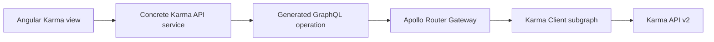

# Current holita integration

This reference maps the external API to existing code. The shared domain
[architecture](../architecture.md#karma-client) remains authoritative for
application ownership and lifecycle rules.

## Request path and ownership

The browser talks to Gateway. The native Apollo Router forwards the signed session
to the independent NestJS Karma Client. Concrete services call `requireTenant`
before upstream access. The application-local `KarmaTransportModule` provides one
`KarmaTransport` for fixed HTTP paths, upstream authentication and JSON reads. Feature
services own multi-read operation deadlines, query construction, car-existence checks and response
mapping into generated GraphQL types. History and Location reuse CarsService for their
actual car lookup; other features use the transport directly. Runtime SDL is explicitly loaded by
[AppModule](../../../../apps/karma-client/src/app.module.ts).

There is no database, Prisma model, ingestion worker, polling loop, telemetry archive,
Fleet implementation import or persisted Karma-to-Fleet identity mapping in this
subgraph. Health is a local process check and does not establish upstream availability.

Fleet's separate [background configuration operations](../architecture.md#background-device-configuration-reads)
call the Karma Client internal machine API. Fleet owns Tenant/Branch-scoped operations,
the scheduler and saved observations. Each operation captures the Karma car/device pair;
it does not require a local Fleet Device association.
Karma Client owns upstream authentication, target rechecks, fixed reads and single-parameter/rule writes
and bounded event parsing. Its request handler does not wait for the device response
and does not start a background worker in this subgraph.

`KARMA_API_URL`, `KARMA_USER` and `KARMA_PASSWORD` configure one server-side account;
`KARMA_CLIENT_GRAPHQL_URL` configures Gateway transport. Configuration is documented
in the single root [.env.example](../../../../.env.example), the
[development guide](../development.md#karma-client), and the
[Router configuration](../../../../apps/gateway/router/router.yaml).
The internal machine endpoints require `KARMA_INTERNAL_TOKEN` with at least 32
characters. Fleet calls them using its configured `FLEET_KARMA_INTERNAL_URL`; browser
signed-session tokens do not authenticate this interface. Internal secrets remain
on the server and are not Gateway or admin configuration.

## Query, upstream and route mapping

Routes below follow `/:language/karma-client`, with `bg` or `en`. Every query is
authenticated and uses the common account regardless of active Branch.
The fifteen public queries reuse twelve upstream GET method/path pairs; daily
reports and position samples compose the existing car, zone, trip and event reads.

| GraphQL query                                                 | Concrete upstream operation                                 | Admin route / behavior                                                               |
| ------------------------------------------------------------- | ----------------------------------------------------------- | ------------------------------------------------------------------------------------ |
| `karmaCars`                                                   | GET `/cars`                                                 | `/cars`; complete account list and Refresh                                           |
| `karmaCar(id: ID!)`                                           | GET `/cars/{id}`                                            | `/cars/:recordId`; matching single truck or missing state                            |
| `karmaEdata(input: KarmaEdataInput!)`                         | GET `/edata`                                                | `/cars/:recordId/edata`; message/parameter details and cursor history                |
| `karmaLocation(carId: ID!)`                                   | GET `/location` plus car precheck                           | `/cars/:recordId/location`; also independently loaded summary in truck detail        |
| `karmaTrips(input: KarmaTripsInput!)`                         | GET `/trips` plus car precheck and possible older lookahead | `/cars/:recordId/trips`; full row details and cursor history                         |
| `karmaDailyReport(input: KarmaDailyReportInput!)`             | GET `/cars/{id}`, `/time-zones`, bounded raw `/trips`       | `/cars/:recordId`; connected truck day overview and comparison                       |
| `karmaPositionSamples(input: KarmaPositionSamplesInput!)`     | GET `/events` within trip message anchors plus car precheck | Trip drawers from the truck overview or `/cars/:recordId/trips`; sampled positions   |
| `karmaEvents(input: KarmaEventsInput!)`                       | GET `/events` plus car precheck                             | `/cars/:recordId/events`; UTC/code filters, details and cursor history               |
| `karmaDiagnosticHistory(input: KarmaDiagnosticHistoryInput!)` | Bounded UTC GET `/events` plus car precheck                 | `/cars/:recordId/diagnostics`; source history, decoded faults and raw reports        |
| `karmaDrivingProfile(input: KarmaDrivingProfileInput!)`       | GET `/driving-profile` plus car precheck                    | `/cars/:recordId/driving-profile`; editable period, nine raw categories              |
| `karmaProjects`                                               | GET `/projects`                                             | `/administration/projects`; complete-list local search/paging and truck name lookups |
| `karmaTimeZones`                                              | GET `/time-zones`                                           | `/administration/time-zones`; complete-list local search/paging and name lookups     |
| `karmaVersion`                                                | GET `/version`, no upstream login                           | `/administration/api-info`; original version text                                    |
| `karmaUsers`                                                  | GET `/users`                                                | `/administration/users`; local search/paging and all-field detail dialog             |
| `karmaRoles`                                                  | GET `/roles`                                                | `/administration/roles`; local search/paging and original descriptions               |

The former `/projects`, `/time-zones`, `/api-info`, `/users` and `/roles` paths
redirect to their Administration destinations while retaining query/fragment state.

Sources: [routes](../../../../apps/admin/src/app/features/karma-client/karma.routes.ts),
feature-owned operations for [cars](../../../../apps/admin/src/app/features/karma-client/cars/operations.graphql),
[eData](../../../../apps/admin/src/app/features/karma-client/edata/operations.graphql),
[location](../../../../apps/admin/src/app/features/karma-client/location/operations.graphql),
[history](../../../../apps/admin/src/app/features/karma-client/history/operations.graphql),
[references](../../../../apps/admin/src/app/features/karma-client/references/operations.graphql)
and [accounts](../../../../apps/admin/src/app/features/karma-client/accounts/operations.graphql),
[fixed HTTP client](../../../../apps/karma-client/src/integrations/karma/karma-transport.ts).
There are no public Karma mutations or arbitrary REST proxy operations. The
[daily report contract](../architecture.md#daily-report-contract) specifies the
proved period/selection, limits, per-metric availability and unconfirmed source units.

## Internal configuration API

The [DeviceConfigurationController](../../../../apps/karma-client/src/modules/device-configuration/device-configuration.controller.ts)
exposes twelve fixed POST endpoints under `/internal/device-configuration`, protected
by the [machine guard](../../../../apps/karma-client/src/modules/device-configuration/device-configuration.guard.ts).
They do not use the public Karma GraphQL scope or accept arbitrary upstream paths.

| Endpoint                   | Input                                                                                   | Result                                                                                    |
| -------------------------- | --------------------------------------------------------------------------------------- | ----------------------------------------------------------------------------------------- |
| `/target`                  | `carId`                                                                                 | Current matching car/device identity                                                      |
| `/request`                 | `carId`, `expectedDeviceId`                                                             | `ACCEPTED` and queue IDs, or `UNCERTAIN` without an automatic replay                      |
| `/profile-request`         | `carId`, `expectedDeviceId`                                                             | `ACCEPTED` and queue IDs, or `UNCERTAIN`; fixed profile read                              |
| `/parameter-request`       | `carId`, `expectedDeviceId`, `parameterId`, `reportingIntervalSeconds`, `rawDefinition` | One additive definition; same submission outcome                                          |
| `/observations`            | `carId`, `expectedDeviceId`, `fromUtc`, `toUtc`, optional `afterMessageId`              | Bounded parsed `401` fragments, scan coverage and assembled readback status               |
| `/profile-observations`    | Same window/identity fields and optional watermark                                      | Separate bounded `416` profile observations and readback status                           |
| `/rules-request`           | `carId`, `expectedDeviceId`                                                             | `ACCEPTED` and queue IDs, or `UNCERTAIN`; fixed full-rule read                            |
| `/rule-request`            | `carId`, `expectedDeviceId`, `ruleId`, `rawDefinition`                                  | One supported rule record; same submission outcome                                        |
| `/rules-observations`      | Same window/identity fields and optional watermark                                      | Separate bounded `402` rule observations and readback status                              |
| `/diagnostic-watermark`    | `carId`, `expectedDeviceId`                                                             | Latest source message ID captured before submission                                       |
| `/diagnostic-request`      | `carId`, `expectedDeviceId`, fixed `kind`, optional `existingQueueIds`                  | `ACCEPTED`, `UNCERTAIN`, or `PENDING` when retained queues are unresolved                 |
| `/diagnostic-observations` | Identity, UTC window, retained `queueIds`, optional `afterMessageId`                    | Raw queue states and bounded ID-based special ACK/fault/communication report observations |

`/request` fixes payload `0702BC`, `/profile-request` fixes `1F`, and `/parameter-request`
constructs only `02` plus one 44-hex-character definition under the same
`30,1,19,0,19,301,0,1,1,` prefix. Parameter ID and interval must match the raw fields;
requested intervals are integers `0..65000`. No endpoint accepts a full command, arbitrary
operation byte or multiple definitions. The full definition is machine-only; Fleet owns
catalog/profile eligibility and construction from a verified preset or captured baseline.
`/rules-request` fixes payload `0802BC`; `/rule-request` constructs only `04` plus one rule
record with matching ID, a nine-byte header and supported 1–128-byte RuleData. The shared
codec validates its frame and expression before dispatch. Rule observations preserve unknown
bytecode as original records, even when it is unavailable for authoring.
Device identity is checked before submission and before reading observations.
Observation windows use canonical ISO UTC timestamps,
span at most 24 hours, and are rounded outward to the provider's whole-second
precision. Target/submission operations share a four-second upstream budget; observation
scans share 20 seconds across identity lookup, authentication and paging. Fleet allows
4.5 and 21 seconds respectively. Diagnostic requests include retained queue reconciliation
within a 20-second upstream / 21-second internal-call budget. Diagnostic observations page
by source ID, discard padded boundary rows and filter UTC locally, without upstream date
filters. Retained queue states `1` and `3` permit a new explicit request; pending, unknown
or unreadable states return `PENDING`. No submission is replayed after an uncertain transport or
authentication result. Events at or below `afterMessageId` are excluded before parsing
and assembly. Scans stop after an empty page, reaching the watermark or four pages;
exhausting the page budget leaves coverage
incomplete. Returned fragments are limited to 64 observations and 1,000 total
definitions; truncation also prevents complete coverage.

The [parser](../../../../apps/karma-client/src/modules/device-configuration/configuration-response.ts)
retains original text and full definitions rather than deriving decoding fields or
parameter support from a catalog. Configuration-ID conflicts, contradictory
numbering/final markers and duplicate parameter IDs prevent a complete result. A
complete readback is structural configuration evidence, not queue acknowledgment or
verification that a signal is physically available. The independent
[profile parser](../../../../apps/karma-client/src/modules/device-configuration/profile-response.ts)
validates `416` payload `1F` without combining it with parameter fragments. Global settings,
profile writes, deletion/replacement, firmware and device destinations are unsupported.
The [rule parser](../../../../apps/karma-client/src/modules/device-configuration/rule-response.ts)
assembles separate numbered `402` responses with payload `08`. It rejects inconsistent
configuration/segment metadata and duplicate rule IDs; complete rules are sorted by ID.
The envelope mirrors parameter observations: scan coverage, readback status/configuration ID,
and original message metadata with `{ruleId, rawDefinition}` records.
Parameter and rule observation envelopes may also contain `terminalResponse` with
`messageId`, `eventTimeUtc` and the exact `rawMessage` `19,0,154,0`. It records a terminal
read without supplying definitions or a configuration ID. Fleet requires complete scan
coverage before ending an incomplete read with `READ_NO_CONFIGURATION`; complete valid
configuration data still takes precedence. The response does not confirm an empty set.
Fleet persists baseline, submitted definition, marker and independent full verification;
the complete lifecycle is defined in the linked architecture.

## Diagnostic evidence and product coverage

The public `karmaEvents` query can return real source messages through Gateway. Its
`KarmaEvent` contract preserves `id`, `carId`, `deviceId`, `eventId`, `edt`, `pdt` and
the original `extra` text; the Events drawer displays those values. This is a raw
history read. The separate `karmaDiagnosticHistory` projection decodes documented `413`
and captured `419` layouts, exposes the documented `411` prefix, and preserves opaque
`418`, E2 and E70 payloads. It has no persistent DTC archive or current-state model.
An eData report number such as `413`, `418` or `419` is not an established Karma
`eventId`; filtering by that number can miss the actual source report.

The fixed diagnostic `306` and stored-fault logger `301`/`19` requests are exposed
through scoped Fleet operations and private machine endpoints. Version `308` and
global-settings `303` remain manual procedures documented in the
[device protocol reference](../../../discocan/erm-resources/edata-simple-protocol-v4.04/diagnostics-and-fault-reporting.md).
The diagnostic worker retains queue and reply evidence separately from configuration readback;
there is no arbitrary command console or product Process DTCs control.

| Observation                             | Supported conclusion                                                                                                                  |
| --------------------------------------- | ------------------------------------------------------------------------------------------------------------------------------------- |
| A queue ID or queue state `transmitted` | The provider supplied a reference or reported transmission; no device result is established                                           |
| A fresh matched `154,0` response        | A device negative/terminal response was observed; it does not prove successful fault retrieval, an empty ECU or the absence of faults |
| A fresh matched `411` or `417` report   | Device communication/ignition or CAN-disconnection evidence within the documented layout; not an ECU fault-code list                  |
| A real `413`, `418` or `419` report     | Raw fault-report evidence to decode against the applicable layout, retaining target, message ID, UTC time, code and reported status   |

A positive `419` proof requires an actual received SPN/FMI/status record and a
trusted interpretation for that installation. A protocol example, configuration
checkbox, successful parameter read or illustrative diagnostic row cannot supply
that evidence. Current live observations and their limits belong to the
[support verification register](../../../discocan/erm-resources/erm-support-diagnostics-protocol-test-server/README.md#verification-register).

## Backend feature boundaries

| Feature                | Concrete implementation                                                                                                                                                             | Contract / mapping                                                                                                                                                                                                                                                                     |
| ---------------------- | ----------------------------------------------------------------------------------------------------------------------------------------------------------------------------------- | -------------------------------------------------------------------------------------------------------------------------------------------------------------------------------------------------------------------------------------------------------------------------------------- |
| Transport              | [KarmaTransport](../../../../apps/karma-client/src/integrations/karma/karma-transport.ts), [module](../../../../apps/karma-client/src/integrations/karma/karma-transport.module.ts) | Fixed upstream endpoints, shared session, authentication renewal and sanitized HTTP reads                                                                                                                                                                                              |
| Cars                   | [CarsService](../../../../apps/karma-client/src/modules/cars/cars.service.ts)                                                                                                       | [SDL](../../../../apps/karma-client/src/modules/cars/cars.graphql), [response](../../../../apps/karma-client/src/modules/cars/cars-response.ts)                                                                                                                                        |
| eData                  | [EdataService](../../../../apps/karma-client/src/modules/edata/edata.service.ts)                                                                                                    | [SDL](../../../../apps/karma-client/src/modules/edata/edata.graphql), [query](../../../../apps/karma-client/src/modules/edata/edata-query.ts), [response](../../../../apps/karma-client/src/modules/edata/edata-response.ts)                                                           |
| Internal configuration | [DeviceConfigurationService](../../../../apps/karma-client/src/modules/device-configuration/device-configuration.service.ts)                                                        | Fixed parameter/profile/rule reads and one-definition parameter/rule writes, identity checks, [input validation](../../../../apps/karma-client/src/modules/device-configuration/configuration-input.ts), separate response parsing; Fleet owns eligibility, persistence and scheduling |
| Location               | [LocationService](../../../../apps/karma-client/src/modules/location/location.service.ts)                                                                                           | [SDL](../../../../apps/karma-client/src/modules/location/location.graphql), [response](../../../../apps/karma-client/src/modules/location/location-response.ts)                                                                                                                        |
| Trips/events/profile   | [HistoryService](../../../../apps/karma-client/src/modules/history/history.service.ts)                                                                                              | [SDL](../../../../apps/karma-client/src/modules/history/history.graphql), [query](../../../../apps/karma-client/src/modules/history/history-query.ts), [response](../../../../apps/karma-client/src/modules/history/history-response.ts)                                               |
| Projects/zones/version | [ReferencesService](../../../../apps/karma-client/src/modules/references/references.service.ts)                                                                                     | [SDL](../../../../apps/karma-client/src/modules/references/references.graphql), [response](../../../../apps/karma-client/src/modules/references/references-response.ts)                                                                                                                |
| Users/roles            | [AccountsService](../../../../apps/karma-client/src/modules/accounts/accounts.service.ts)                                                                                           | [SDL](../../../../apps/karma-client/src/modules/accounts/accounts.graphql), [response](../../../../apps/karma-client/src/modules/accounts/accounts-response.ts)                                                                                                                        |

SDL owns public API types, generated by the existing GraphQL toolchain. The
reconstructed REST schema is not currently wired into this toolchain. Backend
services enforce signed access, while input/response helpers define the concrete
subset accepted by holita. See [field mapping](data-models.md) and
[transport rules](transport-and-authentication.md).

## Frontend behavior

[KarmaWorkspace](../../../../apps/admin/src/app/features/karma-client/karma-workspace.ts)
mounts the selected route section using the captured session, language, truck and
section. Concrete view providers own Apollo clients/caches through
[KarmaApi](../../../../apps/admin/src/app/features/karma-client/karma-api.ts),
[KarmaEdataApi](../../../../apps/admin/src/app/features/karma-client/edata/karma-edata-api.ts)
and [KarmaHistoryApi](../../../../apps/admin/src/app/features/karma-client/history/karma-history-api.ts).
Their generated TypedDocumentNodes go through Gateway with `network-only` reads.
They capture the admin session and send no Branch context.

The section remains accessible when Fleet is disabled or Branch discovery fails.
Changing Branch remembers that selection without reloading Karma. Navigation,
language changes, truck changes, session replacement and logout retire old reads
and clients. Filter/period/cursor changes cancel obsolete reads and clear old rows;
same-query Refresh can retain the last successful result on error. There is no
automatic polling or device writes in these account/history reads. The truck's Device settings
tab consumes separately scoped Fleet read/change operations through Gateway using the shell's
active Branch for operation scope and the selected Karma car's device as the target.
There is no local Device setup step. Fleet's read/change inputs contain `karmaCarId` and
`expectedKarmaDeviceId`, verified upstream before dispatch. These are Fleet contracts, not
public Karma mutations. Read configuration sequences parameter
then rule reads; after reload, continuation requires an explicit action. Refreshing or leaving
the view does not own the server-side job. Login preserves a requested settings route.
See the [configuration workflow](../architecture.md#background-device-configuration-reads).

The car table requests all cars, not a server-paginated/searchable list. Its list
operation selects basic fields and timezone but omits `subType` and `driverCount`;
the detail operation selects them. Name hydration uses an independent projects/zones
query so failed reference lookup cannot hide truck data or original IDs.

Projects, time zones, users and roles load complete arrays and perform local
search/paging with exact totals for that loaded array. URL state uses `q`, `size`
and `first`; page sizes are 25/50/100, default 50. These totals do not imply history
totals or server completeness guarantees beyond the returned list.

eData/trips/events expose full row drawers and Latest/Older/Newer cursor navigation.
Applied size, dates and parameter/event filters are URL-backed. User dialogs display
all eleven source fields and restore focus when closed. Text is escaped; `extra`
and role descriptions are not interpreted as HTML or authorization.

Driving profile starts from a seven-day range derived from the current UTC clock,
then submits its offset-free wall-clock strings. The period is editable and the UI
discloses the unresolved provider timezone. The nine source categories are shown
without a fabricated overall score, thresholds or units.

Location exposes all mapped fields and the shared map preview for valid coordinates.
The preview offers Google Maps and Street View links, with an automatically loaded
Google Embed view when configured. Trip views additionally offer endpoint directions;
suggested directions are separate from the recorded position samples. Source times
remain visible, and a location read can fail independently of truck details.
No online/offline badge is derived from timestamps or zero values.

## Existing verification coverage

This is a map of the kept suites, not a record of an individual run. Commands and prerequisites
belong to [testing](../../../testing.md).

- [karma-transport.spec.ts](../../../../apps/karma-client/src/integrations/karma/karma-transport.spec.ts):
  a rejected Karma session is renewed at most once per operation, and upstream failures are
  sanitized.
- [health.spec.ts](../../../../apps/karma-client/src/health/health.spec.ts): every Karma query
  requires a verified signed session before any upstream call, without Branch context.
- [configuration-transport.spec.ts](../../../../apps/karma-client/src/modules/device-configuration/configuration-transport.spec.ts):
  device commands send one fixed packet once and report UNCERTAIN without replay.
- [device-configuration.spec.ts](../../../../apps/karma-client/src/modules/device-configuration/device-configuration.spec.ts):
  internal device-configuration routes require the machine secret.
- [federation.db.spec.mts](../../../../tools/graphql/federation.db.spec.mts) with the
  [controlled Karma server](../../../../tools/graphql/karma-fixture.mts): real service boundaries
  with dedicated Core/Fleet schemas.
- The Karma browser smoke journey: trucks, details, location and filtered eData through Gateway.

Deterministic fixtures establish holita behavior under controlled responses. They
do not establish provider uptime, permission to write, a complete field catalog,
non-null sensor/driver/video models, real active-trip mutation behavior, metric
units or timezone semantics. Live read observations complement these fixtures;
they do not replace them or constitute a full account/history audit.
