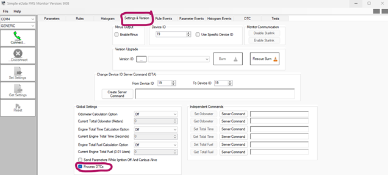
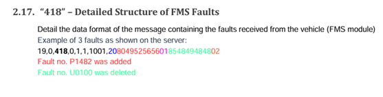
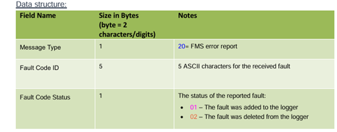
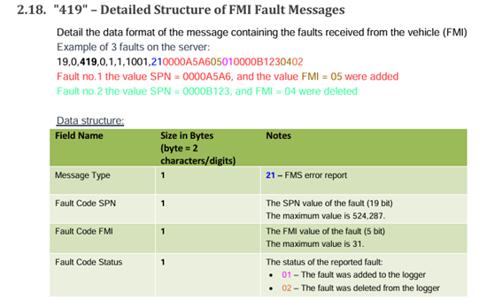

# ERM support reply: technical analysis

[Reference and verification status](README.md) · [Full correspondence](correspondence.md) ·
[Pending tests and ERM questions](../../../todo/karma-api-v2.md#erm-support-verification)

Analysis date: **2026-10-27**, Europe/Sofia. This is an interpretation of supplied
source material. A vendor statement, a screenshot and a sample payload are not live
confirmation for an installed device. The verification register in the reference
README is authoritative for the scope of subsequent evidence.

The later [combined campaign](live-verification-2026-10-27.md) adds actual API/
Gateway positive controls and static Monitor 9.56 decoder evidence: five character
bytes for `418`, four big-endian SPN bytes for `419`, and a concrete global
parser/serializer discrepancy. Those findings qualify the source-only analysis
below; they do not establish new live DTC or interval-change success.

## What ERM states

The reply contains three separate technical statements:

1. ERM supports vehicle fault-code reporting in Karma and API responses. The engineer says to enable **Process DTCs** in Simple eData Monitor, after which fault codes start being transmitted to the server.
2. ERM support reportedly sent StarLink protocol details and access in an earlier email dated **`7/10/2026`**. The present reply does not contain those credentials or the earlier message.
3. **StarLink Test Server** uses a different IP and port and can be used to fork transmission to the customer's server and ERM's test server. The reply does not give the endpoint values or setup procedure.

These are manufacturer statements about capabilities and integration direction, without local live confirmation. The reply is a **partial answer** to the detailed request. Exact OTA activation, firmware compatibility, fault-data representation, connection/acknowledgement flow and Test Server setup remain insufficiently specified for a complete implementation.

The DTC instruction addresses fault-code reporting. It does not establish how often periodic eData measurements such as 539 or 662 will arrive, nor establish whether a vehicle supplies CAN traffic with ignition off. Those need their own configuration and measurement evidence.

## Source identity and evidence boundaries

- The ODT contains 22 paragraph elements and four embedded PNGs. All four occur under the reply's first topic, fault-code reporting.
- There are no embedded hyperlinks in the reply text, no attached executable or installer, and no credentials, actual Test Server IP address or port in the supplied ODT.
- The original request addresses **Oz**. The ODT excerpt does not preserve email headers. ERM-TEST-01 subsequently found the matching reply from Oz Dori in Outlook, received `2026-10-25T08:39:01Z`; the [correspondence provenance](correspondence.md) records that separate evidence.
- ODT metadata records document creation/modification at `2026-10-26T21:32:00Z`, with Microsoft Word as generator. This is an export/document timestamp, not proof of when the email was sent.
- The literal date `7/10/2026` is retained. It likely means 7 October under a day/month convention, but the original email header should establish the exact date.
- The offered meeting days, Wednesday or Thursday, have no explicit calendar dates, time slots or time zone. Do not infer or book a meeting from the ODT metadata alone.
- The images show Monitor **9.08** and protocol headings **2.17/2.18**. The repository's separate sources include Monitor/catalog **9.56** and eData Simple Protocol **4.04**, where the corresponding fault sections are **3.18/3.19**. The email does not identify the source protocol edition or establish compatibility with every installed firmware.

## Question-by-question comparison

The status column describes the completeness of ERM's answer, not a successful test.
See the [verification register](README.md#verification-register) for live-validation status.

“Referred elsewhere” means the engineer points to material outside this ODT. It does not mean the material was never sent; it also does not mean we have inspected it.

| Original question                                                 | What the reply actually supplies                                                                                             | Status                                        | What remains to be established                                                                                           |
| ----------------------------------------------------------------- | ---------------------------------------------------------------------------------------------------------------------------- | --------------------------------------------- | ------------------------------------------------------------------------------------------------------------------------ |
| Arrange a meeting next week                                       | Wednesday or Thursday; a proposed demonstration during the call                                                              | Partially answered                            | Exact date, time and time zone                                                                                           |
| Read vehicle fault codes/DTCs                                     | Explicit support confirmation for Karma and API; Process DTCs option                                                         | Answered at capability level                  | Exact installed-model path and the real API response/endpoint                                                            |
| Read other device errors and diagnostic information               | No separate treatment of tracker internal errors, communication errors, command result codes or general diagnostic snapshots | Partially answered                            | Which diagnostic families exist and how each is requested/reported                                                       |
| Automatic reports or commands?                                    | Fault codes start transmitting after Process DTCs is activated                                                               | Partially answered                            | How the flag is persisted over OTA; initial fault snapshot versus transition reporting; any polling/request requirements |
| Relevant activation/request commands                              | A Monitor checkbox is shown                                                                                                  | Not supplied in this reply                    | Exact command, field/bit, payload, version applicability and independent readback                                        |
| Message formats                                                   | Screenshots describe `418` and `419` with samples and status values                                                          | Partially answered                            | Clarification of the inconsistencies documented below and an unambiguous live sample                                     |
| Error-code descriptions                                           | Example labels `P1482`, `U0100`, SPN/FMI values                                                                              | Not a code-description catalogue              | Code meanings/catalogue, manufacturer-specific interpretation and supported namespaces                                   |
| Example requests/responses                                        | Two example incoming fault reports                                                                                           | Partially answered                            | Activation request, response/readback, complete device/server exchange and captured real data                            |
| Model, firmware and configuration requirements                    | A Monitor 9.08 screenshot                                                                                                    | Not supplied as a compatibility specification | Supported device/eData modules, minimum firmware, FMS/OBD/profile prerequisites                                          |
| Protocol portal credentials                                       | Reference to support email dated `7/10/2026`                                                                                 | Referred elsewhere                            | Retrieve that email and verify the intended portal account; credentials are absent here                                  |
| Documentation for receiving/sending/diagnostics                   | General reference to previously shared StarLink protocol and eData Fault description                                         | Partially answered / referred elsewhere       | Exact pages for framing, checksum, transport, acknowledgements, command correlation and diagnostics                      |
| Send StarLink Test Server and installation instructions           | Description of a different IP/port and fork capability                                                                       | Not supplied as requested                     | Hosted service versus downloadable tool, access, installer if relevant and setup instructions                            |
| Capture messages                                                  | Forking provides a possible path for observing the same traffic at our server                                                | Partially answered                            | Who captures/stores traffic, output format, retention and export                                                         |
| Replay messages                                                   | No replay statement                                                                                                          | Unanswered                                    | Whether replay exists, how it is invoked and whether timing/IDs/acks are reproduced                                      |
| Simulate a device                                                 | No simulation statement                                                                                                      | Unanswered                                    | Whether simulation exists and which device/command behaviours it covers                                                  |
| Sample messages or recordings                                     | Static fault-message examples in screenshots                                                                                 | Partially answered                            | Valid complete frames, packet recordings or replay fixtures with expected results                                        |
| Connection setup, parsing, acknowledgements and command responses | Offered explanation during the future meeting                                                                                | Deferred                                      | Reference sequence and exact packet/ack/command examples                                                                 |
| Configure server address and port                                 | Says Test Server has a different IP and port                                                                                 | Unanswered at implementation level            | Actual addresses/ports, configuration fields/commands, readback and rollback                                             |
| Transport protocol                                                | No TCP/UDP/TLS specification                                                                                                 | Unanswered                                    | Required transport and session behaviour                                                                                 |
| SIM/APN settings                                                  | No SIM/APN details                                                                                                           | Unanswered                                    | Applicable settings or confirmation that existing settings remain valid                                                  |
| Confirm successful connection                                     | No success procedure or sample status                                                                                        | Unanswered                                    | Expected first packet, server log/status, acknowledgement and how to check both destinations                             |

## Image 1: Process DTCs in Monitor

Source archive member: `media/image1.png`, 636×287 pixels.



Visible details:

- Window title: **Simple eData FMS Monitor Version: 9.08**.
- The **Settings & Version** tab is circled in magenta.
- The **Process DTCs** checkbox in the Global Settings area is circled and appears selected.
- A separate nearby checkbox reads **Send Parameters While Ignition Off And Canbus Alive** and appears unselected.
- The screen also contains global calculation settings, independent commands, version upgrade controls, Monitor communication controls and a device-ID area.
- This is not the Parameters table or a per-parameter reporting-interval editor.

The engineer's actionable instruction is to activate the Process DTCs option. The screenshot locates the option, but does not show an OTA command, a saved device readback, the target vehicle, its firmware, an observed fault or proof that the checkbox state was applied to a live device.

The separate ignition-off checkbox matters to the earlier investigation: the software distinguishes DTC processing from parameter reporting while ignition is off and CAN is alive. Selecting Process DTCs must not be assumed to enable that separate mode. An ignition-off reporting option also does not create vehicle CAN traffic when the vehicle supplies none.

The exact click/save/send sequence for global settings is not demonstrated. A checkbox screenshot alone does not establish whether the change is immediately transmitted, requires another action, or is only a local selection.

## Images 2 and 3: FMS fault report 418

Source members: `media/image2.png`, 557×142 pixels; `media/image3.png`, 556×218 pixels.





The screenshots show heading **2.17. “418” – Detailed Structure of FMS Faults** and this exact example:

```text
19,0,418,0,1,1,1001,20804952565601854849484802
```

The coloured explanations say:

- `P1482` was added.
- `U0100` was deleted.

The table states:

| Field             | Source size | Source meaning                                         |
| ----------------- | ----------: | ------------------------------------------------------ |
| Message Type      |      1 byte | `20` = FMS error report                                |
| Fault Code ID     |     5 bytes | Five ASCII characters                                  |
| Fault Code Status |      1 byte | `01` added to the logger; `02` deleted from the logger |

The natural record layout implied by the table is one message-type byte followed by repeated five-character code plus one-byte status records. Added/deleted refer to the logger's reported fault lifecycle; they are not instructions to add/delete eData parameter definitions, and “deleted” does not itself prove a repair or that an ECU-clear command was executed.

**Encoding inconsistency that must be resolved:**

- After `20`, the sample can be segmented as `8049525656 01` and `8548494848 02`.
- If the code fields are ordinary ASCII bytes represented in hexadecimal, `P1482` would be `5031343832` and `U0100` would be `5530313030`. Those are not the printed fields.
- Interpreting the pairs in the printed fields as decimal character codes produces `P1488` and `U0100`. Even this alternative does not reproduce the first printed label, `P1482`.
- The heading says “Example of 3 faults”, while two fault records and two explanations are visible.

This is present in both the supplied screenshot and the repository's eData 4.04 text; it is not a new transcription guess. Possible causes include a documentation typo or a server-display representation that differs from wire bytes. The email does not resolve which. Preserve the original example and obtain a real raw frame plus its expected decoded code. Do not silently rewrite the example or hardcode a mixed decimal/hex interpretation into production.

## Image 4: FMI fault report 419

Source member: `media/image4.png`, 541×339 pixels.



The heading is **2.18. “419” – Detailed Structure of FMI Fault Messages**. The exact example is:

```text
19,0,419,0,1,1,1001,210000A5A605010000B1230402
```

The explanations show:

- SPN `0000A5A6`, FMI `05`, added.
- SPN `0000B123`, FMI `04`, deleted.

The table states:

| Field             | Source size | Source meaning                                                 |
| ----------------- | ----------: | -------------------------------------------------------------- |
| Message Type      |      1 byte | `21`; the note says “FMS error report” despite the FMI heading |
| Fault Code SPN    |      1 byte | A 19-bit SPN, maximum 524,287                                  |
| Fault Code FMI    |      1 byte | A 5-bit FMI, maximum 31                                        |
| Fault Code Status |      1 byte | `01` added; `02` deleted                                       |

**Size inconsistency that must be resolved:**

One byte cannot represent the stated 19-bit SPN range. After the leading `21`, the sample contains 12 bytes. Splitting those into two records of **four SPN bytes + one FMI byte + one status byte** exactly reproduces the two explanations:

| Sample segment   | Four-byte SPN interpretation | FMI | Status  |
| ---------------- | ---------------------------: | --: | ------- |
| `0000A5A6 05 01` |            `0xA5A6` = 42,406 |   5 | Added   |
| `0000B123 04 02` |            `0xB123` = 45,347 |   4 | Deleted |

This is a well-supported interpretation of the example, not a live-validated wire contract. Confirm the actual SPN byte count, endianness, padding/bit masking and applicable firmware before fixing a decoder. The “3 faults” wording again accompanies only two visible records. The table's FMS/FMI label is another source wording inconsistency.

## Relationship to repository references

The mail reinforces parts of the existing documentation while exposing missing information.
Code observations below are a snapshot from 2026-10-27, not proof of a deployed runtime:

- [eData 4.04 fault messages](../edata-simple-protocol-v4.04/content.md) contain the same `418`/`419` samples and inconsistencies. The email images are not a corrected replacement specification.
- The global command `302` table lists **Process FMS DTCs**. The corresponding `410` readback table labels the apparent matching position **Keep Alive Message Time Interval**. The earlier mismatch around CANBUS #2 / ignition-off processing also remains. The screenshot does not identify the correct byte or bit for this hardware/firmware. Do not guess a global payload from these tables.
- The [Monitor guide](../simple-edata-monitor-configuration-v1.0/content.md) has a DTC view with code, description, Added/Removed status and update time, in an OBD-mode context. This is additional documentation, not proof that the exact same mode is required for every FMS/FMI installation.
- The [Karma guide appendix](../karma-guide-appendix-v1.4.2/content.md) separately mentions StarLink parameters **2069/2070 = 134217731** for its DTC report workflow. The engineer's reply does not mention these. Verify applicability before changing them. StarLink system-parameter numbers are not interchangeable with eData parameter IDs such as 539/662.
- The [local portal reference](../starlink-online-protocol/README.md) was originally prepared from screenshots with credentials awaited. The engineer says access was already sent in another email; the reference now records both sources with authenticated access unverified. The actual previous email needs to be recovered and checked before treating either statement as the current access result.
- The current [Fleet operation SDL](../../../../apps/fleet/src/modules/device-operations/device-operations.graphql) supports parameter/rule reads, parameter additions, interval changes and single-rule changes. It does not expose a typed global **Process DTCs** mutation.
- The current [Karma event SDL](../../../../apps/karma-client/src/modules/history/history.graphql) exposes `extra` as source text. There is no dedicated typed `418`/`419` decoder or fault-lifecycle query in the inspected modules. Raw event reading can be used first to locate real examples; the exact event ID/endpoint for fault reports still needs observation or vendor confirmation. Do not assume all DTCs use `event_type=33` solely because configuration/periodic messages did.
- The existing interval-write flow must remain separate from a future global-settings operation. Do not encode Process DTCs as an invented eData parameter, insert arbitrary browser command strings, or bypass the preserved-baseline/readback rules.

Source inspection on **2026-10-27** shows public eData uses an **8-second** signal in [edata.service.ts](../../../../apps/karma-client/src/modules/edata/edata.service.ts), and the [Router configuration](../../../../apps/gateway/router/router.yaml) gives the `karma-client` subgraph **9 seconds**. These source values do not establish deployment, measured request duration or a resolution of fault reporting. No timeout change or runtime request was made during this analysis.

## What the Test Server statement establishes

The capability explicitly described by ERM is **forking device transmission to the customer's server and ERM's test server**. It remains unverified in our integration. Such a path could support comparing traffic and developing a receiver. The implementation could involve vendor forwarding or a device/server configuration; the mail does not specify which.

Do not infer the following from the fork statement:

- A downloadable application or an installer is available in this email.
- Recording, replay or simulation is implemented.
- Both destinations receive byte-identical packets, the same timing or bidirectional command traffic.
- Our receiver should acknowledge the device, the Test Server should acknowledge it, or both should.
- Two independently commanding servers are supported safely.
- A particular TCP/UDP/TLS transport, port, APN or configuration command is known.

Before a routing test, obtain the actual endpoint/access details, who performs the fork, which side owns acknowledgements and commands, and how the original production routing is preserved/restored. Changing a production server address without the confirmed fork procedure could interrupt the current Karma connection. The engineer has offered a mechanism for avoiding that disruption, but the procedure is not included here.

Receiving raw StarLink traffic on our own server is a separate integration path from the existing holita UI reading Karma API. A new receiver is needed only if that direct-server path is in scope; it is not a prerequisite to proving the existing Karma-based parameter editor.

## Evidence categories and acceptance limits

| Information                         | Appropriate source                                               | Meaning for the interface                                      |
| ----------------------------------- | ---------------------------------------------------------------- | -------------------------------------------------------------- |
| Per-parameter definitions/intervals | Complete `401` readback                                          | Configured reporting behaviour                                 |
| Periodic measured values            | `405` / eData measurements                                       | Actual values and observed cadence                             |
| Contact/CAN diagnostic snapshot     | `411`                                                            | State at the source timestamp                                  |
| Vehicle fault transitions           | Validated `418`/`419`, and any separately verified fault formats | Added/removed code or SPN/FMI event, with source identity/time |
| Process DTCs setting                | Confirmed compatible global-settings readback                    | Whether fault processing/reporting is configured               |
| Raw forwarding/connection           | Confirmed Test Server/receiver logs and protocol handshake       | Whether the direct transport path works                        |

The mail's support confirmation does not prove that a vehicle currently has a fault, that the installed module can read every ECU, or that enabling a flag will produce three reports on a fixed timer. Fault reporting can involve state changes, which have a different acceptance criterion from a 30/60/120-second measurement-cadence test.

Current API/editor contracts remain in the existing [Discocan documentation](../../README.md).
Conditional implementation ideas, the bounded test allocation and unsent questions
for ERM are tracked in the [existing backlog](../../../todo/karma-api-v2.md#erm-support-verification).
No new fault decoder, global-setting operation or receiver is implemented by this reference.

## ERM-TEST-01 complementary source findings

The [diagnostics and fault reference](../edata-simple-protocol-v4.04/diagnostics-and-fault-reporting.md)
now includes an explicit stored-fault read (`301`, payload `19`) and the OBD
`413` report, which were omitted from the first FMS/FMI-focused plan. Its printed
P1111/C2222/B3333 codes decode consistently at source-example level. This is not a
new live response. The `302`/`410` conflict was visually confirmed in the original
PDF; `418`/`419` sample ambiguities remain unresolved.

The public portal root and one official vendor deep link returned a login form;
no authenticated content was obtained. The referenced access email/account was not
located in the available sources. Reading the known eData requests is possible in
a separately started device stage; writing a guessed Process DTCs payload is not
justified by these source findings.
