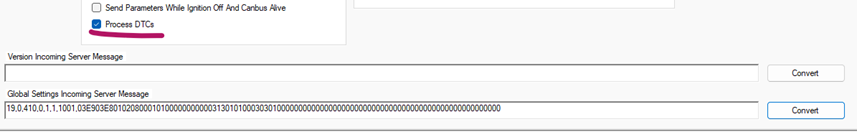
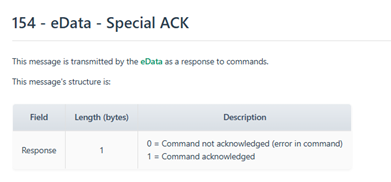
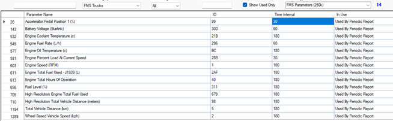
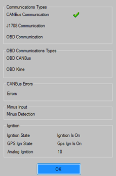

# ERM follow-up: fault evidence and configuration contract

Technical analysis date: **2026-10-29**, Europe/Sofia. [Reference](README.md) ·
[All 29 supplied commands](command-reference-2026-10-29.md) ·
[Earlier analysis](analysis.md) · [Earlier live campaign](live-verification-2026-10-27.md).

The newly supplied reply contains an **identified FMI fault event with
two fault records**, a definitive negative-acknowledgement definition, four new
images and a complete Monitor command export. It changes the earlier source-only
assessment. An ERM-supplied log excerpt is evidence from the manufacturer;
independent retrieval from Karma and new device requests are separate evidence.
The [live verification register](README.md#verification-register) records that scope.
The [29 October live campaign](live-verification-2026-10-29.md) independently
retrieved the exact supplied event and a further current-day `419` report with
SPN 23806 / FMI 15/added. Positive raw fault reception is therefore independently
proved. The existing Gateway `karmaEvents` query independently returned both
events with matching identity, UTC times and raw payloads, without GraphQL errors.
Lifecycle, ECU coverage and on-demand correlation retain their own limits.

The ODT has no email headers. Its creation/modification metadata is
`2026-10-29T14:18:00Z`; that is an export timestamp. Device-event `edt` values in
this reply have no explicit timezone; independently retrieved API evidence is
recorded in UTC in the live campaign. Do not infer email send time, screenshot
capture time or event timezone from the export metadata. The new ODT includes
portal access details, so the private source is not copied into documentation.
This is a technical correspondence summary, without credentials or private
conversational paragraphs. The four PNGs and command attachment are preserved
byte-for-byte; hashes and dimensions are in [metadata.json](metadata.json).

## What the six numbered answers establish

| Answer | ERM's technical statement                                                                                                                                           | Evidence and limit                                                                                                                                                                                                                                                                        |
| ------ | ------------------------------------------------------------------------------------------------------------------------------------------------------------------- | ----------------------------------------------------------------------------------------------------------------------------------------------------------------------------------------------------------------------------------------------------------------------------------------- |
| 1      | Supplies protocol-portal access details.                                                                                                                            | Access is now supplied, superseding the earlier missing-credentials condition. Authenticated acquisition status belongs to the current protocol reference. No Test Server endpoint is supplied here.                                                                                      |
| 2      | Previously submitted command was correct according to ERM's logs; inspect queue `56117619` and event responses.                                                     | Example queue result is `state_id:1`, `state_desc:transmitted`; example device ACK is event `33`, `19,0,154,1`. Transport state and device ACK are distinct from a returned fault list or applied configuration.                                                                          |
| 3      | Pasting the global response into Monitor shows Process DTCs enabled and correct.                                                                                    | Image 1 supports the interpretation of the supplied settings; it does not independently identify the originating device or capture time.                                                                                                                                                  |
| 4      | `154` is eData Special ACK; `154,0` means **Command not acknowledged**. CAN Engine operations use outer command `301` and select the operation inside the payload.  | Image 2 defines `0` versus `1`. ERM also supplies a concrete `419` event containing two added faults, decoded below. The `301` statement applies to CAN Engine operations; the same attached export separately uses `302`, `303`, `306`, `308` and other outer commands.                  |
| 5      | ERM saw most intervals at 180 seconds and a few at 30/60; says it sent all 14 parameters at 60 seconds OTA, using globals → parameters → vehicle, waiting for ACKs. | Image 3 shows the mixed configuration; the export contains 14 definitions at 60 seconds. A supplied ACK proves acknowledgement at most; complete new `401`/`410`/`416` readback and new `405` cadence are needed to establish resulting configuration/reporting.                          |
| 6      | Explains `417` as an interface/wiring issue and reports diagnostics working when checked; ignition-off example concerned an electric vehicle charging while off.    | Image 4 shows CAN communication and ignition on, without a visible CAN error marker. It does not prove a repair or define a universal truck ignition-off policy. ERM explicitly has no answer yet for fault formats, lifecycle and Monitor export discrepancy, pending another developer. |

The claim that the prior 30→60 change was not applied is not sufficient to erase
the separately observed **2026-10-27** complete readback and five periodic records
with four 60-second deltas. The screenshot has no device ID/time and shows a mixed
set in the new reply. It also shows **662 already at 60 seconds**. Subsequent changes or
which earlier definition ERM meant are not established. The supplied configuration
procedure uses bulk operation `01`; discocan's proven single-definition change uses
`02`. Their required sequences must be clarified separately.

## Positive fault capture: exact data and decoding

ERM's identified example is:

```json
{
  "car_id": 16595,
  "device_id": "862129080367299",
  "message_id": 7177124308,
  "extra": "19,0,419,0,1,1,1001,21000010F30701000004DF0B01",
  "edt": "2026-10-28 18:54:31",
  "eid": 33,
  "latitude": 46.620205,
  "longitude": 11.543687
}
```

The raw string is a Karma event `33` carrying eData report **419**, not Karma
`event_type=419`. Preserve `message_id` and source time when locating it; a queue
state alone cannot locate or correlate this event.

The payload is **13 bytes**: message type `21`, then **two six-byte records**.
There is no record-count byte: treating `21` as a count would be incorrect.

| Offset after payload type | Bytes         | Interpretation supported by Monitor 9.56 and both supplied 419 examples |
| ------------------------- | ------------- | ----------------------------------------------------------------------- |
| 0–3                       | `00 00 10 F3` | Four-byte big-endian SPN, hexadecimal `10F3`, decimal **4339**          |
| 4                         | `07`          | FMI **7**                                                               |
| 5                         | `01`          | **Added to the fault logger**                                           |
| 6–9                       | `00 00 04 DF` | Four-byte big-endian SPN, hexadecimal `04DF`, decimal **1247**          |
| 10                        | `0B`          | FMI **11**                                                              |
| 11                        | `01`          | **Added to the fault logger**                                           |

Both SPNs fit the documented 19-bit range and both FMI values fit five bits.
The capture corroborates the four-byte SPN layout and contradicts the printed
one-byte SPN field. It does not resolve upper/reserved bits, ECU/source address,
occurrence count, current-versus-historical semantics or fault descriptions.
No ECU/subsystem identity or repair recommendation is inferred from bare SPN/FMI.
Both statuses are added; **no removed transition is demonstrated**. A raw fault
report proves a vehicle fault can be represented/read through this path; it does
not establish every truck/model, a full current fault inventory or every ECU.

The event is almost 34 hours after the previously recorded `56117619` reply
`7171154531` at **2026-10-27 08:54:32 UTC**. The new reply does not establish that
`7177124308` is a response to that old request. Automatic reporting, a later
request and delayed historical transfer cannot be distinguished from this excerpt.

## Corrected ACK semantics and queue example

The exact ERM-supplied queue example uses **POST**:

```http
POST https://karma.online/apiv2/queue/56117619
Content-Type: application/json

{"karma_sid":"<session_id>"}
```

Expected example response:

```json
{ "56117619": { "state_id": 1, "state_desc": "transmitted" } }
```

Earlier direct observations used **GET** on this endpoint. The supplied POST
example and observed GET are different evidence; a POST example alone does not
change the verified adapter method. Portal/API documentation or a bounded method
test must establish support. The session placeholder is not a saved credential.

The reply's identified positive ACK is:

| Field                | Supplied value                                                |
| -------------------- | ------------------------------------------------------------- |
| Car / device         | `16595` / `862129080367299`                                   |
| Message ID           | `7179129747`                                                  |
| Source `edt`         | `2026-10-29 10:18:44`, timezone unstated in the ODT           |
| Event                | `33`                                                          |
| Raw extra            | `19,0,154,1`                                                  |
| Position             | latitude `48.435162`, longitude `10.304573`                   |
| ERM's stated context | ACK after SET GLOBAL SETTINGS, before SET PARAMETERS SETTINGS |

The earlier Monitor branch displaying no buffer entries on `154,0` must not be
used as a universal empty-logger interpretation. **ERM now explicitly defines it
as command not acknowledged/error in command.** Historical `154,0` results remain
real device responses; their diagnosis remains rejection, without proof of why.
`154,1` is the positive acknowledgement under the supplied protocol definition;
it is not a list of faults, a final multi-fragment marker or full readback.
No echoed queue ID appears in these ACK strings, so temporal association alone
cannot prove universal queue-to-ACK correlation.

## Image 1: global readback interpreted in Monitor

Archive member `media/image1.png`, **857×132**, preserved unchanged:



Every visible control/state:

- **Send Parameters While Ignition Off And Canbus Alive**: unchecked.
- **Process DTCs**: checked, with a hand-drawn magenta underline.
- **Version Incoming Server Message**: empty input and a **Convert** button.
- **Global Settings Incoming Server Message**: populated input and a **Convert**
  button with a blue outline; the outline does not prove a completed action.
- No window title, application version, device/car identifier, timestamp or lower
  settings are visible in this cropped image.

The visible global text matches the previously preserved DTC-enabled readback:

```text
19,0,410,0,1,1,1001,03E903E8010208000101000000000003130101000303010000000000000000000000000000000000000000000000000000
```

It has the same relevant byte 18=`01` and byte 24=`00` interpretation established
by the paired Monitor exports. The new attachment's SET GLOBAL SETTINGS payload
is **not identical** to this readback: it changes additional bytes, detailed in the
[command reference](command-reference-2026-10-29.md#global-settings-payload).
The screenshot supports the checked setting; it does not prove the attachment is
a safe one-byte DTC update.

## Image 2: Special ACK definition

Archive member `media/image2.png`, **391×182**, preserved unchanged:



The heading is **154 - eData - Special ACK**. The introductory text says eData
transmits the message in response to commands. The table has columns **Field**,
**Length (bytes)** and **Description**. Its sole field is **Response**, length
**1**, with these exact meanings:

| Response | Meaning                                     |
| -------- | ------------------------------------------- |
| `0`      | Command not acknowledged (error in command) |
| `1`      | Command acknowledged                        |

No firmware range, operation-specific exception, reason-code breakdown, queue
correlation, timing guarantee or empty-logger definition is visible. This image
resolves the ACK polarity, not the cause of a particular rejected operation.

## Image 3: all visible parameter intervals

Archive member `media/image3.png`, **654×202**, preserved unchanged:



Visible toolbar: blank filter boxes, category **FMS Trucks**, selector **All**,
checked **Show Used Only**, profile **FMS Parameters (250k)**, blue count **14**.
Visible columns: left catalog row marker, **Parameter Name**, **ID**,
**Time Interval**, **In Use**. The first row is selected blue and has the left
selection arrow. Every row says **Used By Periodic Report**. The screenshot's
ID column is hexadecimal, without a `0x` prefix. The left row markers are not
parameter IDs. Units below are preserved from the image, without conversion.

| Left row | Visible parameter name                          | Hex ID | Decimal ID | Visible interval (s) | Attached replacement (s) |
| -------: | ----------------------------------------------- | ------ | ---------: | -------------------: | -----------------------: |
|       20 | Accelerator Pedal Position 1 (%)                | `99`   |        153 |               **30** |                       60 |
|      143 | Battery Voltage (Starlink)                      | `30D`  |        781 |               **60** |                       60 |
|      532 | Engine Coolant Temperature (c)                  | `21B`  |        539 |              **180** |                       60 |
|      545 | Engine Fuel Rate (L/h)                          | `296`  |        662 |               **60** |                       60 |
|      557 | Engine Oil Temperature (c)                      | `BC`   |        188 |              **180** |                       60 |
|      581 | Engine Percent Load At Current Speed            | `28B`  |        651 |              **180** |                       60 |
|      603 | Engine Speed (RPM)                              | `1`    |          1 |              **180** |                       60 |
|      611 | Engine Total Fuel Used - J1939 (L)              | `2AF`  |        687 |              **180** |                       60 |
|      613 | Engine Total Hours Of Operation                 | `40`   |         64 |              **180** |                       60 |
|      656 | Fuel Level (%)                                  | `311`  |        785 |              **180** |                       60 |
|      706 | High Resolution Engine Total Fuel Used          | `679`  |       1657 |              **180** |                       60 |
|      710 | High Resolution Total Vehicle Distance (meters) | `98`   |        152 |              **180** |                       60 |
|     1194 | Total Vehicle Distance (km)                     | `5`    |          5 |              **180** |                       60 |
|     1289 | Wheel Based Vehicle Speed (kph)                 | `2`    |          2 |              **180** |                       60 |

There are **one 30-second, two 60-second and eleven 180-second definitions**.
This is configuration displayed by Monitor, with no actual measurement values.
The image does not identify a device, date, read request, profile readback or
complete `401` source. The attached definitions use the same IDs and row order,
all with final interval bytes `003C`, independently inspectable from the export.

## Image 4: communication and ignition diagnostic

Archive member `media/image4.png`, **229×345**, preserved unchanged:



All visible groups/fields:

| Group                    | Visible labels and state                                                                                                      |
| ------------------------ | ----------------------------------------------------------------------------------------------------------------------------- |
| Communications Types     | **CANBus Communication** has a green check. **J1708 Communication** and **OBD Communication** have no visible check.          |
| OBD Communications Types | **OBD CANBus** and **OBD Kline** have no visible check.                                                                       |
| CANBus Errors            | **Errors** has no visible marker/value.                                                                                       |
| Minus Input              | **Minus Detection** has no visible marker/value.                                                                              |
| Ignition                 | **Ignition State: Ignition Is On**; **GPS Ign State: Gps Ign Is On**; **Analog Ignition: 10**. No unit/scale is shown for 10. |
| Footer                   | Blue **OK** button.                                                                                                           |

No car/device identity, capture timestamp, raw `411`, software version, counter,
DTC/SPN/FMI list or repair event is visible. ERM attributes this view to its device
check, but the screenshot alone cannot bind it to a particular truck/time. A
blank marker is a visual observation, not a complete health certificate.

## Coverage of the original email after both replies

This table compares **the correspondence itself**. The subsequent
[authenticated protocol archive](../starlink-online-protocol/README.md) and
[reading guide](../starlink-online-protocol/authenticated-reading-guide.md) now
supply acquired protocol pages, the Test Server download and local
TCP/UDP/port-forwarding guidance. The inventory records any conversion or resource
gaps. Do not treat those recovered references as
still missing merely because the email did not include them. Actual truck routing,
replay/simulation and dual-destination delivery remain separate unverified work.

| Original question                                               | Available answer/evidence now                                                                                        | Remaining gap                                                                                                                                                                 |
| --------------------------------------------------------------- | -------------------------------------------------------------------------------------------------------------------- | ----------------------------------------------------------------------------------------------------------------------------------------------------------------------------- |
| Read device diagnostics/errors                                  | Fixed `306` diagnostic and `308` version commands; actual earlier `411`/`412`; current diagnostic image.             | Archived StarLink E2 supplies its unit-error catalogue; installed extended eData layouts remain separate.                                                                     |
| Read vehicle faults/DTCs                                        | Process DTCs, logger read `301`/`19`, concrete event `33` with `419` and two added SPN/FMI records.                  | Independent retrieval is now proved in the live campaign; fresh command correlation, supported vehicles and complete ECU coverage/current snapshot semantics remain distinct. |
| Automatic reporting versus explicit commands                    | Earlier reply says automatic after activation; export provides explicit stored-logger request.                       | Is the supplied `419` automatic or requested? Empty buffer, terminal marker and request correlation remain unspecified.                                                       |
| Commands, formats and examples                                  | 29 exact commands, positive/negative ACK definitions, real `419`, older `413`/`418`/`419` source examples.           | Corrected `418` sample, reserved bits, installed extensions and exact vehicle fault descriptions.                                                                             |
| Firmware/model/configuration requirements                       | Concrete FMS profile 343 export and Monitor images.                                                                  | Supported hardware/modules/firmware, CAN/FMS/OBD prerequisites; screenshot/profile name is not compatibility certification.                                                   |
| Portal credentials                                              | Supplied in the new private ODT; subsequent authenticated archive acquired.                                          | No remaining access-email blocker; use the archive inventory for exact content coverage.                                                                                      |
| Receiving messages, sending commands, diagnostics documentation | Existing PDFs plus authenticated StarLink framing/checksum/confirmation, command/result/event and parameter pages.   | Installed firmware applicability and preserved source contradictions remain; use the reading guide.                                                                           |
| StarLink Test Server and installation                           | Reply omits a package; subsequent portal G7/G11 supplies Test Server ZIP and local TCP/UDP/port-forwarding guidance. | Actual local execution, installation-specific endpoints and a verified fork procedure remain untested.                                                                        |
| Capture/replay/simulate and sample recordings                   | Static examples and one identified fault excerpt.                                                                    | No confirmation of recording, replay or simulation; no packet capture/replay fixture supplied.                                                                                |
| Connection flow and parsing                                     | Reply has queue/ACK examples; subsequent G1/G2/G16 and command/event catalogs document the direct protocol.          | Implemented direct receiver/handshake and live routing proof; keep source contradictions explicit.                                                                            |
| Server address/port/transport/APN                               | No new values or applicable configuration instructions.                                                              | Exact endpoints, transport, SIM/APN requirements, production-route preservation/readback.                                                                                     |
| Successful Test Server connection                               | No new success criterion/capture.                                                                                    | Fresh matched traffic at both destinations and ACK/command ownership.                                                                                                         |
| Meeting scheduling                                              | Earlier offered Wednesday/Thursday only.                                                                             | No confirmed date/time/timezone in the new reply.                                                                                                                             |

## Questions still requiring an ERM contract

1. For `301`/`19`, what precisely causes `154,0`? What is the empty-logger response,
   which report families are emitted, how are fragments terminated, and how does a
   client associate a report with its request?
2. Is event `7177124308` automatic or requested? Does status `01` represent a new
   vehicle occurrence, initial logger replay, current-active snapshot or another
   state? How do status `02`, repeated faults and logger clear differ from ECU
   clear/repair?
3. Confirm `419` four-byte big-endian SPN, upper/reserved bits, five-bit FMI,
   ECU/source address, occurrence count and authoritative descriptions for
   **SPN 4339 / FMI 7**, **SPN 1247 / FMI 11** and the independently acquired
   **SPN 23806 / FMI 15** on this exact truck/ECU.
4. Correct the `418` printed sample and one-byte `419` table. ERM explicitly says
   another developer's answer on formats/lifecycle is pending.
5. Does globals → bulk `01` → vehicle apply only to full Monitor exports/profile
   replacement? What extra sequence, if any, is required for an existing-definition
   `02` interval-only update already proved by complete readback and cadence?
   Was ERM's 30→60 objection about ID153, ID662, another date or persistence after
   reset/profile reload? Confirm whether SET VEHICLE restores preset definitions.
6. Explain global byte7 parser/serializer discrepancy and why the supplied global
   command differs from the accepted readback at bytes 7/11/12/13. Which exact
   Monitor/firmware layout and byte definitions are canonical?
7. Give complete supported firmware/module/profile requirements, the exact extended `411`/`412` layouts and remaining model-specific internal
   errors beyond the archived StarLink E2 catalogue.
8. Using the now-available Test Server package and portal setup reference, clarify
   the exact dual-destination/fork procedure, installation-specific transport/APN,
   recording/replay/simulation features, success criteria and ACK/command ownership.
9. Confirm the queue endpoint's supported **GET versus POST** methods and whether
   any queue/event correlation identifier exists beyond temporal association.

These are technical gaps, not evidence that positive fault reading is impossible.
The supplied `419` establishes a concrete positive path to verify independently;
no clear/reset command or artificial vehicle fault is required to inspect it.
