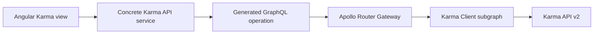

# Current holita integration

This reference maps the external API to existing code. The shared domain
[architecture](../../architecture.md#karma-client) remains authoritative for
application ownership and lifecycle rules.

## Request path and ownership

The browser talks to Gateway. The native Apollo Router forwards the signed session
to the independent NestJS Karma Client. Concrete services call `requireTenant`
before upstream access. The application-local `KarmaTransportModule` provides one
`KarmaTransport` for fixed HTTP paths, upstream authentication and JSON reads. Feature
services own multi-read operation deadlines, query construction, car-existence checks and response
mapping into generated GraphQL types. History and Location reuse CarsService for their
actual car lookup; other features use the transport directly. Runtime SDL is explicitly loaded by
[AppModule](../../../../apps/karma-client/src/app.module.ts).

There is no database, Prisma model, ingestion worker, polling loop, telemetry archive,
Fleet implementation import or persisted Karma-to-Fleet identity mapping in this
subgraph. Health is a local process check and does not establish upstream availability.

Fleet's separate [background configuration operations](../../architecture.md#background-device-configuration-reads)
call the Karma Client internal machine API. Fleet owns the Tenant/Branch Device,
explicit target selection, persisted operation, scheduler and saved observations.
Karma Client owns upstream authentication, target rechecks, fixed reads and the single-definition write
and bounded event parsing. Its request handler does not wait for the device response
and does not start a background worker in this subgraph.

`KARMA_API_URL`, `KARMA_USER` and `KARMA_PASSWORD` configure one server-side account;
`KARMA_CLIENT_GRAPHQL_URL` configures Gateway transport. Configuration is documented
in the single root [.env.example](../../../../.env.example), the
[development guide](../../development.md#karma-client), and the
[Router configuration](../../../../apps/gateway/router/router.yaml).
The internal machine endpoints require `KARMA_INTERNAL_TOKEN` with at least 32
characters. Fleet calls them using its configured `FLEET_KARMA_INTERNAL_URL`; browser
signed-session tokens do not authenticate this interface. Internal secrets remain
on the server and are not Gateway or admin configuration.

## Query, upstream and route mapping

Routes below follow `/:language/karma-client`, with `bg` or `en`. Every query is
authenticated and uses the common account regardless of active Branch.

| GraphQL query                                           | Concrete upstream operation                                 | Admin route / behavior                                                        |
| ------------------------------------------------------- | ----------------------------------------------------------- | ----------------------------------------------------------------------------- |
| `karmaCars`                                             | GET `/cars`                                                 | `/cars`; complete account list and Refresh                                    |
| `karmaCar(id: ID!)`                                     | GET `/cars/{id}`                                            | `/cars/:recordId`; matching single truck or missing state                     |
| `karmaEdata(input: KarmaEdataInput!)`                   | GET `/edata`                                                | `/cars/:recordId/edata`; message/parameter details and cursor history         |
| `karmaLocation(carId: ID!)`                             | GET `/location` plus car precheck                           | `/cars/:recordId/location`; also independently loaded summary in truck detail |
| `karmaTrips(input: KarmaTripsInput!)`                   | GET `/trips` plus car precheck and possible older lookahead | `/cars/:recordId/trips`; full row details and cursor history                  |
| `karmaEvents(input: KarmaEventsInput!)`                 | GET `/events` plus car precheck                             | `/cars/:recordId/events`; UTC/code filters, details and cursor history        |
| `karmaDrivingProfile(input: KarmaDrivingProfileInput!)` | GET `/driving-profile` plus car precheck                    | `/cars/:recordId/driving-profile`; editable period, nine raw categories       |
| `karmaProjects`                                         | GET `/projects`                                             | `/projects`; complete-list local search/paging and truck name lookups         |
| `karmaTimeZones`                                        | GET `/time-zones`                                           | `/time-zones`; complete-list local search/paging and name lookups             |
| `karmaVersion`                                          | GET `/version`, no upstream login                           | `/api-info`; original version text                                            |
| `karmaUsers`                                            | GET `/users`                                                | `/users`; local search/paging and all-field detail dialog                     |
| `karmaRoles`                                            | GET `/roles`                                                | `/roles`; local search/paging and original descriptions                       |

Sources: [routes](../../../../apps/admin/src/app/features/karma-client/karma.routes.ts),
feature-owned operations for [cars](../../../../apps/admin/src/app/features/karma-client/cars/operations.graphql),
[eData](../../../../apps/admin/src/app/features/karma-client/edata/operations.graphql),
[location](../../../../apps/admin/src/app/features/karma-client/location/operations.graphql),
[history](../../../../apps/admin/src/app/features/karma-client/history/operations.graphql),
[references](../../../../apps/admin/src/app/features/karma-client/references/operations.graphql)
and [accounts](../../../../apps/admin/src/app/features/karma-client/accounts/operations.graphql),
[fixed HTTP client](../../../../apps/karma-client/src/integrations/karma/karma-transport.ts).
There are no public Karma mutations or arbitrary REST proxy operations.

## Internal configuration API

The [DeviceConfigurationController](../../../../apps/karma-client/src/modules/device-configuration/device-configuration.controller.ts)
exposes six fixed POST endpoints under `/internal/device-configuration`, protected
by the [machine guard](../../../../apps/karma-client/src/modules/device-configuration/device-configuration.guard.ts).
They do not use the public Karma GraphQL scope or accept arbitrary upstream paths.

| Endpoint                | Input                                                                                   | Result                                                                      |
| ----------------------- | --------------------------------------------------------------------------------------- | --------------------------------------------------------------------------- |
| `/target`               | `carId`                                                                                 | Current matching car/device identity                                        |
| `/request`              | `carId`, `expectedDeviceId`                                                             | `ACCEPTED` and queue IDs, or `UNCERTAIN` without an automatic replay        |
| `/profile-request`      | `carId`, `expectedDeviceId`                                                             | `ACCEPTED` and queue IDs, or `UNCERTAIN`; fixed profile read                |
| `/parameter-request`    | `carId`, `expectedDeviceId`, `parameterId`, `reportingIntervalSeconds`, `rawDefinition` | One additive definition; same submission outcome                            |
| `/observations`         | `carId`, `expectedDeviceId`, `fromUtc`, `toUtc`, optional `afterMessageId`              | Bounded parsed `401` fragments, scan coverage and assembled readback status |
| `/profile-observations` | Same window/identity fields and optional watermark                                      | Separate bounded `416` profile observations and readback status             |

`/request` fixes payload `0702BC`, `/profile-request` fixes `1F`, and `/parameter-request`
constructs only `02` plus one 44-hex-character definition under the same
`30,1,19,0,19,301,0,1,1,` prefix. Parameter ID and interval must match the raw fields;
requested intervals are integers `0..65000`. No endpoint accepts a full command, arbitrary
operation byte or multiple definitions. The full definition is machine-only; Fleet owns
catalog/profile eligibility and construction from a verified preset or captured baseline.
Device identity is checked before submission and before reading observations.
Observation windows use canonical ISO UTC timestamps,
span at most 24 hours, and are rounded outward to the provider's whole-second
precision. Target/submission operations share a four-second upstream budget; observation
scans share 20 seconds across identity lookup, authentication and paging. Fleet allows
4.5 and 21 seconds respectively. No submission is replayed after an uncertain transport or
authentication result. Events at or below `afterMessageId` are excluded before parsing
and assembly. Scans stop after an empty page, reaching the watermark or four pages;
exhausting the page budget leaves coverage
incomplete. Returned fragments are limited to 64 observations and 1,000 total
definitions; truncation also prevents complete coverage.

The [parser](../../../../apps/karma-client/src/modules/device-configuration/configuration-response.ts)
retains original text and full definitions rather than deriving decoding fields or
parameter support from a catalog. Configuration-ID conflicts, contradictory
numbering/final markers and duplicate parameter IDs prevent a complete result. A
complete readback is structural configuration evidence, not queue acknowledgment or
verification that a signal is physically available. The independent
[profile parser](../../../../apps/karma-client/src/modules/device-configuration/profile-response.ts)
validates `416` payload `1F` without combining it with parameter fragments. Global settings,
profile writes, deletion/replacement, rules, firmware and device destinations are unsupported.
Fleet persists baseline, submitted definition, marker and independent full verification;
the complete lifecycle is defined in the linked architecture.

## Backend feature boundaries

| Feature                | Concrete implementation                                                                                                                                                             | Contract / mapping                                                                                                                                                                                                                                                                  |
| ---------------------- | ----------------------------------------------------------------------------------------------------------------------------------------------------------------------------------- | ----------------------------------------------------------------------------------------------------------------------------------------------------------------------------------------------------------------------------------------------------------------------------------- |
| Transport              | [KarmaTransport](../../../../apps/karma-client/src/integrations/karma/karma-transport.ts), [module](../../../../apps/karma-client/src/integrations/karma/karma-transport.module.ts) | Fixed upstream endpoints, shared session, authentication renewal and sanitized HTTP reads                                                                                                                                                                                           |
| Cars                   | [CarsService](../../../../apps/karma-client/src/modules/cars/cars.service.ts)                                                                                                       | [SDL](../../../../apps/karma-client/src/modules/cars/cars.graphql), [response](../../../../apps/karma-client/src/modules/cars/cars-response.ts)                                                                                                                                     |
| eData                  | [EdataService](../../../../apps/karma-client/src/modules/edata/edata.service.ts)                                                                                                    | [SDL](../../../../apps/karma-client/src/modules/edata/edata.graphql), [query](../../../../apps/karma-client/src/modules/edata/edata-query.ts), [response](../../../../apps/karma-client/src/modules/edata/edata-response.ts)                                                        |
| Internal configuration | [DeviceConfigurationService](../../../../apps/karma-client/src/modules/device-configuration/device-configuration.service.ts)                                                        | Fixed parameter/profile reads and one-definition additive write, identity checks, [input validation](../../../../apps/karma-client/src/modules/device-configuration/configuration-input.ts), separate parameter/profile parsing; Fleet owns eligibility, persistence and scheduling |
| Location               | [LocationService](../../../../apps/karma-client/src/modules/location/location.service.ts)                                                                                           | [SDL](../../../../apps/karma-client/src/modules/location/location.graphql), [response](../../../../apps/karma-client/src/modules/location/location-response.ts)                                                                                                                     |
| Trips/events/profile   | [HistoryService](../../../../apps/karma-client/src/modules/history/history.service.ts)                                                                                              | [SDL](../../../../apps/karma-client/src/modules/history/history.graphql), [query](../../../../apps/karma-client/src/modules/history/history-query.ts), [response](../../../../apps/karma-client/src/modules/history/history-response.ts)                                            |
| Projects/zones/version | [ReferencesService](../../../../apps/karma-client/src/modules/references/references.service.ts)                                                                                     | [SDL](../../../../apps/karma-client/src/modules/references/references.graphql), [response](../../../../apps/karma-client/src/modules/references/references-response.ts)                                                                                                             |
| Users/roles            | [AccountsService](../../../../apps/karma-client/src/modules/accounts/accounts.service.ts)                                                                                           | [SDL](../../../../apps/karma-client/src/modules/accounts/accounts.graphql), [response](../../../../apps/karma-client/src/modules/accounts/accounts-response.ts)                                                                                                                     |

SDL owns public API types, generated by the existing GraphQL toolchain. The
reconstructed REST schema is not currently wired into this toolchain. Backend
services enforce signed access, while input/response helpers define the concrete
subset accepted by holita. See [field mapping](data-models.md) and
[transport rules](transport-and-authentication.md).

## Frontend behavior

[KarmaWorkspace](../../../../apps/admin/src/app/features/karma-client/karma-workspace.ts)
mounts the selected route section using the captured session, language, truck and
section. Concrete view providers own Apollo clients/caches through
[KarmaApi](../../../../apps/admin/src/app/features/karma-client/karma-api.ts),
[KarmaEdataApi](../../../../apps/admin/src/app/features/karma-client/edata/karma-edata-api.ts)
and [KarmaHistoryApi](../../../../apps/admin/src/app/features/karma-client/history/karma-history-api.ts).
Their generated TypedDocumentNodes go through Gateway with `network-only` reads.
They capture the admin session and send no Branch context.

The section remains accessible when Fleet is disabled or Branch discovery fails.
Changing Branch remembers that selection without reloading Karma. Navigation,
language changes, truck changes, session replacement and logout retire old reads
and clients. Filter/period/cursor changes cancel obsolete reads and clear old rows;
same-query Refresh can retain the last successful result on error. There is no
automatic polling or command/write UI in the Karma section. The Fleet Device
configuration view consumes separately scoped persisted read/change operations through
Gateway; refreshing or leaving that view does not own the server-side job.

The car table requests all cars, not a server-paginated/searchable list. Its list
operation selects basic fields and timezone but omits `subType` and `driverCount`;
the detail operation selects them. Name hydration uses an independent projects/zones
query so failed reference lookup cannot hide truck data or original IDs.

Projects, time zones, users and roles load complete arrays and perform local
search/paging with exact totals for that loaded array. URL state uses `q`, `size`
and `first`; page sizes are 25/50/100, default 50. These totals do not imply history
totals or server completeness guarantees beyond the returned list.

eData/trips/events expose full row dialogs and Latest/Older/Newer cursor navigation.
Applied size, dates and parameter/event filters are URL-backed. User dialogs display
all eleven source fields and restore focus when closed. Text is escaped; `extra`
and role descriptions are not interpreted as HTML or authorization.

Driving profile starts from a seven-day range derived from the current UTC clock,
then submits its offset-free wall-clock strings. The period is editable and the UI
discloses the unresolved provider timezone. The nine source categories are shown
without a fabricated overall score, thresholds or units.

Location exposes all mapped fields and an OpenStreetMap link only when both
coordinates are valid. Map opening is a user action; no embedded map SDK or map
request runs automatically. A separate detail summary can fail independently of
the truck details. No online/offline badge is derived from timestamps or zero values.

## Existing verification coverage

This is a map of existing suites, not a record of an individual run. Commands and
prerequisites belong to [Discocan testing](../../testing.md#karma-client-checks).

| Layer                             | Suites / fixtures                                                                                                                                                                                                                                                                                                                                                                 | What they establish                                                                                                                                                                                                                               |
| --------------------------------- | --------------------------------------------------------------------------------------------------------------------------------------------------------------------------------------------------------------------------------------------------------------------------------------------------------------------------------------------------------------------------------- | ------------------------------------------------------------------------------------------------------------------------------------------------------------------------------------------------------------------------------------------------- |
| Backend transport                 | [cars.spec.ts](../../../../apps/karma-client/src/modules/cars/cars.spec.ts), [cars.service.spec.ts](../../../../apps/karma-client/src/modules/cars/cars.service.spec.ts)                                                                                                                                                                                                          | Fixed reads, canonical IDs, leading zeros, login sharing, renewal, missing details, bounded failures, sanitization and shared signed access                                                                                                       |
| eData                             | [edata.spec.ts](../../../../apps/karma-client/src/modules/edata/edata.spec.ts), [edata.service.spec.ts](../../../../apps/karma-client/src/modules/edata/edata.service.spec.ts)                                                                                                                                                                                                    | Traversal beyond fixture batch caps, snapshot cursors, UTC/array encoding, response/filter checks and signed access                                                                                                                               |
| Internal configuration operations | [device-configuration.spec.ts](../../../../apps/karma-client/src/modules/device-configuration/device-configuration.spec.ts), [configuration-transport.spec.ts](../../../../apps/karma-client/src/modules/device-configuration/configuration-transport.spec.ts), [parameter-write.spec.ts](../../../../apps/karma-client/src/modules/device-configuration/parameter-write.spec.ts) | Machine authentication, fixed read/profile/single-definition write, no uncertain replay, identity and definition checks, bounded paging, watermarks, separate profile evidence, malformed/conflicting multipart responses and unknown definitions |
| Location/references               | [location.spec.ts](../../../../apps/karma-client/src/modules/location/location.spec.ts)                                                                                                                                                                                                                                                                                           | All mapped fields, null/zero, selected fields, whole-operation signal, reference validation and signed public-version access                                                                                                                      |
| Histories/profile                 | [history.spec.ts](../../../../apps/karma-client/src/modules/history/history.spec.ts)                                                                                                                                                                                                                                                                                              | ID-bound paging, short-trip lookahead, event filtering, null/zero and nine categories                                                                                                                                                             |
| Accounts/health                   | [accounts.spec.ts](../../../../apps/karma-client/src/modules/accounts/accounts.spec.ts), [health.spec.ts](../../../../apps/karma-client/src/health/health.spec.ts)                                                                                                                                                                                                                | Eleven user fields, ordered memberships, duplicates, role text, authentication and local health                                                                                                                                                   |
| Angular                           | `karma-workspace.spec.ts`, `edata/edata-page/edata-page.spec.ts`, `location-references.spec.ts`, `history/history.spec.ts`, `accounts/accounts.spec.ts` in the Karma feature                                                                                                                                                                                                      | Captured clients, routes, filters, retained refresh data, escaping, dialogs, reference failure and cancellation                                                                                                                                   |
| Federation                        | [federation.db.spec.mts](../../../../tools/graphql/federation.db.spec.mts), [controlled Karma server](../../../../tools/graphql/karma-fixture.mts)                                                                                                                                                                                                                                | Real service boundaries with local controlled upstream and dedicated Core/Fleet schemas                                                                                                                                                           |
| Browser                           | Karma/eData smoke suites listed in the testing guide                                                                                                                                                                                                                                                                                                                              | Compiled-app routing, history/dialog interactions, refresh behavior and scoped navigation                                                                                                                                                         |

Deterministic fixtures establish holita behavior under controlled responses. They
do not establish provider uptime, permission to write, a complete field catalog,
non-null sensor/driver/video models, real active-trip mutation behavior, metric
units or timezone semantics. Live read observations complement these fixtures;
they do not replace them or constitute a full account/history audit.
