# Karma User Guide - Appendix for Partners - images

[Overview](README.md) · [Source content](content.md) · [Original PDF](source/original.pdf)

Analysis date: 2026-10-16 (Europe/Sofia). Descriptions distinguish illustrative UI/device examples from live data. Only images with documentary value are retained: technical illustrations, screenshots, UI controls and explanatory annotations. Standalone cover artwork, publisher logos and generic note/support markers are omitted. Transparency is composited onto white; retained page occurrences are recorded in metadata.json. Context captures preserve vector annotations. Image identifiers retain their original numbers, so gaps are intentional. Local reference edition: 1.1; updated 2026-10-17.

## Image 004

Driver icon used beside the Add driver step in the onboarding diagram.

Source: [p. 3](content.md#pdf-page-3).

## Image 005

Vehicle icon used beside the Add vehicle step in the onboarding diagram.

Source: [p. 3](content.md#pdf-page-3).

## Image 006

Fleet/edit icon used beside Create a fleet in the onboarding diagram.

Source: [p. 3](content.md#pdf-page-3).

## Image 007

Users/group icon used beside Add user in the onboarding diagram.

Source: [p. 3](content.md#pdf-page-3).

## Image 008

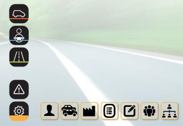

Karma home navigation with Settings selected and the fleet/user/vehicle/driver shortcuts visible.

Source: [p. 3](content.md#pdf-page-3).

## Image 009

Fleet/edit icon identifying the Fleets settings action.

Source: [p. 4](content.md#pdf-page-4).

## Image 010

Add new fleet button.

Source: [p. 4](content.md#pdf-page-4).

## Image 011

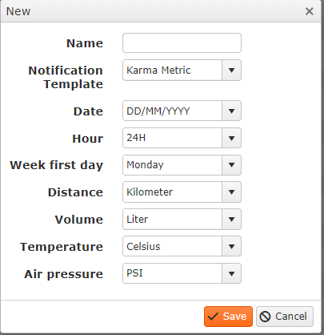

Fleet creation dialog with name, notification template, date/time preferences and unit-conversion choices.

Source: [p. 4](content.md#pdf-page-4).

## Image 012

Users/group icon identifying user settings.

Source: [p. 5](content.md#pdf-page-5).

## Image 013

Add new user button.

Source: [p. 5](content.md#pdf-page-5).

## Image 014

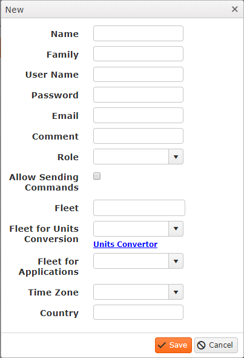

User creation form with identity, login fields, role, command permission, fleet and conversion preferences.

Source: [p. 5](content.md#pdf-page-5).

## Image 015

Arrow/callout overlay connecting user-form fields to explanatory labels.

Source: [p. 5](content.md#pdf-page-5).

## Image 016

Arrow/callout overlay connecting user-form fields to explanatory labels.

Source: [p. 5](content.md#pdf-page-5).

## Image 017

Arrow/callout overlay connecting user-form fields to explanatory labels.

Source: [p. 5](content.md#pdf-page-5).

## Image 018

Arrow/callout overlay connecting user-form fields to explanatory labels.

Source: [p. 5](content.md#pdf-page-5).

## Image 019

Add new vehicle button.

Source: [p. 6](content.md#pdf-page-6).

## Image 020

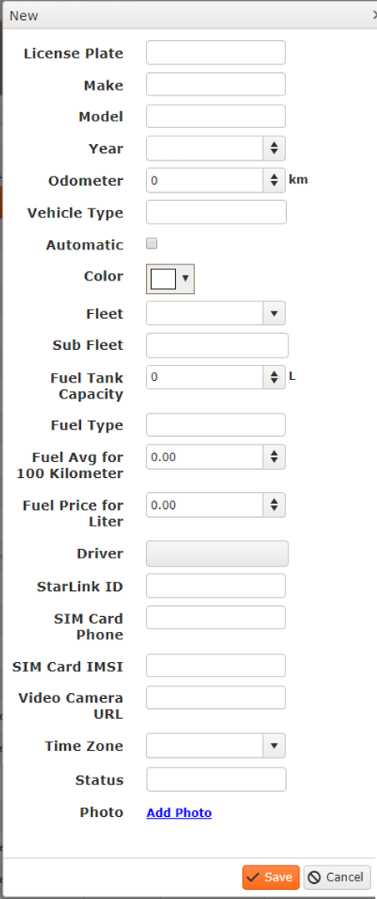

Vehicle creation form containing vehicle details, driver assignment, StarLink ID and SIM-related fields.

Source: [p. 6](content.md#pdf-page-6).

## Image 021

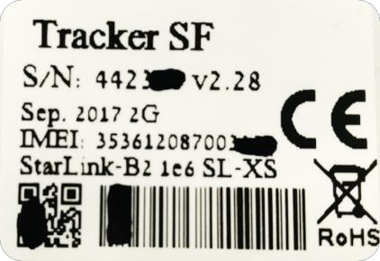

Example Tracker SF device label showing the location of the IMEI/StarLink identifier. Some identifier digits are obscured in the source.

Source: [p. 6](content.md#pdf-page-6).

## Image 022

Add new driver button.

Source: [p. 7](content.md#pdf-page-7).

## Image 023

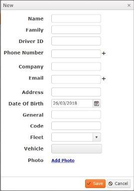

Driver creation form with unique driver ID, phone/contact fields, comments, code and vehicle assignment.

Source: [p. 7](content.md#pdf-page-7).

## Image 024

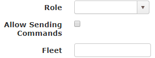

User-setting fragment showing the Allow Sending Commands checkbox and Fleet selection.

Source: [p. 8](content.md#pdf-page-8).

## Image 025

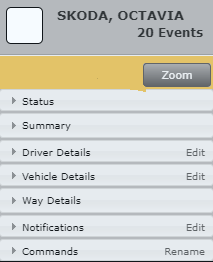

Vehicle card with its Commands section and Read Log entry.

Source: [p. 8](content.md#pdf-page-8).

## Image 026

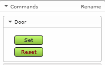

Output control expanded to show Set and Reset buttons for the named output Door.

Source: [p. 8](content.md#pdf-page-8).

## Image 027

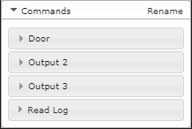

Commands panel with named outputs and Read Log, illustrating manual output renaming.

Source: [p. 8](content.md#pdf-page-8).

## Image 028

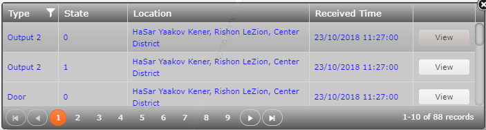

Commands log table with type, time, location, receiving time and view controls.

Source: [p. 9](content.md#pdf-page-9).

## Image 029

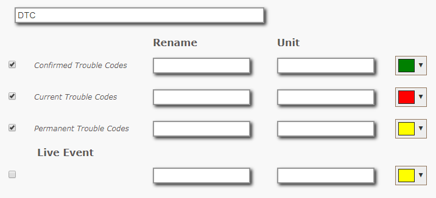

DTC configuration panel for confirmed/current/permanent trouble codes and live events, with colors and units.

Source: [p. 9](content.md#pdf-page-9).

## Image 030

Narrow example DTC report header; the source is small and its text should be checked in the PDF at higher zoom.

Source: [p. 9](content.md#pdf-page-9).

## Illustrations in page context

These rendered crops include arrows, callout text, vector diagrams and table geometry that are separate PDF objects. Refer to the image descriptions above and the corresponding source text for their meaning.

### PDF page 3

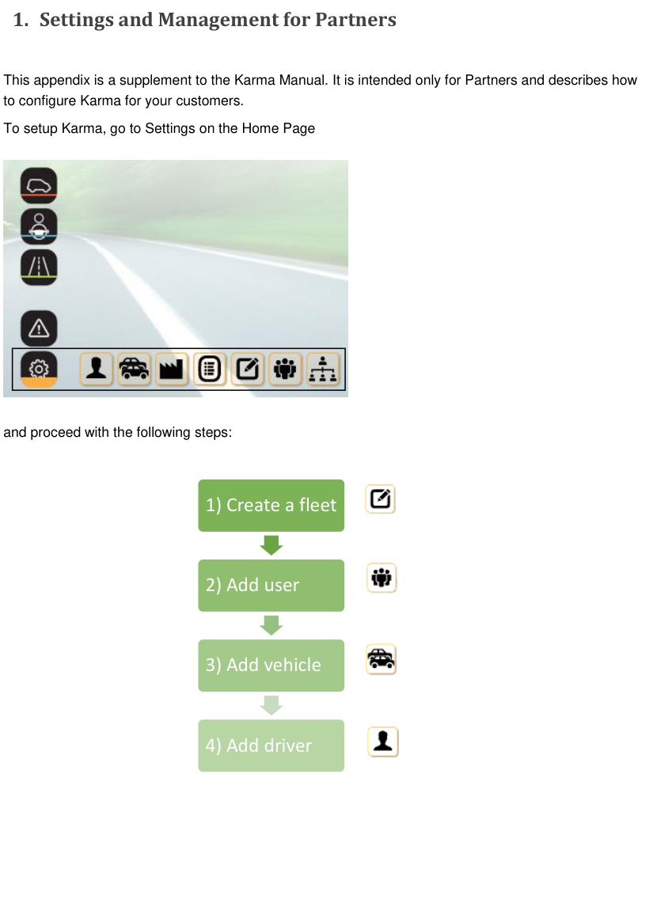

[Read the page text](content.md#pdf-page-3).

### PDF page 4

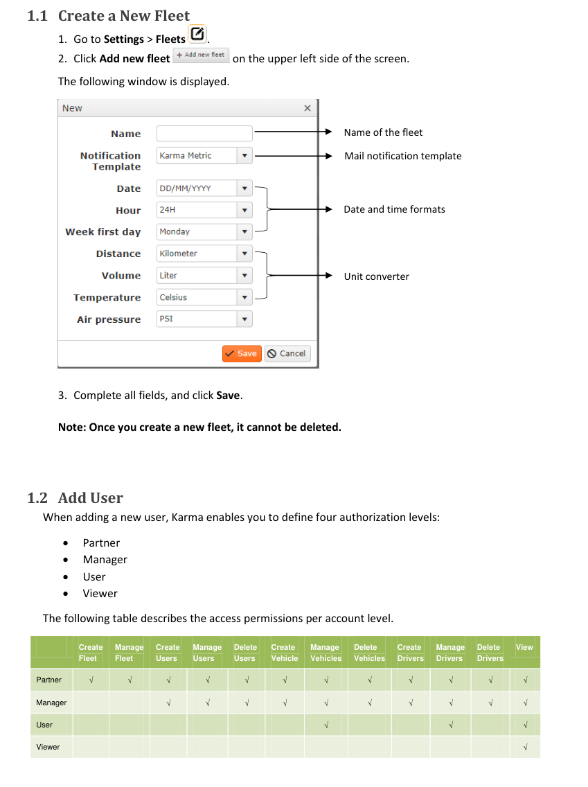

[Read the page text](content.md#pdf-page-4).

### PDF page 5

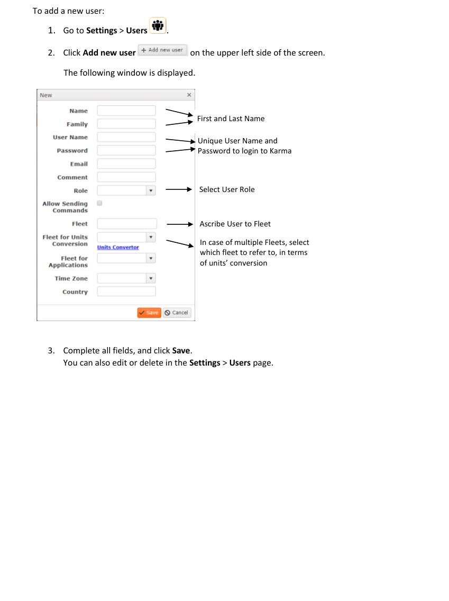

[Read the page text](content.md#pdf-page-5).

### PDF page 6

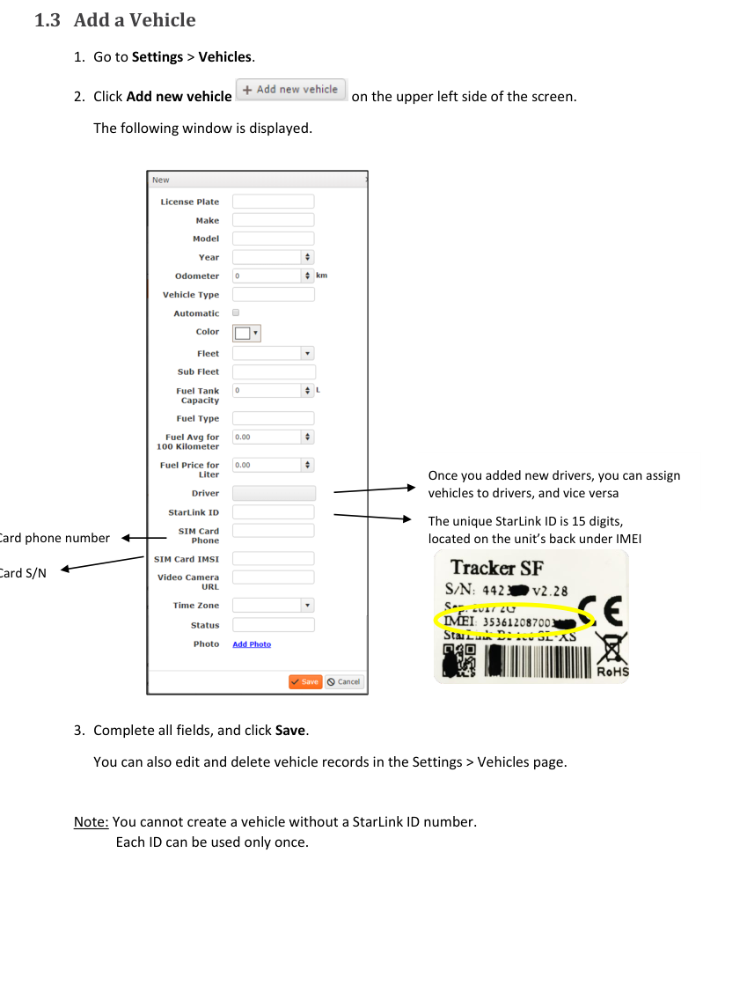

[Read the page text](content.md#pdf-page-6).

### PDF page 7

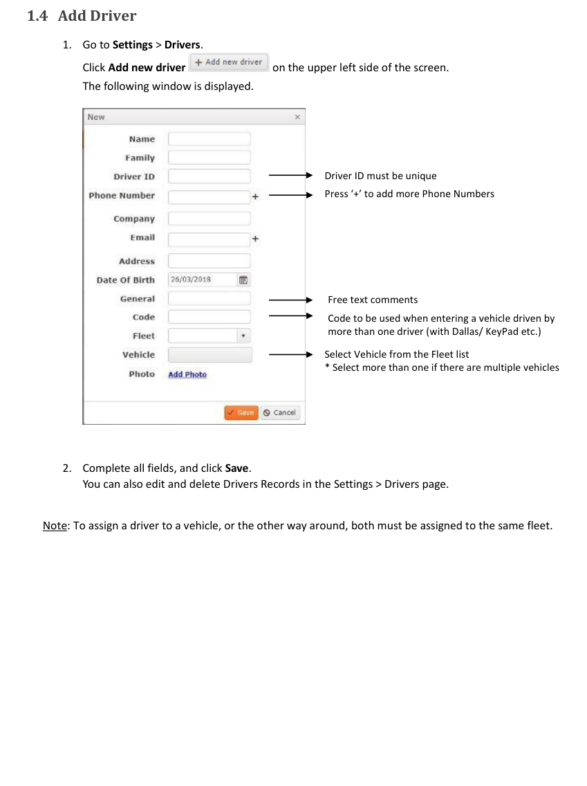

[Read the page text](content.md#pdf-page-7).
