# Karma User Guide - images

[Overview](README.md) · [Source content](content.md) · [Original PDF](source/original.pdf)

Analysis date: 2026-10-16 (Europe/Sofia). Descriptions distinguish illustrative UI/device examples from live data. Only images with documentary value are retained: technical illustrations, screenshots, UI controls and explanatory annotations. Standalone cover artwork, publisher logos and generic note/support markers are omitted. Transparency is composited onto white; retained page occurrences are recorded in metadata.json. Context captures preserve vector annotations. Image identifiers retain their original numbers, so gaps are intentional. Local reference edition: 1.1; updated 2026-10-17.

## Image 005

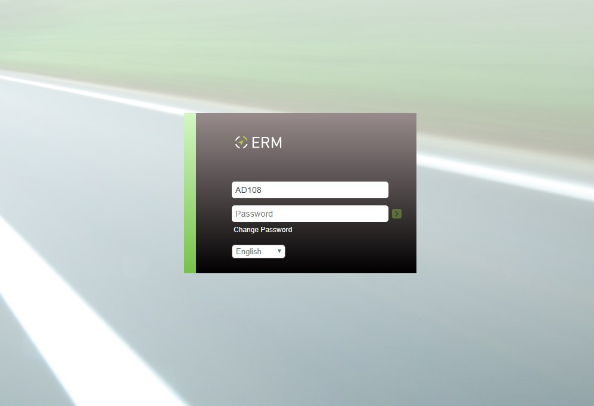

Historical Karma login screen with username, password and language controls.

Source: [p. 5](content.md#pdf-page-5).

## Image 007

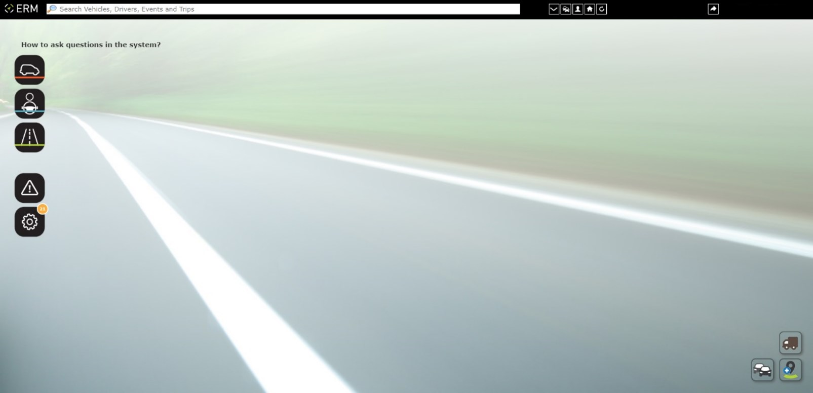

Karma home screen with question field, left navigation and quick-launch shortcuts; page annotations explain navigation.

Source: [p. 6](content.md#pdf-page-6).

## Image 008

Driver shortcut icon.

Source: [p. 6](content.md#pdf-page-6).

## Image 009

Vehicles shortcut icon.

Source: [p. 6](content.md#pdf-page-6).

## Image 010

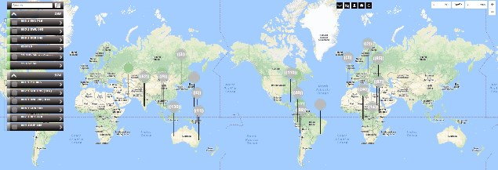

World-map fleet overview with vehicle cards on the left.

Source: [p. 6](content.md#pdf-page-6).

## Image 011

Hide/open search toolbar icon.

Source: [p. 6](content.md#pdf-page-6).

## Image 012

Vehicle-location quick-launch icon.

Source: [p. 6](content.md#pdf-page-6).

## Image 013

Driver-location quick-launch icon.

Source: [p. 6](content.md#pdf-page-6).

## Image 014

Home-page quick-launch icon.

Source: [p. 6](content.md#pdf-page-6).

## Image 015

Refresh quick-launch icon.

Source: [p. 6](content.md#pdf-page-6).

## Image 016

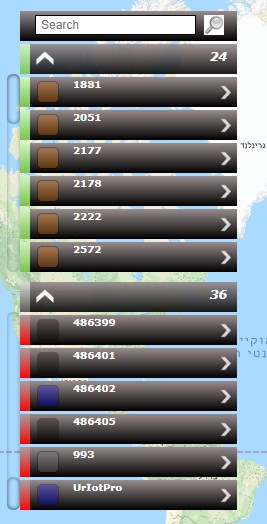

Scrollable vehicle-card list with search and colored ignition/connection indicators.

Source: [p. 7](content.md#pdf-page-7).

## Image 017

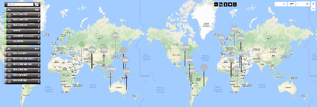

Fleet world map showing vehicle positions and the left vehicle-card list.

Source: [p. 7](content.md#pdf-page-7).

## Image 018

Green, gray and red status swatches explaining ignition on, ignition off and no server connection.

Source: [p. 7](content.md#pdf-page-7).

## Image 019

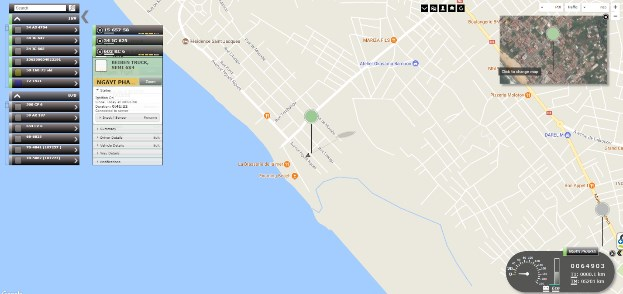

Zoomed vehicle map with the selected vehicle card, mini-map and dashboard gauge.

Source: [p. 8](content.md#pdf-page-8).

## Image 020

Small expand/open control referenced by the map-information instructions.

Source: [p. 8](content.md#pdf-page-8).

## Image 021

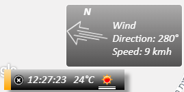

Weather and wind information overlays displaying direction, speed, time and temperature.

Source: [p. 9](content.md#pdf-page-9).

## Image 022

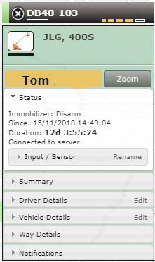

Expanded vehicle card with status, summary, driver, vehicle, trip and notification sections.

Source: [p. 9](content.md#pdf-page-9).

## Image 023

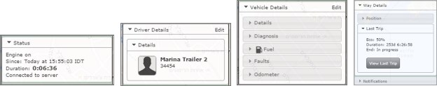

Separate detail panes expanded from a vehicle card, including summary, driver, vehicle and way details.

Source: [p. 9](content.md#pdf-page-9).

## Image 024

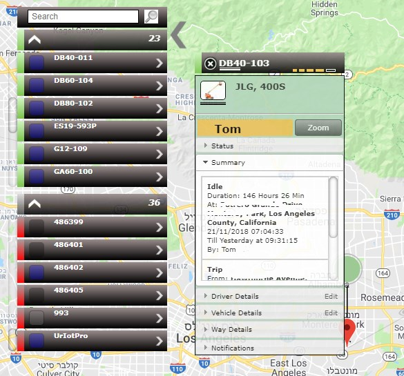

Vehicle list and expanded card over the map, used to explain summary labels and scrolling.

Source: [p. 10](content.md#pdf-page-10).

## Image 025

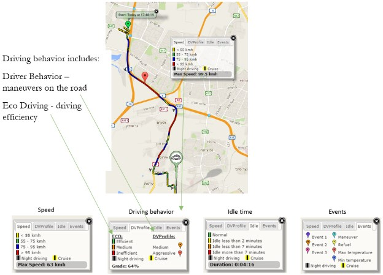

Annotated trip map with speed, driving behavior, idle-time and event panes.

Source: [p. 10](content.md#pdf-page-10).

## Image 026

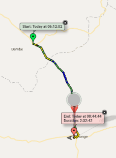

Trip path with start/end markers and a colored route.

Source: [p. 10](content.md#pdf-page-10).

## Image 027

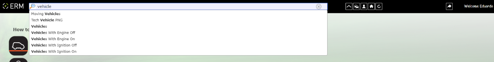

Natural-language question field with suggestions on the home page.

Source: [p. 11](content.md#pdf-page-11).

## Image 028

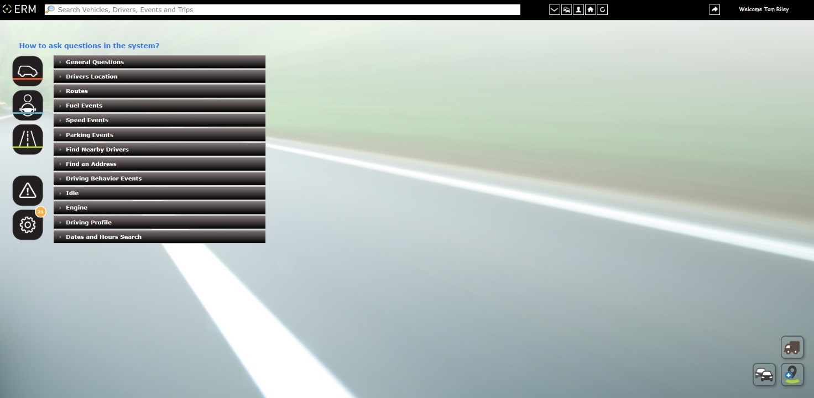

Home screen with the categorized question menu open.

Source: [p. 11](content.md#pdf-page-11).

## Image 029

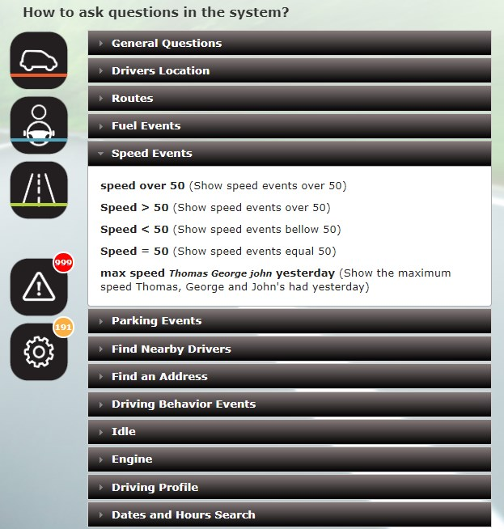

Expanded question menu showing categories and specific query examples.

Source: [p. 12](content.md#pdf-page-12).

## Image 030

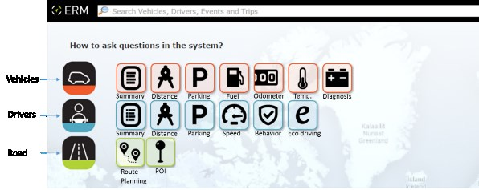

Report-type icon grid organized into vehicle, driver and fleet categories.

Source: [p. 12](content.md#pdf-page-12).

## Image 031

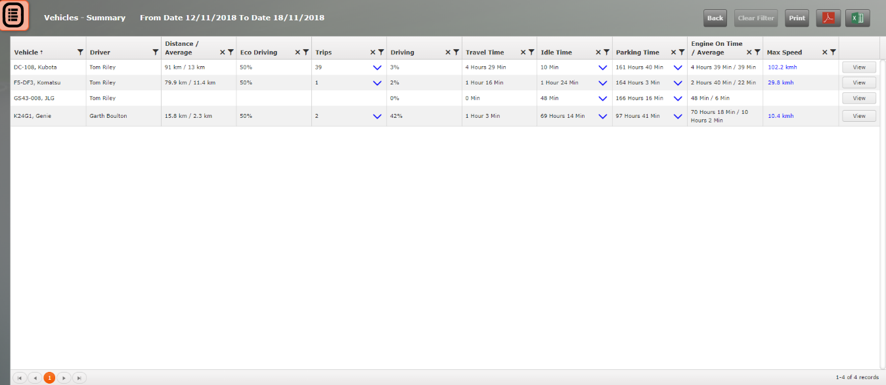

Generated tabular report with vehicles/drivers and report values.

Source: [p. 13](content.md#pdf-page-13).

## Image 032

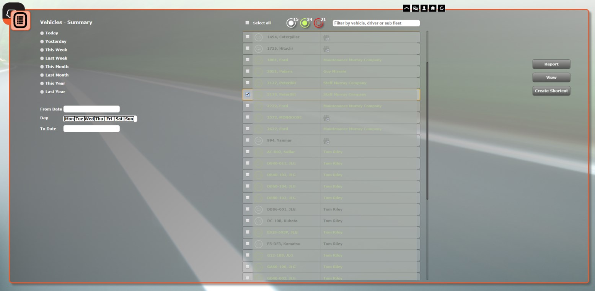

Report wizard used to choose date period, vehicles/drivers and output view.

Source: [p. 13](content.md#pdf-page-13).

## Image 033

Expand-row chevron used to display record details.

Source: [p. 14](content.md#pdf-page-14).

## Image 034

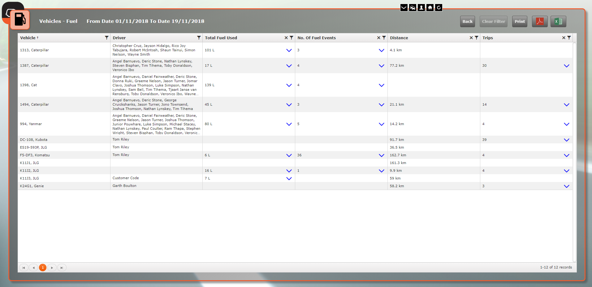

Report table expanded to display a selected record in more detail.

Source: [p. 14](content.md#pdf-page-14).

## Image 035

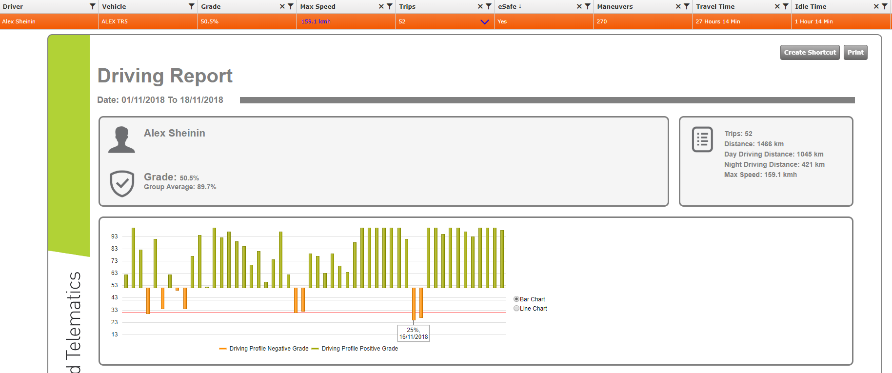

Driving Report with bar-chart visualization and a trip summary.

Source: [p. 14](content.md#pdf-page-14).

## Image 037

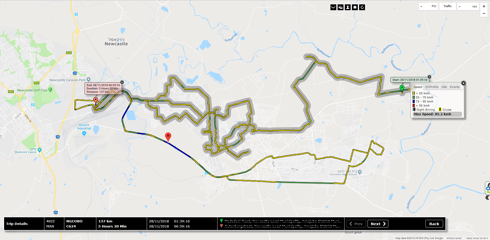

Trip route displayed on a map with a color legend.

Source: [p. 15](content.md#pdf-page-15).

## Image 038

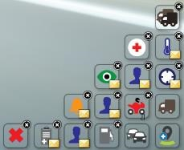

Saved report/question shortcut icons, including envelope markers for emailed reports.

Source: [p. 15](content.md#pdf-page-15).

## Image 039

Shortcut edit/delete control shown beside saved shortcuts.

Source: [p. 15](content.md#pdf-page-15), [p. 16](content.md#pdf-page-16).

## Image 040

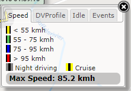

Speed legend with colored ranges, night-driving/cruise indicators and an example maximum speed.

Source: [p. 15](content.md#pdf-page-15).

## Image 041

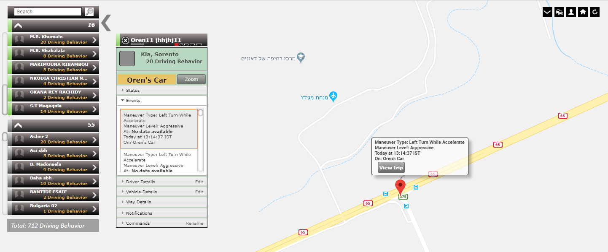

Driving-behavior event map with a vehicle card, maneuver description and location callout.

Source: [p. 16](content.md#pdf-page-16).

## Image 042

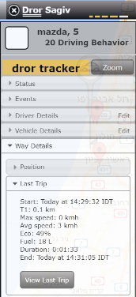

Driver/vehicle card with Way Details expanded.

Source: [p. 17](content.md#pdf-page-17).

## Image 043

Driver report-category icons, with Behavior highlighted.

Source: [p. 17](content.md#pdf-page-17).

## Image 044

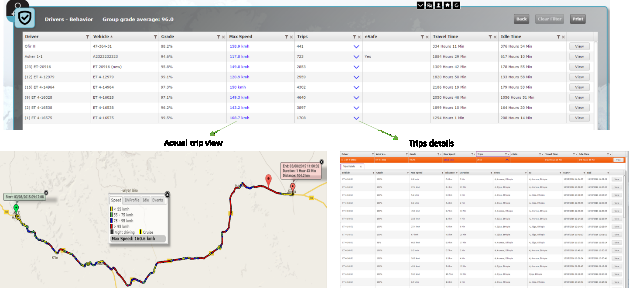

Driving-behavior table linked to a mapped trip and event detail list.

Source: [p. 17](content.md#pdf-page-17).

## Image 045

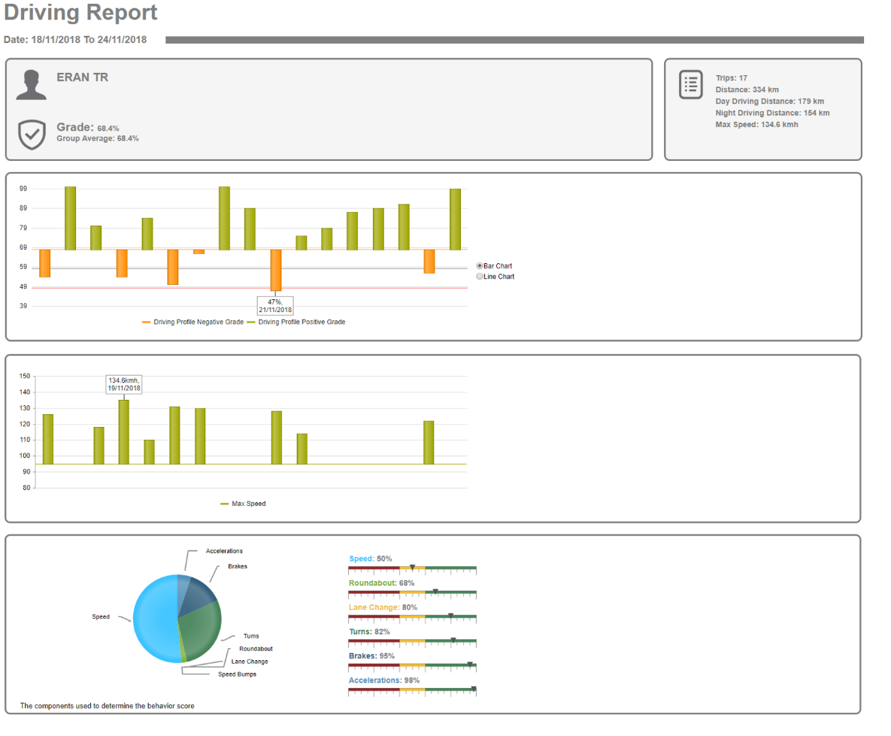

Driving Report combining behavior grades, speed bars and a pie chart of behavior categories; example data only.

Source: [p. 18](content.md#pdf-page-18).

## Image 046

Fleet dashboard launcher icon.

Source: [p. 19](content.md#pdf-page-19).

## Image 047

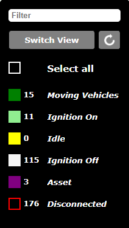

Dashboard status filter with moving, ignition on/off, idle, asset and disconnected categories.

Source: [p. 19](content.md#pdf-page-19).

## Image 048

Table-edge resize handles used by the dashboard instructions.

Source: [p. 20](content.md#pdf-page-20).

## Image 049

Fleet dashboard icon used while creating a sub-fleet.

Source: [p. 20](content.md#pdf-page-20).

## Image 050

Switch View button.

Source: [p. 20](content.md#pdf-page-20).

## Image 051

Add Shortcut button used in the sub-fleet procedure.

Source: [p. 20](content.md#pdf-page-20).

## Image 052

Create button used to save a sub-fleet.

Source: [p. 20](content.md#pdf-page-20).

## Image 053

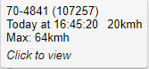

Speed chart tooltip with vehicle, time, current speed and maximum speed.

Source: [p. 20](content.md#pdf-page-20).

## Image 054

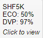

Driving-profile tooltip with example ECO and DVP percentages.

Source: [p. 20](content.md#pdf-page-20).

## Image 055

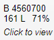

Fuel tooltip with example tank quantity and percentage; these are illustrative values.

Source: [p. 21](content.md#pdf-page-21).

## Image 056

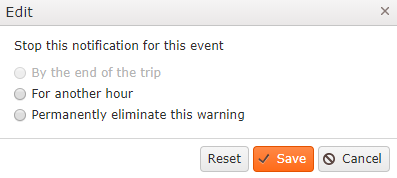

Notification edit dialog offering temporary or permanent suppression and save/cancel controls.

Source: [p. 21](content.md#pdf-page-21).

## Image 057

Road navigation icon.

Source: [p. 22](content.md#pdf-page-22), [p. 23](content.md#pdf-page-23), [p. 24](content.md#pdf-page-24).

## Image 058

POI toolbar icons.

Source: [p. 22](content.md#pdf-page-22), [p. 23](content.md#pdf-page-23).

## Image 059

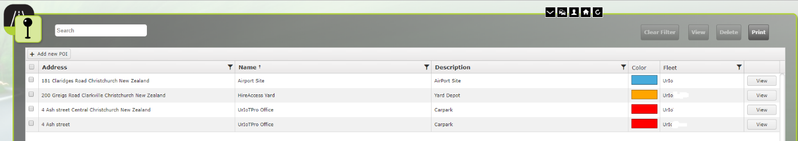

Color-coded POI list with address/name and fleet-related columns.

Source: [p. 22](content.md#pdf-page-22).

## Image 060

Filter funnel icon for list columns.

Source: [p. 22](content.md#pdf-page-22).

## Image 061

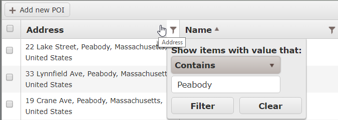

POI address filter using a Contains condition.

Source: [p. 22](content.md#pdf-page-22).

## Image 062

Add new POI button.

Source: [p. 22](content.md#pdf-page-22).

## Image 063

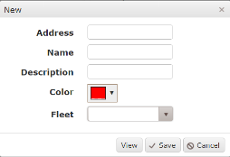

POI creation form with address, name, description, color and fleet.

Source: [p. 22](content.md#pdf-page-22).

## Image 064

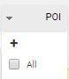

Map-side POI control with add and select-all options.

Source: [p. 23](content.md#pdf-page-23).

## Image 065

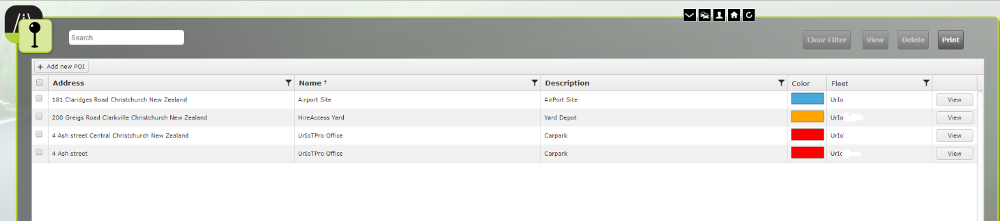

POI list used to choose a point for map display.

Source: [p. 23](content.md#pdf-page-23).

## Image 066

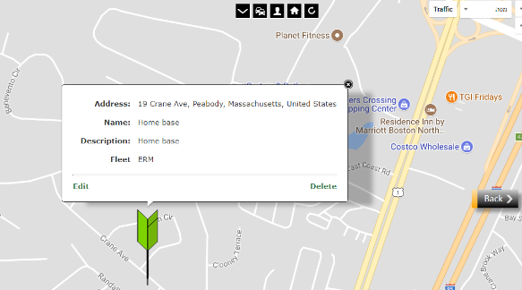

POI map marker with a details balloon.

Source: [p. 23](content.md#pdf-page-23).

## Image 067

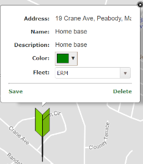

Editable POI balloon with name, description, color, fleet, save and delete controls.

Source: [p. 24](content.md#pdf-page-24).

## Image 068

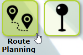

Route Planning toolbar icon.

Source: [p. 24](content.md#pdf-page-24).

## Image 069

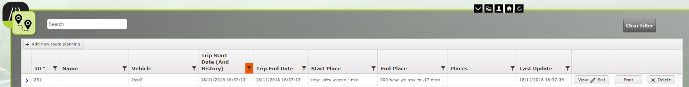

Route-planning list shown before or after a route is created.

Source: [p. 24](content.md#pdf-page-24), [p. 27](content.md#pdf-page-27).

## Image 070

Add new route planning button.

Source: [p. 24](content.md#pdf-page-24).

## Image 071

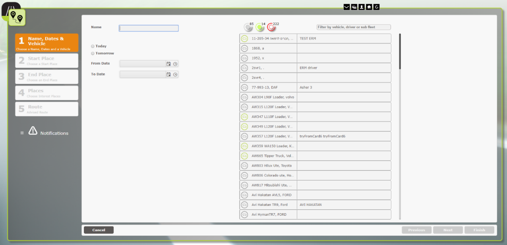

Route wizard assignment/date stage with vehicle or driver selection.

Source: [p. 25](content.md#pdf-page-25).

## Image 072

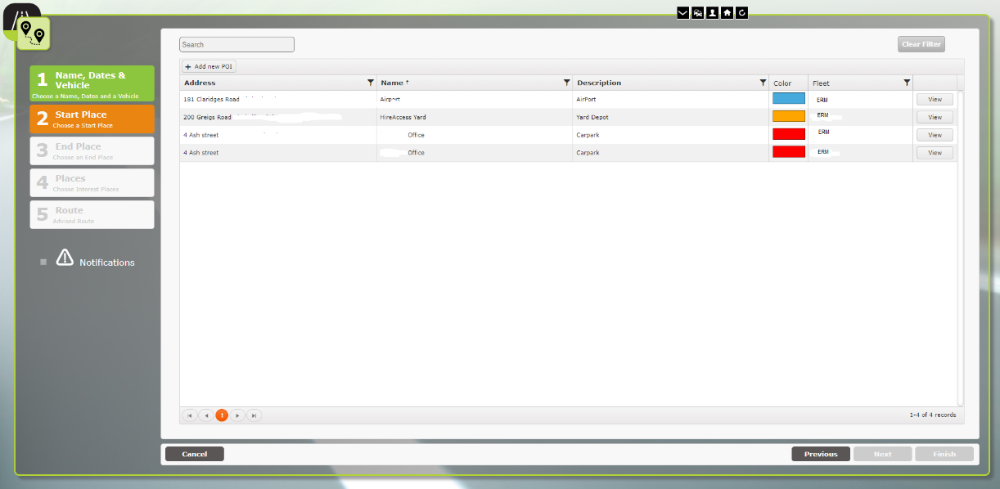

Route wizard Start Place stage with a list of candidate POIs.

Source: [p. 25](content.md#pdf-page-25).

## Image 073

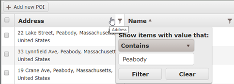

Route POI address filter using Contains.

Source: [p. 26](content.md#pdf-page-26).

## Image 074

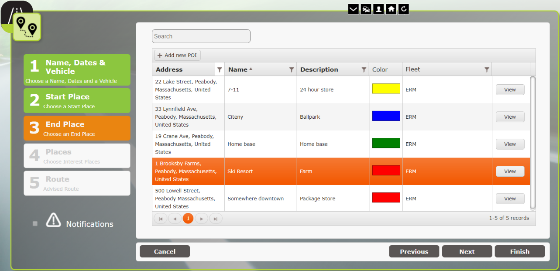

Route wizard End Place stage with selectable colored POIs.

Source: [p. 26](content.md#pdf-page-26).

## Image 075

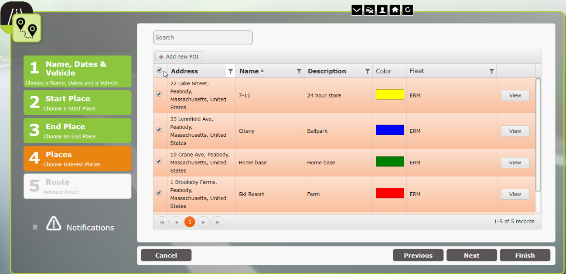

Route wizard Places stage for intermediate points between start and end.

Source: [p. 26](content.md#pdf-page-26).

## Image 076

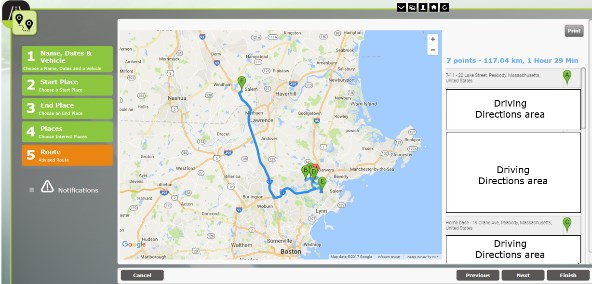

Advised route map with stop/distance/travel-time information in the side panel.

Source: [p. 27](content.md#pdf-page-27).

## Image 077

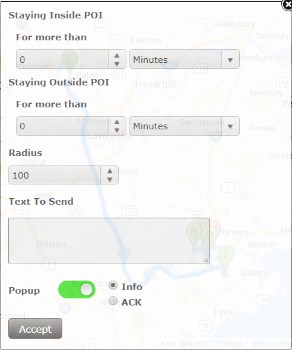

Route notification dialog for inside/outside duration, radius, message text and notification type.

Source: [p. 27](content.md#pdf-page-27).

## Image 078

Notification navigation icon.

Source: [p. 28](content.md#pdf-page-28).

## Image 079

Create/Edit notification icon.

Source: [p. 28](content.md#pdf-page-28).

## Image 080

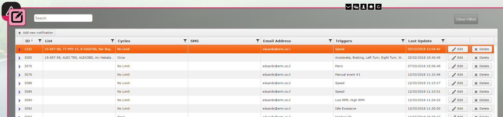

Notifications list with add, edit and delete controls.

Source: [p. 28](content.md#pdf-page-28).

## Image 081

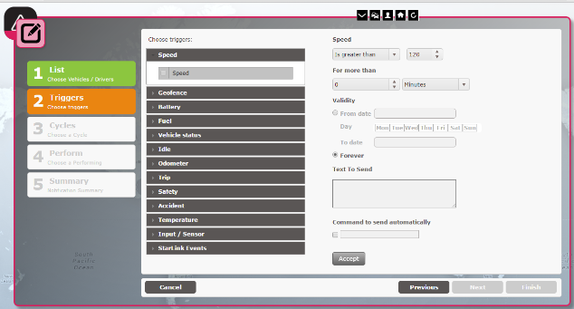

Notification wizard for selecting vehicles/drivers and configuring the event query.

Source: [p. 28](content.md#pdf-page-28).

## Image 082

Quick-launch group showing Fleet, Vehicles and Add new shortcut.

Source: [p. 29](content.md#pdf-page-29).

## Image 083

Add new shortcut icon.

Source: [p. 29](content.md#pdf-page-29), [p. 31](content.md#pdf-page-31).

## Image 084

Shortcut wizard with icon selection and description input.

Source: [p. 30](content.md#pdf-page-30).

## Image 085

Question-shortcut wizard with query suggestions.

Source: [p. 30](content.md#pdf-page-30).

## Image 086

Report-shortcut wizard with icon selection.

Source: [p. 31](content.md#pdf-page-31).

## Image 087

Question input area that can be skipped when creating a report shortcut.

Source: [p. 31](content.md#pdf-page-31).

## Image 088

Report-category selection in the shortcut wizard.

Source: [p. 31](content.md#pdf-page-31).

## Image 089

Settings home view used to access drivers, vehicles, assets, fleets and users.

Source: [p. 33](content.md#pdf-page-33).

## Image 090

Drivers settings icon.

Source: [p. 33](content.md#pdf-page-33).

## Image 091

Vehicles settings icon.

Source: [p. 33](content.md#pdf-page-33).

## Image 092

Assets settings icon.

Source: [p. 33](content.md#pdf-page-33).

## Image 093

Fleets settings icon.

Source: [p. 33](content.md#pdf-page-33).

## Image 094

Users settings icon.

Source: [p. 33](content.md#pdf-page-33).

## Image 095

Questions history/settings icon.

Source: [p. 33](content.md#pdf-page-33).

## Image 096

Disconnected vehicles icon for vehicles disconnected longer than 48 hours, as described by the guide.

Source: [p. 33](content.md#pdf-page-33).

## Image 097

Fuel settings icon.

Source: [p. 34](content.md#pdf-page-34).

## Image 098

Fuel-report wizard with date/vehicle/driver selection.

Source: [p. 34](content.md#pdf-page-34).

## Image 099

Fuel details list with no records added in the illustrated example.

Source: [p. 34](content.md#pdf-page-34).

## Image 100

Add new fuel details button.

Source: [p. 34](content.md#pdf-page-34).

## Image 101

Fuel entry form for date, volume, odometer, location and receipt upload.

Source: [p. 34](content.md#pdf-page-34).

## Image 102

Maintenance settings icon.

Source: [p. 35](content.md#pdf-page-35).

## Image 103

Add new maintenance details button.

Source: [p. 35](content.md#pdf-page-35).

## Image 104

Maintenance form for dates, odometer thresholds, service type, replaced parts, location, comments and receipt.

Source: [p. 35](content.md#pdf-page-35).

## Image 105

Tires settings icon.

Source: [p. 36](content.md#pdf-page-36).

## Image 106

Vehicle schematic with tire positions and red plus signs, including a spare position.

Source: [p. 36](content.md#pdf-page-36).

## Image 107

Red plus icon used to add a tire at a selected position.

Source: [p. 36](content.md#pdf-page-36).

## Image 108

Edit Tire dialog for size, tire/vehicle odometer, replacement threshold, pressure and replacement date.

Source: [p. 36](content.md#pdf-page-36).

## Image 109

New-vehicle form fragment with a manually entered odometer.

Source: [p. 37](content.md#pdf-page-37).

## Image 110

Vehicle Details odometer editor with Save and Cancel controls.

Source: [p. 37](content.md#pdf-page-37).

## Image 111

Dashboard gauge with the odometer area marked as editable.

Source: [p. 37](content.md#pdf-page-37).

## Image 112

Wind/temperature overlay illustrating the information available from a double-line control.

Source: [p. 38](content.md#pdf-page-38).

## Image 113

Economical-driving tooltip over the vehicle dashboard.

Source: [p. 38](content.md#pdf-page-38).

## Image 114

Satellite map view with the map-type control.

Source: [p. 38](content.md#pdf-page-38).

## Image 115

Street View illustration used to inspect road conditions behind a reported driving event.

Source: [p. 38](content.md#pdf-page-38).

## Illustrations in page context

These rendered crops include arrows, callout text, vector diagrams and table geometry that are separate PDF objects. Refer to the image descriptions above and the corresponding source text for their meaning.

### PDF page 6

[Read the page text](content.md#pdf-page-6).

### PDF page 7

[Read the page text](content.md#pdf-page-7).

### PDF page 8

[Read the page text](content.md#pdf-page-8).

### PDF page 9

[Read the page text](content.md#pdf-page-9).

### PDF page 10

[Read the page text](content.md#pdf-page-10).

### PDF page 13

[Read the page text](content.md#pdf-page-13).

### PDF page 16

[Read the page text](content.md#pdf-page-16).

### PDF page 18

[Read the page text](content.md#pdf-page-18).

### PDF page 29

[Read the page text](content.md#pdf-page-29).
