# Simple eData Monitor Configuration Guide - images

[Overview](README.md) · [Source content](content.md) · [Original PDF](source/original.pdf)

Analysis date: 2026-10-16 (Europe/Sofia). Descriptions distinguish illustrative UI/device examples from live data. Only images with documentary value are retained: technical illustrations, screenshots, UI controls and explanatory annotations. Standalone cover artwork, publisher logos and generic note/support markers are omitted. Transparency is composited onto white; retained page occurrences are recorded in metadata.json. Context captures preserve vector annotations. Image identifiers retain their original numbers, so gaps are intentional. Local reference edition: 1.1; updated 2026-10-17.

## Image 002

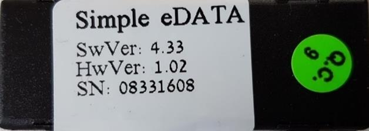

Sample Simple eDATA device label showing software 4.33 and hardware 1.02; these are not the guide release number.

Source: [p. 1](content.md#pdf-page-1).

## Image 004

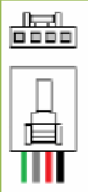

Four-pin connector orientation drawing with the colored wires shown underneath.

Source: [p. 4](content.md#pdf-page-4).

## Image 005

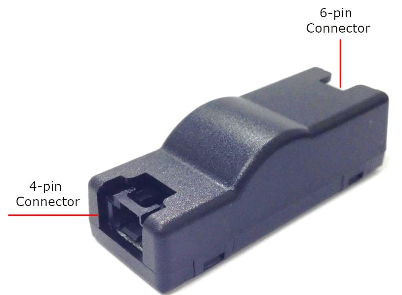

Simple eData hardware photograph with arrows identifying the 4-pin and 6-pin connectors.

Source: [p. 4](content.md#pdf-page-4).

## Image 006

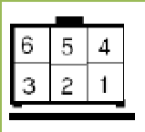

Six-pin connector face diagram: upper row 6, 5, 4 and lower row 3, 2, 1.

Source: [p. 5](content.md#pdf-page-5).

## Image 007

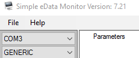

Monitor connection controls showing COM3 and GENERIC; the screenshot title says monitor version 7.21.

Source: [p. 6](content.md#pdf-page-6).

## Image 008

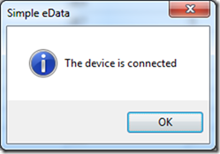

Connection confirmation dialog: The device is connected.

Source: [p. 6](content.md#pdf-page-6).

## Image 009

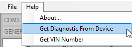

Help menu with Get Diagnostic from Device selected.

Source: [p. 6](content.md#pdf-page-6).

## Image 011

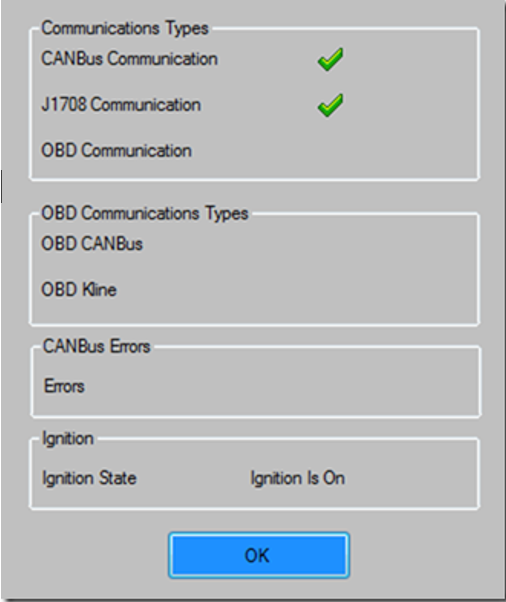

Diagnostic dialog showing communication types, CANBus errors and ignition state.

Source: [p. 7](content.md#pdf-page-7).

## Image 012

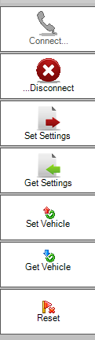

Vertical action toolbar with connect/disconnect, settings, vehicle and reset actions.

Source: [p. 7](content.md#pdf-page-7).

## Image 013

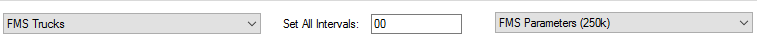

Vehicle category/type and interval controls used by Get Vehicle and parameter selection.

Source: [p. 8](content.md#pdf-page-8).

## Image 014

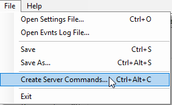

File menu with settings/event-log loading, save options and Create Server Commands.

Source: [p. 8](content.md#pdf-page-8).

## Image 015

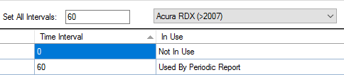

Parameter interval example showing zero as Not In Use and a positive interval as periodic reporting.

Source: [p. 9](content.md#pdf-page-9).

## Image 016

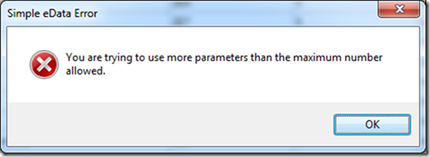

Error dialog warning that more than the maximum number of parameters were selected.

Source: [p. 9](content.md#pdf-page-9).

## Image 017

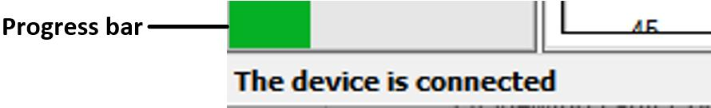

Storage progress bar and connected-device status indicator.

Source: [p. 10](content.md#pdf-page-10).

## Image 018

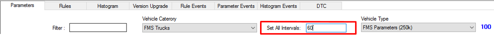

Parameter list with the Filter field highlighted.

Source: [p. 10](content.md#pdf-page-10).

## Image 019

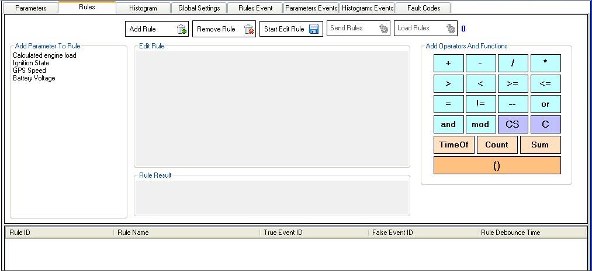

Rules editor with parameter list, expression area, operator palette and saved-rules grid.

Source: [p. 11](content.md#pdf-page-11).

## Image 020

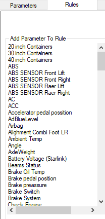

Available parameters panel for building a rule.

Source: [p. 12](content.md#pdf-page-12).

## Image 021

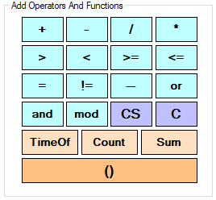

Operator/function palette containing arithmetic, relational, logical, TimeOf, Count and Sum controls.

Source: [p. 12](content.md#pdf-page-12).

## Image 022

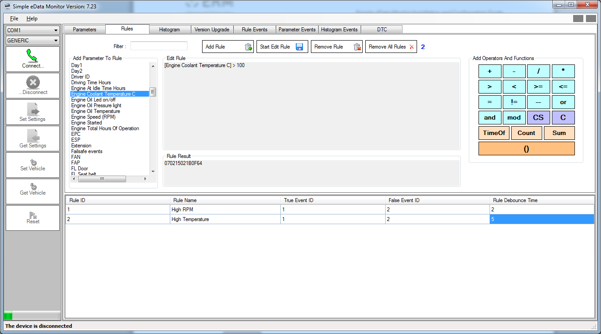

Saved rule selected in the rules grid below the editor.

Source: [p. 13](content.md#pdf-page-13).

## Image 023

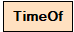

TimeOf function button.

Source: [p. 13](content.md#pdf-page-13).

## Image 024

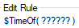

TimeOf expression placeholder before selecting a parameter.

Source: [p. 13](content.md#pdf-page-13).

## Image 025

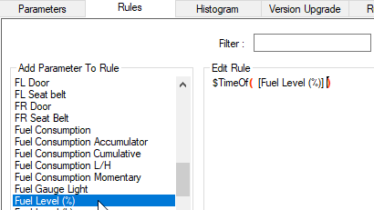

Fuel Level (%) parameter selected in the TimeOf expression editor.

Source: [p. 14](content.md#pdf-page-14).

## Image 026

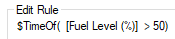

TimeOf expression testing Fuel Level (%) greater than 50.

Source: [p. 14](content.md#pdf-page-14).

## Image 027

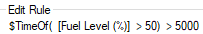

TimeOf condition with a greater-than-5000 duration threshold; the text describes milliseconds.

Source: [p. 14](content.md#pdf-page-14).

## Image 028

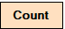

Count function button.

Source: [p. 14](content.md#pdf-page-14).

## Image 029

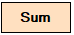

Sum function button.

Source: [p. 14](content.md#pdf-page-14).

## Image 030

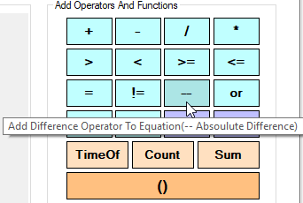

Absolute-difference operator highlighted in the operator palette.

Source: [p. 15](content.md#pdf-page-15).

## Image 031

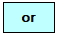

or logical operator button.

Source: [p. 15](content.md#pdf-page-15).

## Image 032

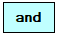

and logical operator button.

Source: [p. 15](content.md#pdf-page-15).

## Image 033

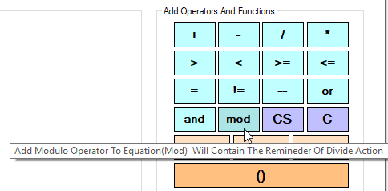

mod operator tooltip explaining division remainder.

Source: [p. 15](content.md#pdf-page-15).

## Image 034

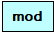

mod operator button.

Source: [p. 15](content.md#pdf-page-15).

## Image 035

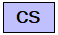

CS clear-spaces control.

Source: [p. 15](content.md#pdf-page-15).

## Image 036

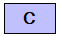

C clear-text control.

Source: [p. 15](content.md#pdf-page-15).

## Image 037

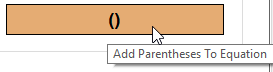

Parentheses control and its Add Parentheses To Equation tooltip.

Source: [p. 15](content.md#pdf-page-15).

## Image 038

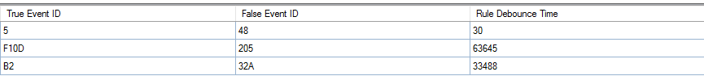

Rule grid with True Event ID, False Event ID and Rule Debounce Time columns.

Source: [p. 16](content.md#pdf-page-16).

## Image 039

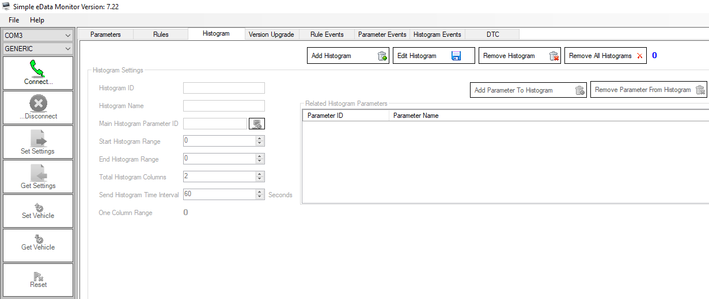

Histogram tab with the Add Histogram action.

Source: [p. 18](content.md#pdf-page-18).

## Image 040

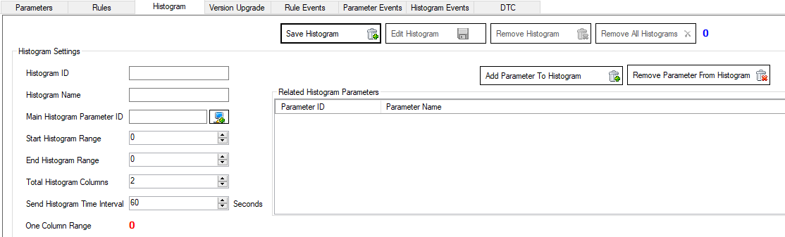

Histogram settings form after Add Histogram is selected.

Source: [p. 18](content.md#pdf-page-18).

## Image 041

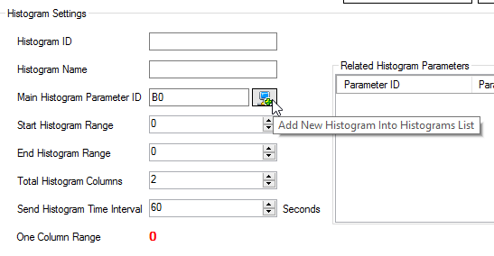

Main histogram parameter selector in the settings form.

Source: [p. 19](content.md#pdf-page-19).

## Image 042

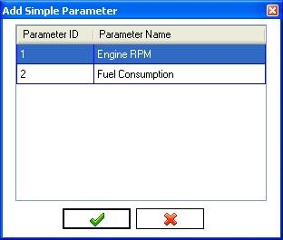

Add Simple Parameter dialog listing Engine RPM and Fuel Consumption.

Source: [p. 19](content.md#pdf-page-19).

## Image 043

Green accept/check icon for choosing a parameter.

Source: [p. 19](content.md#pdf-page-19), [p. 20](content.md#pdf-page-20).

## Image 044

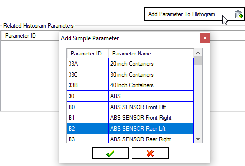

Related-parameter picker opened from Add Parameter To Histogram.

Source: [p. 20](content.md#pdf-page-20).

## Image 045

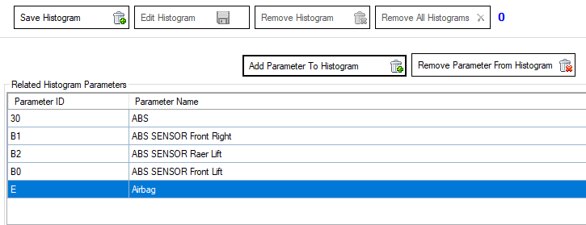

Related histogram parameters grid with Remove Parameter controls.

Source: [p. 20](content.md#pdf-page-20).

## Image 046

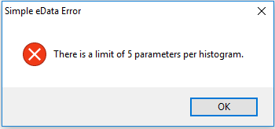

Error dialog stating the limit of five parameters per histogram.

Source: [p. 21](content.md#pdf-page-21).

## Image 047

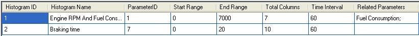

Saved histogram row with its configuration columns.

Source: [p. 21](content.md#pdf-page-21).

## Image 048

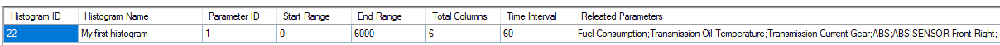

Histogram list with a selected entry ready to edit.

Source: [p. 21](content.md#pdf-page-21).

## Image 049

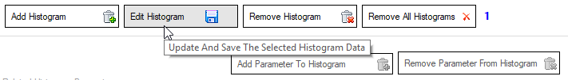

Start Edit Histogram control with tooltip.

Source: [p. 21](content.md#pdf-page-21).

## Image 050

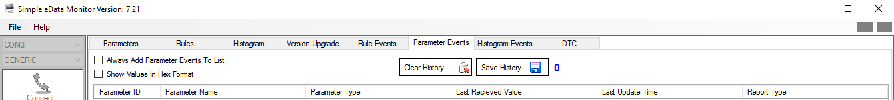

Parameter Events table with identifiers, names, values, timestamps and report types.

Source: [p. 22](content.md#pdf-page-22).

## Image 051

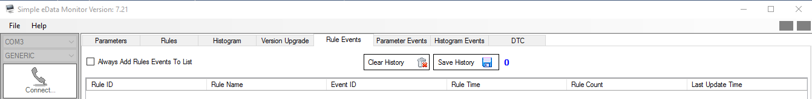

Rule Events table with rule/event values and history controls.

Source: [p. 22](content.md#pdf-page-22).

## Image 052

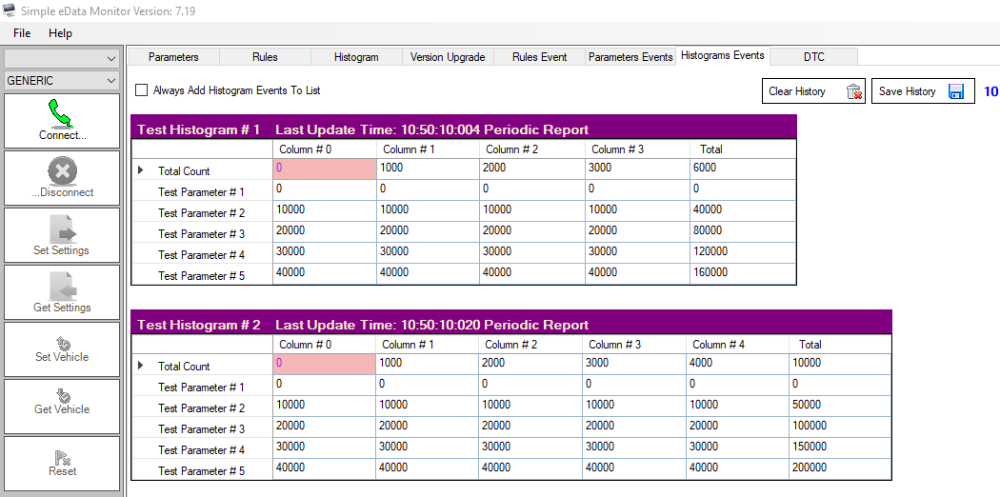

Histogram Events screen with separate tables for received histogram reports.

Source: [p. 23](content.md#pdf-page-23).

## Image 053

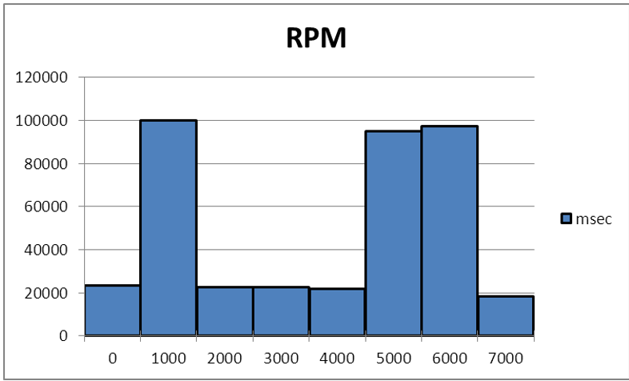

Blue-bar RPM histogram: RPM ranges on the horizontal axis and accumulated milliseconds on the vertical axis; illustrative data.

Source: [p. 24](content.md#pdf-page-24).

## Image 054

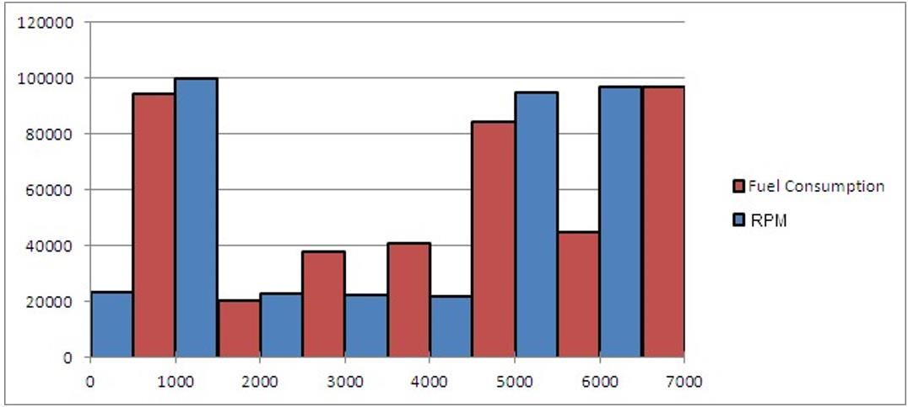

Grouped histogram comparing blue RPM bars with red Fuel Consumption bars; illustrates a main parameter plus a related parameter, not a calibrated live measurement.

Source: [p. 24](content.md#pdf-page-24).

## Image 055

DTC/Fault Codes table with fault ID, description, status and update-time fields.

Source: [p. 25](content.md#pdf-page-25).

## Image 056

Removal context menu distinguishing list-only, device-only and combined deletion actions.

Source: [p. 26](content.md#pdf-page-26).

## Image 057

Version Upgrade tab with device/version IDs, file browse control and Burn button.

Source: [p. 28](content.md#pdf-page-28).

## Illustrations in page context

These rendered crops include arrows, callout text, vector diagrams and table geometry that are separate PDF objects. Refer to the image descriptions above and the corresponding source text for their meaning.

### PDF page 4

[Read the page text](content.md#pdf-page-4).

### PDF page 5

[Read the page text](content.md#pdf-page-5).

### PDF page 13

[Read the page text](content.md#pdf-page-13).

### PDF page 14

[Read the page text](content.md#pdf-page-14).

### PDF page 15

[Read the page text](content.md#pdf-page-15).

### PDF page 17

[Read the page text](content.md#pdf-page-17).

### PDF page 24

[Read the page text](content.md#pdf-page-24).
