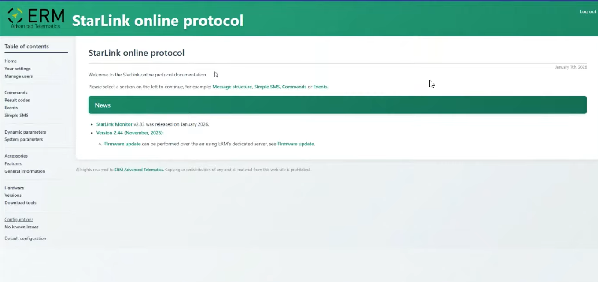
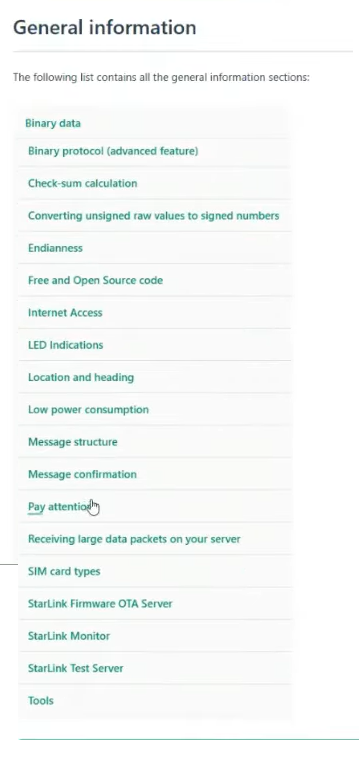
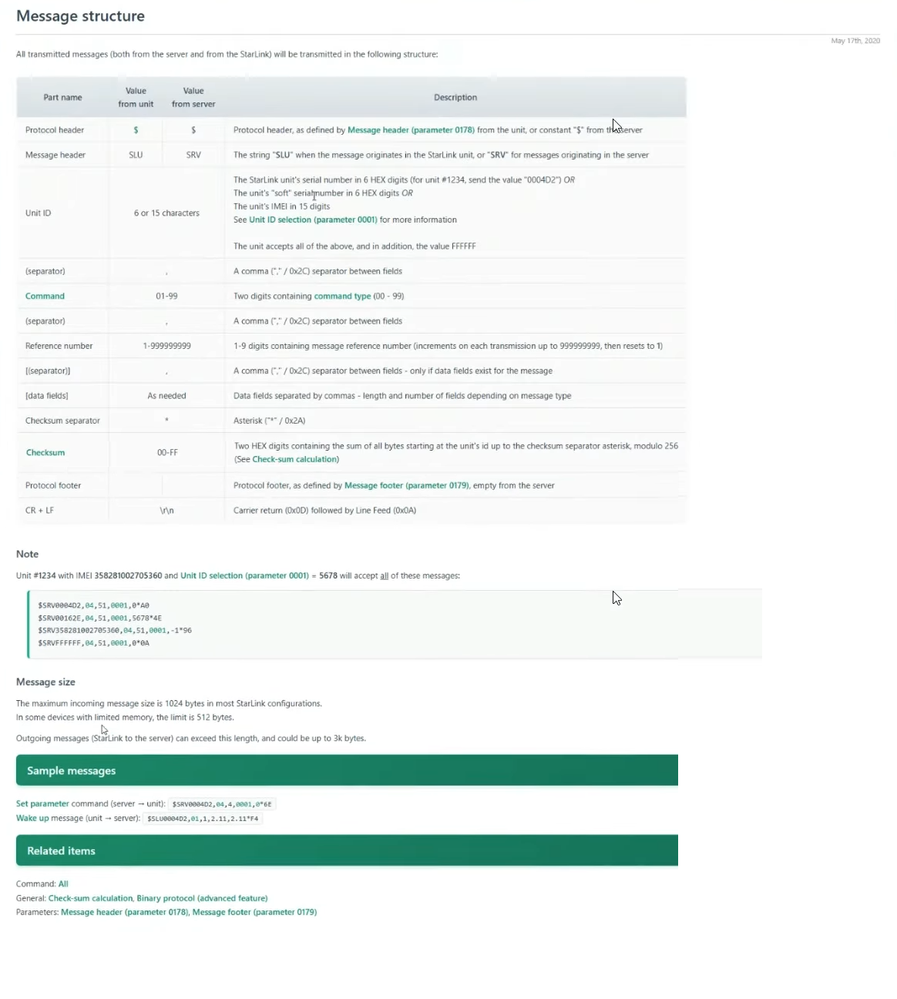

# StarLink portal screenshots

[Portal overview](README.md) · [Message structure](message-structure.md) ·
[Source metadata and checksums](metadata.json)

Analysis date: **2026-10-16** (Europe/Sofia). The following user-supplied screenshots
are preserved without pixel changes. Their capture dates and capturing account
are unknown. They are source evidence, not screenshots of a session accessed by
holita or during this analysis.

## Home page

Source filename: `img.png`. ERM branding and the StarLink online protocol title
appear above the navigation sidebar. The main panel welcomes the reader and links
to Message structure, Simple SMS, Commands and Events. News mentions StarLink
Monitor v2.83 in January 2026 and Version 2.44 (November, 2025), including an OTA
firmware-update link. The page displays January 7th, 2026. A Log out control is
visible; this supplied image does not establish that we have portal credentials.

## General information menu

Source filename: `menu.png`. The vertical list contains 19 general-information
entries covering binary data, checksum, number representation, connectivity,
device indications, message framing/confirmation and tools. The
[overview](README.md#general-information-menu) transcribes every visible entry.
No individual page content is visible in this menu capture.

## Message structure

Source filename: `p1.png`. The page displays May 17th, 2020. A four-column table
defines part names, values from the unit/server and descriptions, with merged
cells for shared values. Below it are four accepted-identifier examples, message
size limits, Set parameter and Wake up examples, and related reference links.
The [detailed transcription](message-structure.md) preserves these relationships,
distinguishes the two directions and records source inconsistencies.
