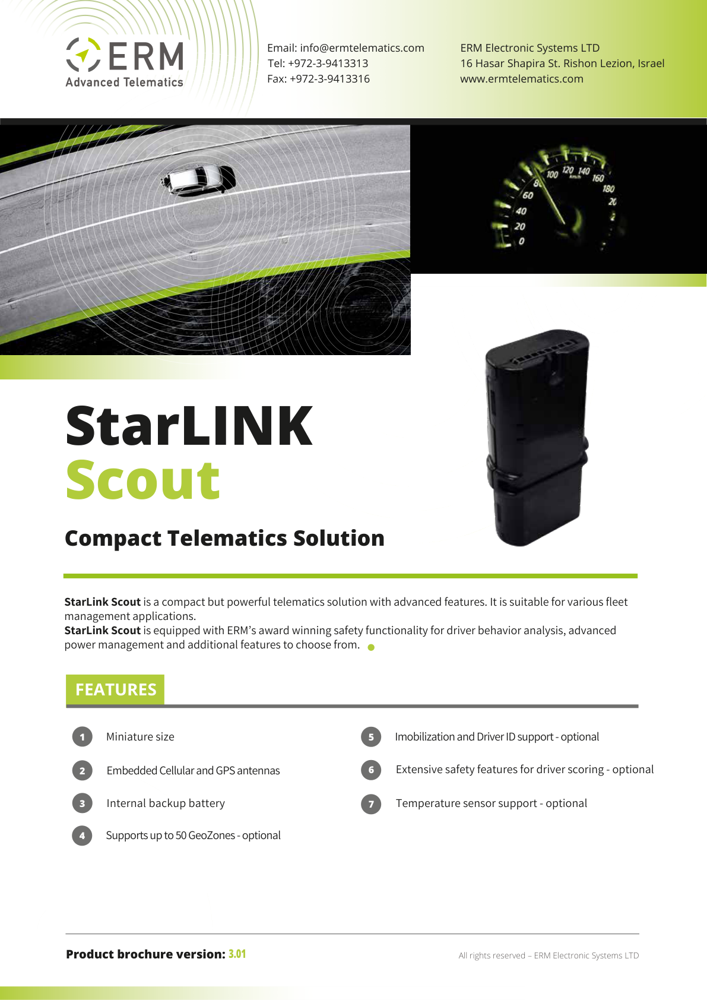
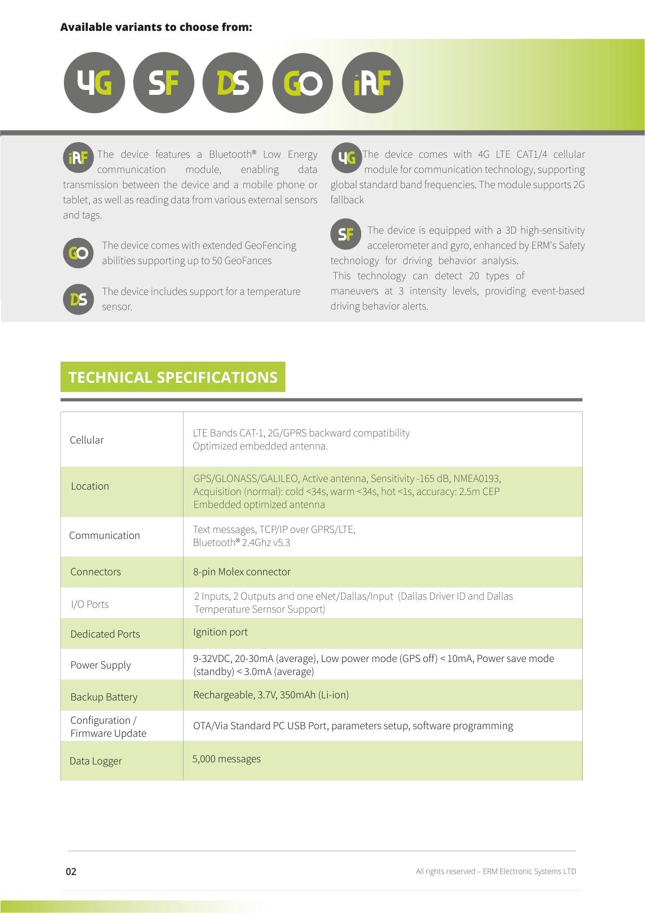
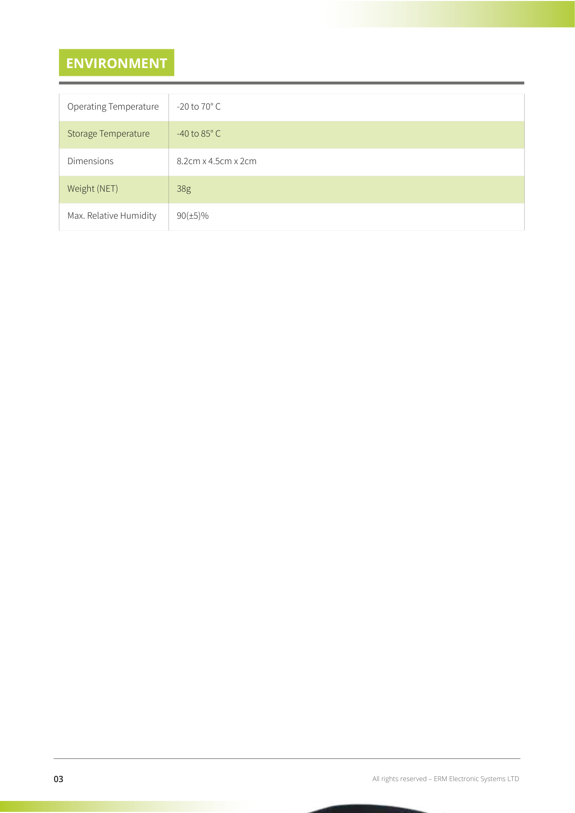
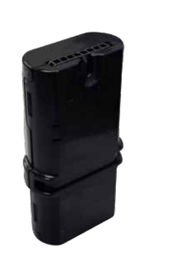

# StarLINK Scout - Compact Telematics Solution - images

[Overview](README.md) · [Source content](content.md) · [Original PDF](source/original.pdf)

Analysis date: 2026-10-16 (Europe/Sofia). Descriptions distinguish illustrative UI/device examples from live data. Figures are rendered from visible PDF pages and cropped where useful, preserving vector artwork and avoiding hidden legacy layers.

## Image 001

Full visible cover of StarLINK Scout - Compact Telematics Solution: ERM branding, overhead road/car artwork, speedometer photograph, product photograph and the printed brochure version.

Source: [p. 1](content.md#pdf-page-1).

## Image 002

Full visible second page, preserving variant badges, column layout and specifications/features while excluding the covered old text layer.

Source: [p. 2](content.md#pdf-page-2).

## Image 003

Full visible third page with the specification/environment table and its source units.

Source: [p. 3](content.md#pdf-page-3).

## Image 004

Product photograph: a narrow black Scout enclosure shown upright.

Source: [p. 1](content.md#pdf-page-1).

## Image 005

Variant badge strip: 4G, SF, DS, GO and iRF.

Source: [p. 2](content.md#pdf-page-2).
